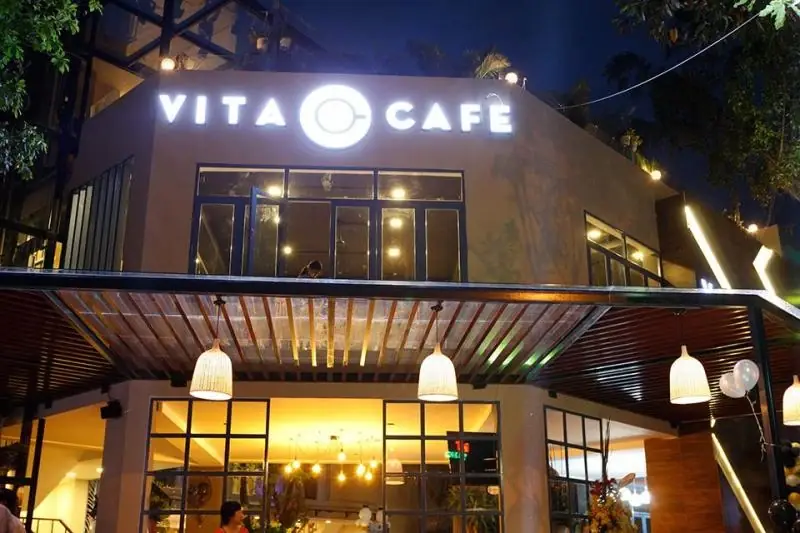
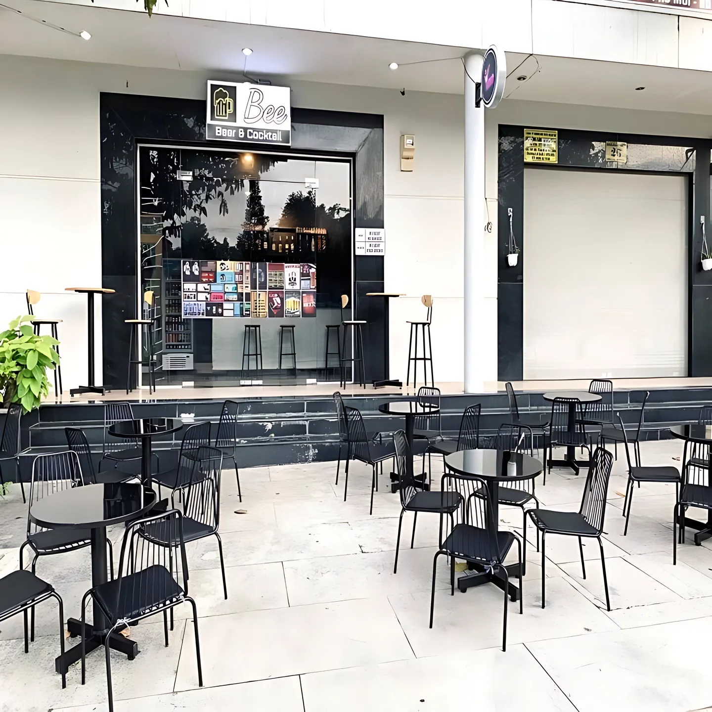
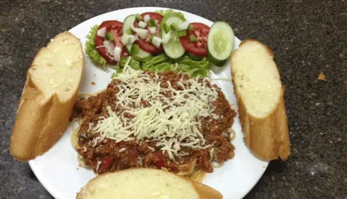

**Bar Bình Dương** tập trung chủ yếu ở trung tâm TP. Thủ Dầu Một, quanh Đại lộ Bình Dương, đường Bạch Đằng ven sông và khu dân cư Chánh Nghĩa. Thuận An và Dĩ An có thêm vài quán bia gần nhà cho dân văn phòng. Ở đây có lounge với ca sĩ và DJ, cocktail bar ngồi chill, pub vừa ăn vừa xem bóng đá. Bài này gom 8 quán theo từng kiểu, kèm địa chỉ và mức chi tham khảo.

## Bar Bình Dương tập trung ở đâu?

- **Trung tâm Thủ Dầu Một (Đại lộ Bình Dương, Nguyễn Đình Chiểu):** lounge có ca sĩ, DJ.
- **Phường Chánh Nghĩa, Phú Cường, Hòa Phú:** pub, cocktail bar và quán bia trong khu dân cư, ven sông Sài Gòn.
- **Thuận An, Dĩ An:** quán bia, cà phê kiêm bia giá mềm, gần các khu công nghiệp và khu dân cư.

Xem toàn bộ danh sách tại trang [bar Bình Dương](/bar-binh-duong/) và [bar Thủ Dầu Một](/bar-thu-dau-mot/).

## Lounge có ca sĩ và DJ

### Vita Club

[Vita Club](/bar/vita-club/) là lounge trên tầng 4 tòa nhà Becamex Tower, 230 Đại lộ Bình Dương, ngay trung tâm Thủ Dầu Một. Không gian được khách nhận xét là sang trọng, thường có ca sĩ khách mời và DJ lên nhạc về khuya. Cuối tuần bàn thường kín nên đặt trước.

- Phù hợp: nhóm bạn muốn đi chơi đêm có âm nhạc sôi động
- Mức chi tham khảo: từ 400.000đ/người

### Imperial Dragon Lounge

[Imperial Dragon Lounge](/bar/imperial-dragon-lounge/) ở 25 Nguyễn Đình Chiểu, Thủ Dầu Một. Cuối tuần quán có ca sĩ và DJ biểu diễn, hay được chọn để tổ chức tiệc sinh nhật, mức chi được giới thiệu là khá dễ chịu.

- Giờ mở cửa: 18:00 – 00:00
- Mức chi tham khảo: từ 350.000đ/người

Xem thêm các [lounge Bình Dương](/lounge-binh-duong/).

## Cocktail bar ngồi chill

### Bee Beer Cocktail

[Bee Beer Cocktail](/bar/bee-beer-cocktail/) là quán cocktail phong cách cổ điển ở 27 Lê Lai, phường Hòa Phú. Quán có khu trong nhà và khu ngoài trời, nhiều khách thích ngồi ngắm hoàng hôn. Thực đơn có cocktail từ dễ uống đến cầu kỳ, bia, burger và shisha.

- Giờ mở cửa: 17:00 – 01:00
- Mức chi tham khảo: từ 300.000đ/người

Chưa biết gọi gì? Đọc [các loại cocktail phổ biến](/blog/cac-loai-cocktail-pho-bien/).

## Pub và quán bia

### Chích Pub - Food & Beer

[Chích Pub](/bar/chich-pub-food-va-beer/) ở 35 Bạch Đằng, phường Phú Cường, trên tuyến đường ven sông dễ tìm của Thủ Dầu Một. Quán có view đẹp, phục vụ cocktail, bia và pizza, buổi tối có DJ, hợp nhóm bạn đi ăn uống hoặc tổ chức sinh nhật.

- Mức chi tham khảo: từ 300.000đ/người

### JD's Bar & Grill

[JD's Bar & Grill](/bar/jd-s-bar-va-grill/) là pub kiểu phương Tây trên đường Trần Phú, khu dân cư Chánh Nghĩa, nằm trên tầng cao một tòa nhà Becamex. Quán có bàn bi-a, phi tiêu, màn hình chiếu thể thao và pizza đế mỏng. Cuối tuần thường khá kín chỗ.

- Mức chi tham khảo: từ 300.000đ/người

### Nhà Xưởng Số 3 - Coffee & Beer Bar

[Nhà Xưởng Số 3](/bar/nha-xuong-so-3-coffee-va-beer-bar/) là quán cà phê kiêm beer bar ở 26-28 Đường D, khu dân cư Chánh Nghĩa. Không khí nhộn nhịp, giá tầm trung, hợp nhóm bạn tụ tập uống bia cuối tuần.

- Mức chi tham khảo: từ 300.000đ/người

### Beer Zone - Vĩnh Phú 41 (Thuận An)

[Beer Zone](/bar/beer-zone-vinh-phu-41/) là quán bia dạng beer club bình dân ở 25 Vĩnh Phú 41, phường Lái Thiêu, Thuận An. Hợp người ở khu Lái Thiêu và dân văn phòng muốn có chỗ gần nhà để uống bia sau giờ làm.

- Mức chi tham khảo: từ 300.000đ/người

### Ngáo - Coffee & Beer (Dĩ An)

[Ngáo - Coffee & Beer](/bar/ngao-coffee-va-beer/) ở 105 đường GS1, phường Đông Hòa, Dĩ An, được khách khen có không gian đẹp và chọn nhạc hay. Ban ngày ngồi cà phê, buổi tối uống bia nhẹ nhàng cùng bạn bè.

- Mức chi tham khảo: từ 300.000đ/người

Xem thêm các [pub Bình Dương](/pub-binh-duong/).

## So sánh nhanh bar Bình Dương

| Bar | Loại hình | Địa chỉ | Mức chi tham khảo |
|---|---|---|---|
| Vita Club | Lounge | 230 Đại lộ Bình Dương, Thủ Dầu Một | Từ 400k/người |
| Imperial Dragon Lounge | Lounge | 25 Nguyễn Đình Chiểu, Thủ Dầu Một | Từ 350k/người |
| Bee Beer Cocktail | Cocktail bar | 27 Lê Lai, Hòa Phú | Từ 300k/người |
| Chích Pub | Pub, DJ | 35 Bạch Đằng, Phú Cường | Từ 300k/người |
| JD's Bar & Grill | Pub thể thao | Trần Phú, KDC Chánh Nghĩa | Từ 300k/người |
| Nhà Xưởng Số 3 | Beer bar | 26-28 Đường D, Chánh Nghĩa | Từ 300k/người |
| Beer Zone | Quán bia | 25 Vĩnh Phú 41, Thuận An | Từ 300k/người |
| Ngáo | Cà phê, bia | 105 GS1, Dĩ An | Từ 300k/người |

Mức chi là giá tham khảo, thay đổi theo đồ uống bạn chọn. Giờ mở cửa có thể thay đổi, gọi tổng đài để xác nhận trước khi đi.

:::cta
Đặt bàn bar Bình Dương tối nay
Gọi 0838 000 222 hoặc để lại số điện thoại, tổng đài TopChill giữ bàn giúp bạn, không cần cọc.
:::

## Kinh nghiệm đi bar ở Bình Dương

1. **Lounge đông nhất tối thứ 6, thứ 7,** nhất là khi có ca sĩ khách mời. Đặt bàn trước và hỏi lịch biểu diễn.
2. **Đặt tiệc sinh nhật** thì báo trước số người để quán chuẩn bị bàn và trang trí.
3. **Các quán cách nhau khá xa** giữa Thủ Dầu Một, Thuận An và Dĩ An, nên chọn quán gần nơi ở hoặc tính đường đi trước.
4. **Muốn xem bóng đá** thì chọn pub có màn hình lớn và đặt bàn sớm vào tối có trận.
5. **Uống có trách nhiệm,** không lái xe sau khi uống rượu bia. Gọi taxi hoặc xe công nghệ.

Đi Sài Gòn chơi tiếp? Xem [bar Sài Gòn](/blog/bar-sai-gon/). Muốn biết gọi gì, đọc [đi bar nên uống gì](/blog/di-bar-nen-uong-gi/).

## Câu hỏi thường gặp

### Bar Bình Dương tập trung ở đâu?

Phần lớn ở trung tâm TP. Thủ Dầu Một, quanh Đại lộ Bình Dương, đường Bạch Đằng và khu dân cư Chánh Nghĩa. Thuận An và Dĩ An có thêm quán bia, cà phê kiêm bia.

### Bình Dương có lounge nghe nhạc không?

Có. Vita Club (tầng 4 Becamex Tower, 230 Đại lộ Bình Dương) thường có ca sĩ khách mời và DJ; Imperial Dragon Lounge (25 Nguyễn Đình Chiểu) có ca sĩ và DJ vào cuối tuần.

### Đi bar ở Bình Dương hết bao nhiêu tiền?

Mức chi tham khảo khoảng 300.000đ–400.000đ mỗi người trở lên cho 2–3 đồ uống. Lounge thường cao hơn pub và quán bia.

### Quán nào ở Bình Dương hợp tổ chức sinh nhật?

Imperial Dragon Lounge và Chích Pub thường được chọn để tổ chức tiệc sinh nhật. Báo trước số người khi đặt bàn để quán chuẩn bị.

### Đặt bàn bar Bình Dương qua TopChill có cần cọc không?

Không. Bạn gọi 0838 000 222, nhắn Zalo hoặc để lại số trên web, tổng đài sẽ gọi lại xác nhận bàn.
