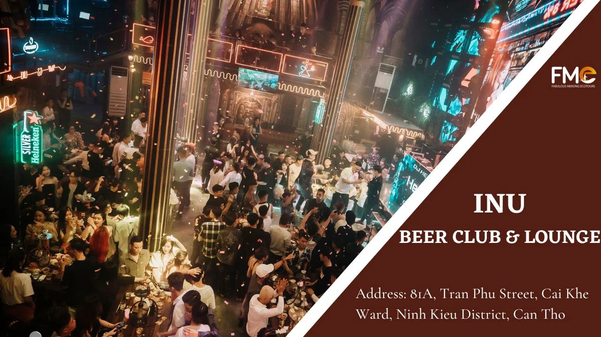
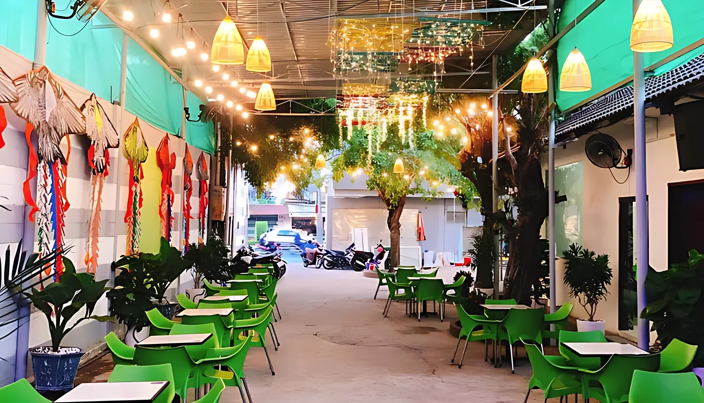
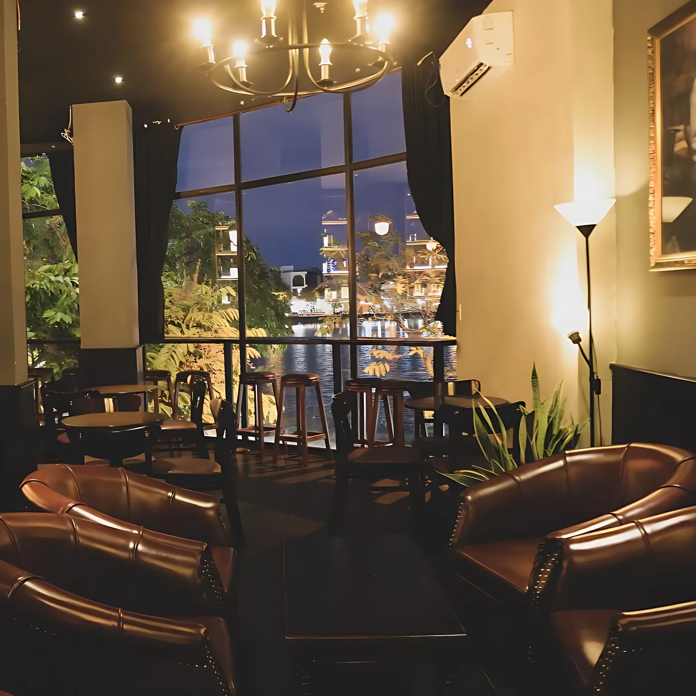

**Bar Cần Thơ** tập trung gần như hết ở quận Ninh Kiều, quanh các trục Trần Văn Khéo, Lê Lợi, Trần Phú và đường 30 Tháng 4, gần bến Ninh Kiều. Thành phố miền Tây có nhiều beer club và club lớn với DJ, ca sĩ khách mời, bên cạnh vài sky bar và quán cocktail yên tĩnh cho buổi tối nhẹ nhàng. Bài này gom 11 quán theo từng kiểu, kèm địa chỉ và mức chi tham khảo.

## Bar Cần Thơ tập trung ở đâu?

- **Phường Cái Khế (Lê Lợi, Trần Phú, Trần Văn Khéo):** khu tập trung club và beer club lớn.
- **Đường 30 Tháng 4, phường Xuân Khánh:** trục đường chính có lounge DJ và sky bar trong khách sạn.
- **Quanh hồ Xáng Thổi, hồ Bún Xáng và quận Bình Thủy:** quán cocktail, quán bia yên tĩnh hơn.

Xem toàn bộ danh sách tại trang [bar Cần Thơ](/bar-can-tho/) và [bar Ninh Kiều](/bar-ninh-kieu/).

## Beer club và club sôi động

### INU Beer Club & Lounge

[INU Beer Club & Lounge](/bar/inu-beer-club-va-lounge/) ở 81A Trần Phú, phường Cái Khế, kết hợp beer club và lounge. Không gian rộng, có tầng lửng và quầy bar trung tâm, dàn âm thanh tốt, thường tổ chức sự kiện hằng tuần với DJ và nghệ sĩ khách mời.

- Giờ mở cửa: 16:00 – 01:00
- Phù hợp: giới trẻ, nhóm tổ chức sinh nhật
- Mức chi tham khảo: từ 600.000đ/người

### Golf Club

[Golf Club](/bar/golf-club/) ở 16A Lê Lợi, phường Cái Khế, thường được nhắc tới trong nhóm club lớn của thành phố. Club đầu tư âm thanh, ánh sáng nhập khẩu, DJ chơi nhạc điện tử, nội thất trẻ trung.

- Mức chi tham khảo: từ 500.000đ/người

### 777 Club

[777 Club](/bar/777-club/) ở 127 Trần Văn Khéo, phường Cái Khế, đã hoạt động nhiều năm, thường có chương trình biểu diễn với ca sĩ, DJ và vũ đoàn.

- Mức chi tham khảo: từ 400.000đ/người

### XK Club

[XK Club](/bar/xk-club/) ở 108B Trần Văn Khéo. Theo nhận xét của khách, club thường mời ca sĩ từ Sài Gòn về biểu diễn, có DJ, shisha và đĩa trái cây. Khách phần nhiều ở độ tuổi trưởng thành, hợp người thích nghe nhạc, giao lưu.

- Mức chi tham khảo: từ 550.000đ/người

### Knight Beer Club

[Knight Beer Club](/bar/knight-beer-club/) ở 27 Lê Lợi, phường Cái Khế, không gian rộng, bàn đặt thoáng, nhạc mạnh, có shisha, nhân viên được khách khen nhiệt tình.

- Mức chi tham khảo: từ 450.000đ/người

### Mode DJ Lounge

[Mode DJ Lounge](/bar/mode-dj-lounge/) ở 354 đường 30 Tháng 4, phường Xuân Khánh. Khách nhận xét âm thanh và ánh sáng khá tốt, nhạc DJ mạnh, đôi khi có ca sĩ từ Sài Gòn về biểu diễn.

- Mức chi tham khảo: từ 350.000đ/người

## Sky bar ngắm thành phố

### Iris Sky Bar

[Iris Sky Bar](/bar/iris-sky-bar/) trên sân thượng khách sạn Iris, 224 đường 30 Tháng 4, nhìn toàn cảnh thành phố về đêm và trục đường 30 Tháng 4 nhộn nhịp bên dưới. Có chỗ ngồi trong nhà và ngoài trời, hợp cặp đôi hoặc nhóm nhỏ.

- Mức chi tham khảo: từ 450.000đ/người

## Cocktail bar và quán yên tĩnh

### Hiraeth Cocktail Bar & Kitchen

[Hiraeth Cocktail Bar & Kitchen](/bar/hiraeth-cocktail-bar-va-kitchen/) ở 199 Nguyễn Thị Minh Khai, cách bến Ninh Kiều không xa. Quán hơi khuất khỏi đường đông, mang cảm giác speakeasy hiện đại với sofa, ánh nến, mở đến khuya.

- Mức chi tham khảo: từ 400.000đ/người

### Déjà Vu - Cocktail & Wine Bar

[Déjà Vu](/bar/deja-vu-cocktail-va-wine-bar/) ở 142 Huỳnh Cương, phường An Cư, trên tầng một một căn nhà nhìn ra hồ Xáng Thổi. Quán chuyên cocktail và rượu vang, không mở nhạc ồn hay đèn chớp nháy.

- Giờ mở cửa: 18:00 – 00:00
- Phù hợp: cặp đôi, nhóm muốn trò chuyện
- Mức chi tham khảo: từ 300.000đ/người

### LEGI Cocktails & Dining

[LEGI Cocktails & Dining](/bar/legi-cocktails-va-dining/) ở 160 Đồng Văn Cống, quận Bình Thủy. Ban ngày là quán cà phê, buổi tối chuyển sang cocktail đặc trưng cùng món khai vị và món chính, phong cách châu Âu cổ điển.

- Giờ mở cửa: 19:00 – 23:30
- Mức chi tham khảo: từ 350.000đ/người

### Tiệm Bia Nhà An

[Tiệm Bia Nhà An](/bar/tiem-bia-nha-an/) là quán bia bình dân ngoài trời bên hồ Bún Xáng, phường An Khánh, có bia lên men từ trái cây dễ uống. Hợp nhóm bạn muốn ngồi chill bên hồ.

- Mức chi tham khảo: từ 400.000đ/người

## So sánh nhanh bar Cần Thơ

| Bar | Loại hình | Địa chỉ | Mức chi tham khảo |
|---|---|---|---|
| INU Beer Club & Lounge | Beer club | 81A Trần Phú | Từ 600k/người |
| Golf Club | Club | 16A Lê Lợi | Từ 500k/người |
| 777 Club | Club | 127 Trần Văn Khéo | Từ 400k/người |
| XK Club | Club | 108B Trần Văn Khéo | Từ 550k/người |
| Knight Beer Club | Beer club | 27 Lê Lợi | Từ 450k/người |
| Mode DJ Lounge | Lounge DJ | 354 đường 30/4 | Từ 350k/người |
| Iris Sky Bar | Sky bar | 224 đường 30/4 | Từ 450k/người |
| Hiraeth | Cocktail bar | 199 Nguyễn Thị Minh Khai | Từ 400k/người |
| Déjà Vu | Cocktail, vang | 142 Huỳnh Cương | Từ 300k/người |
| LEGI | Cocktail, ăn tối | 160 Đồng Văn Cống | Từ 350k/người |

Mức chi là giá tham khảo, thay đổi theo đồ uống bạn chọn. Giờ mở cửa có thể thay đổi, gọi tổng đài để xác nhận trước khi đi.

:::cta
Đặt bàn bar Cần Thơ tối nay
Gọi 0838 000 222 hoặc để lại số điện thoại, tổng đài TopChill giữ bàn giúp bạn, không cần cọc.
:::

## Kinh nghiệm đi bar ở Cần Thơ

1. **Club và beer club đông nhất tối thứ 6, thứ 7,** nhất là khi có ca sĩ khách mời. Đặt bàn trước và hỏi mức chi tối thiểu bàn VIP.
2. **Hỏi lịch biểu diễn** khi đặt bàn nếu bạn muốn xem ca sĩ hoặc DJ cụ thể.
3. **Muốn yên tĩnh** thì chọn quán cocktail quanh hồ Xáng Thổi hoặc hồ Bún Xáng.
4. **Mang CCCD,** club có thể kiểm tra giấy tờ ở cửa.
5. **Uống có trách nhiệm,** không lái xe sau khi uống rượu bia. Gọi taxi hoặc xe công nghệ.

Đi Sài Gòn trước khi xuống miền Tây? Xem thêm [bar Sài Gòn](/bar-sai-gon/). Muốn biết gọi gì, đọc [đi bar nên uống gì](/blog/di-bar-nen-uong-gi/).

## Câu hỏi thường gặp

### Bar Cần Thơ tập trung ở đâu?

Phần lớn ở quận Ninh Kiều, quanh Trần Văn Khéo, Lê Lợi, Trần Phú (phường Cái Khế) và đường 30 Tháng 4 (phường Xuân Khánh).

### Cần Thơ có sky bar không?

Có. Iris Sky Bar trên sân thượng khách sạn Iris (224 đường 30 Tháng 4) nhìn toàn cảnh thành phố về đêm.

### Đi bar ở Cần Thơ hết bao nhiêu tiền?

Mức chi tham khảo khoảng 300.000đ–600.000đ mỗi người trở lên cho 2–3 đồ uống. Club và beer club thường cao hơn quán cocktail.

### Club nào ở Cần Thơ có ca sĩ biểu diễn?

Theo thông tin tổng hợp, 777 Club, XK Club, INU Beer Club và Mode DJ Lounge thường có ca sĩ hoặc nghệ sĩ khách mời. Lịch có thể đổi, bạn nên gọi tổng đài xác nhận.

### Đặt bàn bar Cần Thơ qua TopChill có cần cọc không?

Không. Bạn gọi 0838 000 222, nhắn Zalo hoặc để lại số trên web, tổng đài sẽ gọi lại xác nhận bàn.
