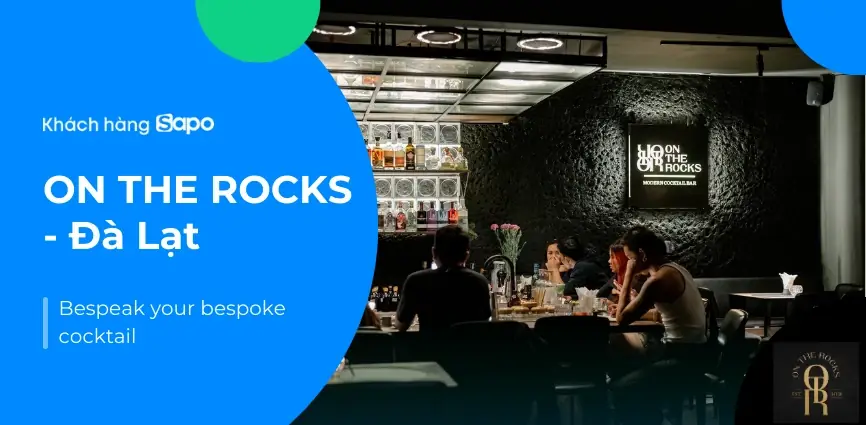
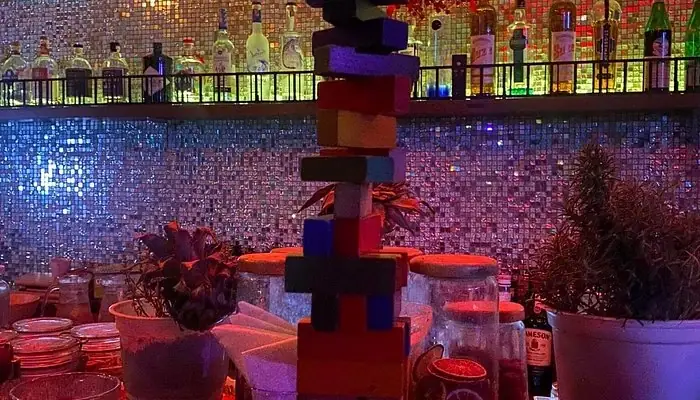
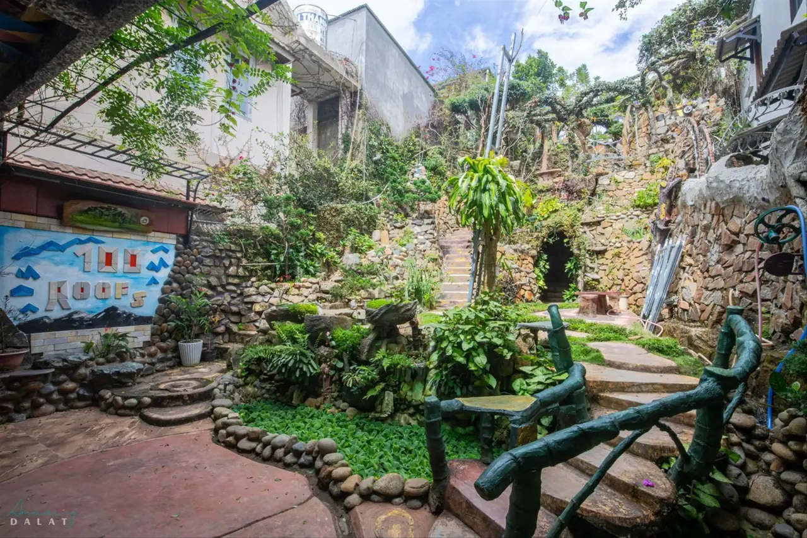

**Bar Đà Lạt** khác hẳn bar ở thành phố biển: trời se lạnh, quán nhỏ, ấm, nhiều quán cocktail ẩn trong hẻm hay dưới tầng hầm, và không ít nơi có nhạc sống mỗi tối. Phần lớn quán tập trung quanh đường Trương Công Định, gần chợ Đà Lạt và hồ Xuân Hương, nên bạn có thể đi bộ ghé vài quán trong một tối. Bài này gom 12 quán theo từng kiểu, kèm địa chỉ và mức chi tham khảo.

## Bar Đà Lạt tập trung ở đâu?

- **Đường Trương Công Định:** con phố về đêm nhộn nhịp nhất, có nhiều quán cocktail và pub nằm sát nhau.
- **Quanh chợ Đà Lạt và hồ Xuân Hương:** quán cocktail cổ điển, quán có không gian độc đáo cho du khách.
- **Các hẻm và tầng hầm trung tâm:** nơi có speakeasy và quán nhỏ kín đáo.

Xem toàn bộ danh sách tại trang [bar Đà Lạt](/bar-da-lat/) và [cocktail bar Đà Lạt](/cocktail-bar-da-lat/).

## Cocktail bar dùng nguyên liệu Đà Lạt

### On The Rocks Cocktail Bar

[On The Rocks Cocktail Bar](/bar/on-the-rocks-cocktail-bar/) là quán cocktail dạng hầm ở số 69 Trương Công Định, mở từ cuối năm 2021. Không gian hiện đại, có hệ thống âm thanh, ánh sáng và thiết bị DJ, thỉnh thoảng có diễn nhạc rock. Cocktail được pha theo sở thích từng khách, nhiều món dùng nguyên liệu địa phương.

- Phù hợp: hẹn hò, nhóm bạn
- Mức chi tham khảo: từ 300.000đ/người

### Gemination Eatery & Bar

[Gemination Eatery & Bar](/bar/gemination-eatery-va-bar/) ở 24 Trương Công Định, do đội ngũ On The Rocks vận hành. Quán đưa nhiều nông sản tươi của Đà Lạt vào cocktail, không gian ấm cúng, ánh sáng dịu và nhạc chọn lọc, hợp buổi tối yên tĩnh.

- Mức chi tham khảo: từ 300.000đ/người

### The Fog Bar

[The Fog Bar](/bar/the-fog-bar/) ở 76 Trương Công Định, nổi bật với đèn neon, tranh graffiti và những chai rượu treo ngược trên trần. Buổi tối thường có DJ chơi EDM và nhạc Âu Mỹ, hợp nhóm bạn trẻ muốn vừa nhâm nhi cocktail vừa hoà vào không khí sôi động.

- Mức chi tham khảo: từ 400.000đ/người

## Speakeasy và quán ẩn mình

### The Balcony Speakeasy Bar

[The Balcony Speakeasy Bar](/bar/the-balcony-speakeasy-bar/) nằm trên đường Quang Trung. Bên ngoài trông như một quán cà phê bình thường, bên trong là không gian tối với tông gỗ trầm, tầng trên có chỗ ngồi đệm ngoài trời nhìn ra thành phố. Các nguồn ghi số nhà khác nhau, bạn nên gọi tổng đài xác nhận địa chỉ trước khi đến.

- Mức chi tham khảo: từ 400.000đ/người

### Fox's Den

[Fox's Den](/bar/fox-s-den/) là quán bar nhỏ ẩn dưới tầng hầm trong một con hẻm trung tâm, lối vào là cầu thang dẫn xuống một cánh cửa gỗ. Nhạc thiên về acoustic và indie, hợp nhóm nhỏ thích quán kín đáo. Quán khó tìm và các nguồn ghi địa chỉ khác nhau, hãy gọi tổng đài để được chỉ đường.

- Mức chi tham khảo: từ 300.000đ/người

### Léon Bar

[Léon Bar](/bar/leon-bar/) ở 278 Hai Bà Trưng, kết hợp kiến trúc Đông – Tây với nhiều kỷ vật gợi nhớ điện ảnh. Quán được biết đến với rượu vang và cocktail, theo tinh thần "We don't sell drinks, we sell stories": bartender có thể pha đồ uống dựa trên câu chuyện bạn kể.

- Mức chi tham khảo: từ 300.000đ/người

## Quán có nhạc sống, acoustic

### Heyla Cocktail Bar

[Heyla Cocktail Bar](/bar/heyla-cocktail-bar/) ở 10 Tản Đà, có ban nhạc acoustic biểu diễn hằng đêm, tầng trên có trò chơi cổ điển và chỗ ngồi cho nhóm bạn.

- Giờ mở cửa: 17:00 – 00:00
- Mức chi tham khảo: từ 300.000đ/người

### Woody Classic Bar

[Woody Classic Bar](/bar/woody-classic-bar/) là quán cocktail phong cách cổ điển gần hồ Xuân Hương, không gian yên tĩnh, lãng mạn với nhạc jazz hoặc acoustic. Hợp cặp đôi hoặc nhóm nhỏ trong buổi tối se lạnh. Có nguồn cho biết quán đã chuyển địa điểm, hãy gọi tổng đài để xác nhận.

- Mức chi tham khảo: từ 300.000đ/người

### The Escape Bar & Café

[The Escape Bar & Café](/bar/the-escape-bar-va-cafe/) là quán bar nhạc sống phong cách thập niên 1970, treo tranh các huyền thoại âm nhạc và điện ảnh. Buổi tối có ban nhạc chơi country, blues, rock 'n' roll và reggae, có bàn bi-a và sân hiên. Địa chỉ có thể đã thay đổi, nên gọi tổng đài trước khi đến.

- Mức chi tham khảo: từ 300.000đ/người

## Pub, quán độc lạ và club

### B21 Bar

[B21 Bar](/bar/b21-bar/) ở 68 Trương Công Định, phong cách châu Âu. Ban ngày mở nhạc nhẹ, tối chuyển sang EDM do DJ chơi. Quán đông khách trẻ, buổi tối thường kín bàn nên nhóm đông nên đặt trước.

- Giờ mở cửa: 15:00 – 01:00
- Mức chi tham khảo: từ 400.000đ/người

### Maze Bar (100 Roofs Café)

[Maze Bar (100 Roofs Café)](/bar/maze-bar-100-roofs-cafe/), còn gọi là Đường Lên Trăng, ở 57 Phan Bội Châu, cách chợ Đà Lạt khoảng 100 m. Kiến trúc mê cung nhiều tầng với lối đi quanh co, hang hốc, phòng ẩn và cầu thang xoắn dẫn lên khu vườn trên mái. Hợp du khách thích khám phá không gian lạ.

- Mức chi tham khảo: từ 400.000đ/người

### Rain Night Club

[Rain Night Club](/bar/rain-night-club/) ở 1 Lê Hồng Phong, không gian rộng, tập trung nhạc dance và không khí sôi động, dành cho ai muốn quẩy thay vì ngồi chill.

- Giờ mở cửa: 19:00 – 02:00
- Mức chi tham khảo: từ 400.000đ/người

## So sánh nhanh bar Đà Lạt

| Bar | Loại hình | Địa chỉ / khu vực | Mức chi tham khảo |
|---|---|---|---|
| On The Rocks | Cocktail bar (hầm) | 69 Trương Công Định | Từ 300k/người |
| Gemination | Cocktail bar | 24 Trương Công Định | Từ 300k/người |
| The Fog Bar | Cocktail bar, DJ | 76 Trương Công Định | Từ 400k/người |
| The Balcony | Speakeasy | Quang Trung | Từ 400k/người |
| Léon Bar | Cocktail, vang | 278 Hai Bà Trưng | Từ 300k/người |
| Heyla | Cocktail, acoustic | 10 Tản Đà | Từ 300k/người |
| B21 Bar | Pub, EDM | 68 Trương Công Định | Từ 400k/người |
| Maze Bar | Quán độc lạ | 57 Phan Bội Châu | Từ 400k/người |
| Rain Night Club | Club | 1 Lê Hồng Phong | Từ 400k/người |

Mức chi là giá tham khảo, thay đổi theo đồ uống bạn chọn. Giờ mở cửa có thể đổi theo mùa, gọi tổng đài để xác nhận trước khi đi.

:::cta
Đặt bàn bar Đà Lạt tối nay
Gọi 0838 000 222 hoặc để lại số điện thoại, tổng đài TopChill giữ bàn giúp bạn, không cần cọc.
:::

## Kinh nghiệm đi bar ở Đà Lạt

1. **Mang áo khoác:** đêm Đà Lạt lạnh, nhất là khi ngồi tầng trên hoặc ngoài trời.
2. **Trương Công Định đi bộ được,** có thể ghé 2–3 quán trong một tối.
3. **Cuối tuần và mùa lễ rất đông khách du lịch,** các quán nhỏ hết chỗ nhanh, nên đặt trước.
4. **Quán trong hẻm, dưới hầm khó tìm,** hãy gọi tổng đài hoặc xem bản đồ trước khi đi.
5. **Muốn thử cocktail nguyên liệu Đà Lạt,** hãy nói với bartender khẩu vị của bạn. Xem thêm bài [các loại cocktail phổ biến](/blog/cac-loai-cocktail-pho-bien/).
6. **Đường đèo, dốc:** tuyệt đối không lái xe sau khi uống rượu bia, gọi taxi hoặc xe công nghệ.

## Câu hỏi thường gặp

### Bar Đà Lạt tập trung ở đâu?

Phần lớn quanh đường Trương Công Định, gần chợ Đà Lạt và hồ Xuân Hương. Các quán speakeasy nằm trong hẻm hoặc dưới tầng hầm ở khu trung tâm.

### Đà Lạt có quán bar nhạc sống không?

Có. Heyla Cocktail Bar có ban nhạc acoustic hằng đêm, Woody Classic Bar có jazz, acoustic, The Escape Bar & Café có ban nhạc chơi country, blues, rock. Lịch có thể đổi, bạn nên gọi tổng đài xác nhận.

### Đi bar ở Đà Lạt hết bao nhiêu tiền?

Mức chi tham khảo khoảng 300.000đ–400.000đ mỗi người trở lên cho 2–3 đồ uống, tuỳ quán và đồ uống bạn chọn.

### Đà Lạt có club không?

Có. Rain Night Club ở 1 Lê Hồng Phong là điểm quẩy nhạc dance, ngoài ra B21 Bar và The Fog Bar có DJ chơi EDM buổi tối.

### Đặt bàn bar Đà Lạt qua TopChill có cần cọc không?

Không. Bạn gọi 0838 000 222, nhắn Zalo hoặc để lại số trên web, tổng đài sẽ gọi lại xác nhận bàn.
