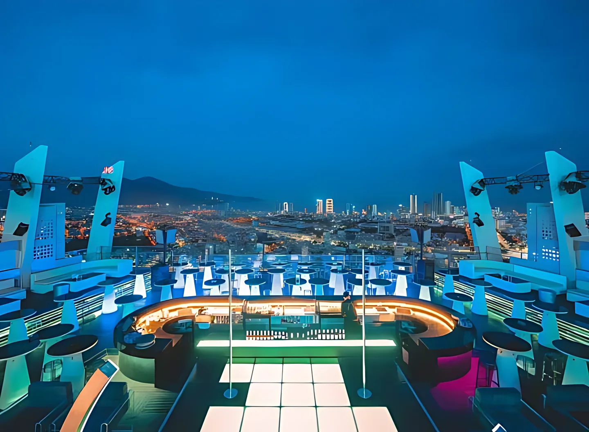
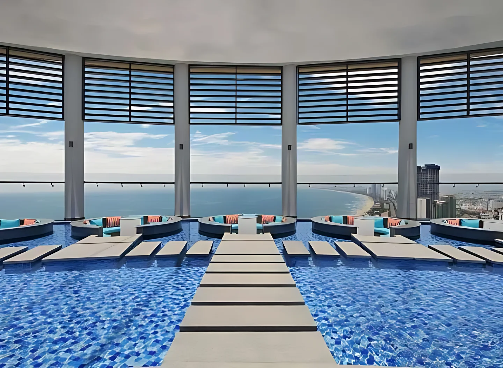
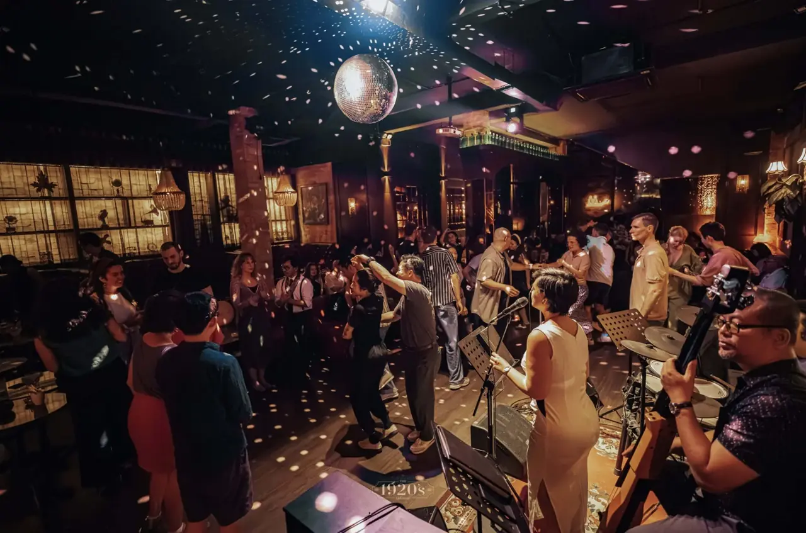

**Bar Đà Nẵng** có hai "mặt": bên sông Hàn là rooftop khách sạn nhìn cầu Rồng và trung tâm Hải Châu, còn bên biển Mỹ Khê là beach bar ngồi sát cát. Xen giữa là những quán cocktail kiểu speakeasy và quán nhạc sống jazz, rock ở trung tâm. Bài này gom 14 quán theo từng kiểu, kèm địa chỉ và mức chi tham khảo để bạn chọn nhanh.

## Bar Đà Nẵng tập trung ở đâu?

- **Hải Châu, ven sông Hàn (Bạch Đằng, Trần Phú, Nguyễn Chí Thanh):** rooftop nhìn sông, cocktail bar, pub và quán nhạc sống.
- **Biển Mỹ Khê, đường Võ Nguyên Giáp:** rooftop khách sạn cao tầng và beach bar sát bãi cát.
- **An Thượng, Ngũ Hành Sơn:** khu phố Tây gần biển, có quán cocktail nhỏ.

Xem toàn bộ danh sách tại trang [bar Đà Nẵng](/bar-da-nang/), [bar Hải Châu](/bar-hai-chau/) và [bar Mỹ Khê](/bar-my-khe/).

## Rooftop nhìn sông Hàn và biển

### Sky36

[Sky36](/bar/sky36/) là rooftop bar kiêm nightclub trên tầng 35–37 khách sạn Novotel Danang Premier Han River, 36 Bạch Đằng, nhìn xuống sông Hàn và trung tâm Hải Châu. Có khu ngoài trời, bàn cao, sofa lounge và khu VIP, thường có đêm DJ.

- Giờ mở cửa: 18:00 – 02:00
- Mức chi tham khảo: từ 300.000đ/người

### Endless Summer Rooftop Bar & Lounge

[Endless Summer](/bar/endless-summer-rooftop-bar-va-lounge-da-nang/) nằm trên tầng 25 khách sạn Wink Hotel Danang Riverside, 351 Trần Hưng Đạo, nhìn 360 độ ra sông Hàn và trung tâm. Quán mở cửa trở lại từ 1/3/2025 sau đợt cải tạo, gắn với hồ bơi trên mái.

- Giờ mở cửa: 16:30 – 00:00
- Mức chi tham khảo: từ 350.000đ/người

### Brilliant Top Bar

[Brilliant Top Bar](/bar/brilliant-top-bar/) là rooftop kiêm nhà hàng ngoài trời trên tầng 17 khách sạn Brilliant, 162 Bạch Đằng, nhìn ra sông Hàn, cầu Rồng và thành phố. Thực đơn có cocktail, mocktail, bia tươi, rượu vang và các món như salad, hàu, steak.

- Giờ mở cửa: 16:00 – 23:00
- Mức chi tham khảo: từ 400.000đ/người

### Horizon Bar

[Horizon Bar](/bar/horizon-bar/) trên tầng 36 khách sạn Four Points by Sheraton Danang, 118–120 Võ Nguyên Giáp, có khu trong nhà cửa kính toàn cảnh và sân hiên ngoài trời. Khách có thể ngồi trong các ô ghế dạng pod bên hồ bơi vô cực, ngắm biển, thành phố và sông Hàn.

- Mức chi tham khảo: từ 500.000đ/người

### Sky 21 Bar & Bistro

[Sky 21 Bar & Bistro](/bar/sky-21-bar-va-bistro/) trên tầng 21 khách sạn Belle Maison Parosand, 216 Võ Nguyên Giáp, hướng ra biển Mỹ Khê, kết hợp phần trong nhà với sân hiên mở.

- Giờ mở cửa: 17:00 – 00:00
- Mức chi tham khảo: từ 450.000đ/người

## Beach bar biển Mỹ Khê, Non Nước

### Maia Beach Bar

[Maia Beach Bar](/bar/maia-beach-bar/) nằm trên bãi biển dọc trục Võ Nguyên Giáp, mở từ sáng đến khuya, có ghế tắm nắng trên cát, cocktail và DJ chơi nhạc buổi tối.

- Giờ mở cửa: 08:00 – 01:00
- Mức chi tham khảo: từ 500.000đ/người

### Esco Beach Bar, Lounge & Restaurant

[Esco Beach Bar](/bar/esco-beach-bar-lounge-va-restaurant/) ở Lô 12 Võ Nguyên Giáp, dọc bãi biển Mỹ Khê, có chỗ ngồi sát bãi cát, nhạc sống của nghệ sĩ địa phương buổi tối và múa lửa.

- Mức chi tham khảo: từ 350.000đ/người

### Vive Océane Beach Club

[Vive Océane Beach Club](/bar/vive-oceane-beach-club/) là beach club kiêm nhà hàng của Hyatt Regency Danang, 5 Trường Sa, đặt trực tiếp trên bãi cát Non Nước, thực đơn kết hợp ẩm thực Pháp, Địa Trung Hải và Việt Nam.

- Giờ mở cửa: 11:00 – 23:00
- Mức chi tham khảo: từ 350.000đ/người

## Cocktail bar và speakeasy

### United Bar Danang

[United Bar Danang](/bar/united-bar-danang/) ở 02 Nguyễn Chí Thanh, kiểu speakeasy ẩn sau mặt tiền nhỏ như một xe bánh mì. Bên trong tường gạch, gác gỗ, tông màu tối gợi nhớ quán speakeasy Mỹ thập niên 1920.

- Giờ mở cửa: 18:00 – 01:00
- Mức chi tham khảo: từ 300.000đ/người

### Tê Cocktail Bar và Vấn Cocktail Bar

[Tê Cocktail Bar](/bar/te-cocktail-bar/) trên tầng 3, 39–41 Nguyễn Thái Học, kín đáo, chuyên cocktail và rượu vang. [Vấn Cocktail Bar](/bar/van-cocktail-bar/) trên tầng 3, 180–182 Nguyễn Chí Thanh, pha chế dựa trên tequila, whisky, rum, vodka với nguyên liệu tự nhiên mang hương vị Việt.

- Mức chi tham khảo: từ 300.000đ–400.000đ/người

### The Craftsman Cocktail Bar

[The Craftsman](/bar/the-craftsman-cocktail-bar/) là bar cocktail nhỏ kiểu speakeasy chỉ gói gọn trong một gian phòng, ở rìa khu phố Tây An Thượng, gần biển Mỹ Khê. Khách hay nhắc tới các ly Singapore Sling, Whiskey Sour, Hemingway Daiquiri.

- Giờ mở cửa: 19:30 – 01:30
- Mức chi tham khảo: từ 400.000đ/người

## Quán nhạc sống

### The 1920's Lounge và On The Radio Bar

[The 1920's Lounge](/bar/the-1920-s-lounge/) ở 53 Trần Quốc Toản, phong cách thập niên 1920, có jazz biểu diễn trực tiếp mỗi tối cùng acoustic và ballad. [On The Radio Bar](/bar/on-the-radio-bar/) ở 76 Thái Phiên, cùng chủ, theo chủ đề radio cổ, có ban nhạc chơi rock, ballad và các đêm open mic.

- Mức chi tham khảo: từ 300.000đ–350.000đ/người

## So sánh nhanh bar Đà Nẵng

| Bar | Loại hình | Khu vực | Mức chi tham khảo |
|---|---|---|---|
| Sky36 | Rooftop, club | Bạch Đằng, Hải Châu | Từ 300k/người |
| Endless Summer | Rooftop, hồ bơi | Trần Hưng Đạo, Sơn Trà | Từ 350k/người |
| Brilliant Top Bar | Rooftop | Bạch Đằng, Hải Châu | Từ 400k/người |
| Horizon Bar | Rooftop | Võ Nguyên Giáp | Từ 500k/người |
| Maia Beach Bar | Beach bar | Võ Nguyên Giáp | Từ 500k/người |
| Esco Beach Bar | Beach bar | Võ Nguyên Giáp | Từ 350k/người |
| United Bar | Speakeasy | Nguyễn Chí Thanh | Từ 300k/người |
| The Craftsman | Cocktail bar | An Thượng | Từ 400k/người |
| The 1920's Lounge | Jazz bar | Trần Quốc Toản | Từ 300k/người |

Mức chi là giá tham khảo, thay đổi theo đồ uống bạn chọn. Giờ mở cửa có thể thay đổi, gọi tổng đài để xác nhận trước khi đi.

:::cta
Đặt bàn bar Đà Nẵng tối nay
Gọi 0838 000 222 hoặc để lại số điện thoại, tổng đài TopChill giữ bàn giúp bạn, không cần cọc.
:::

## Kinh nghiệm đi bar ở Đà Nẵng

1. **Ngắm cầu Rồng phun lửa:** cầu Rồng thường phun lửa, phun nước lúc 21h tối thứ 7 và chủ nhật. Nếu muốn xem từ trên cao, chọn rooftop ven sông Hàn và đặt bàn sát lan can từ sớm.
2. **Chiều ra biển, tối vào phố:** ngồi beach bar Mỹ Khê lúc hoàng hôn, sau đó về Hải Châu nghe nhạc sống hoặc lên rooftop.
3. **Mùa mưa bão** (khoảng tháng 9 đến tháng 12) có thể làm đóng khu ngoài trời, nên kiểm tra thời tiết.
4. **Mùa hè và dịp lễ rất đông khách du lịch,** nên đặt bàn trước.
5. **Uống có trách nhiệm,** không lái xe sau khi uống rượu bia. Gọi taxi hoặc xe công nghệ.

Đi tiếp Huế hay Hội An? Xem thêm [bar Huế](/blog/bar-hue/). Muốn biết gọi gì, đọc [các loại cocktail phổ biến](/blog/cac-loai-cocktail-pho-bien/).

## Câu hỏi thường gặp

### Bar Đà Nẵng tập trung ở đâu?

Phần lớn ở Hải Châu ven sông Hàn (Bạch Đằng, Nguyễn Chí Thanh, Trần Phú) và dọc biển Mỹ Khê trên đường Võ Nguyên Giáp. Khu An Thượng có thêm quán cocktail nhỏ.

### Rooftop nào ở Đà Nẵng nhìn cầu Rồng?

Brilliant Top Bar (tầng 17, 162 Bạch Đằng) nhìn ra sông Hàn và cầu Rồng. Sky36 (tầng 35–37 Novotel) và Endless Summer (tầng 25 Wink Hotel) cũng nhìn bao quát sông Hàn và trung tâm.

### Đi bar ở Đà Nẵng hết bao nhiêu tiền?

Mức chi tham khảo khoảng 300.000đ–500.000đ mỗi người trở lên cho 2–3 đồ uống. Rooftop khách sạn và beach bar thường cao hơn cocktail bar trong phố.

### Đà Nẵng có quán nhạc sống không?

Có. The 1920's Lounge có jazz sống mỗi tối, On The Radio Bar có ban nhạc rock, ballad và open mic, Esco Beach Bar có nhạc sống bên biển buổi tối.

### Đặt bàn bar Đà Nẵng qua TopChill có cần cọc không?

Không. Bạn gọi 0838 000 222, nhắn Zalo hoặc để lại số trên web, tổng đài sẽ gọi lại xác nhận bàn.
