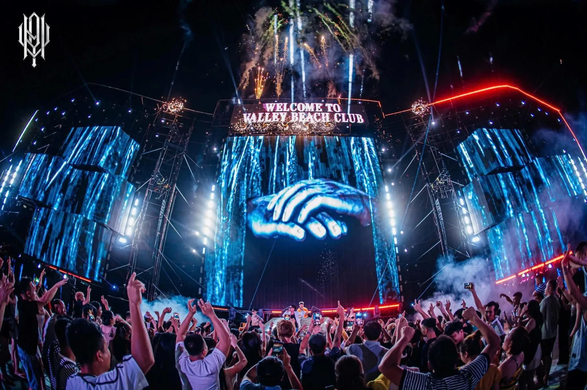
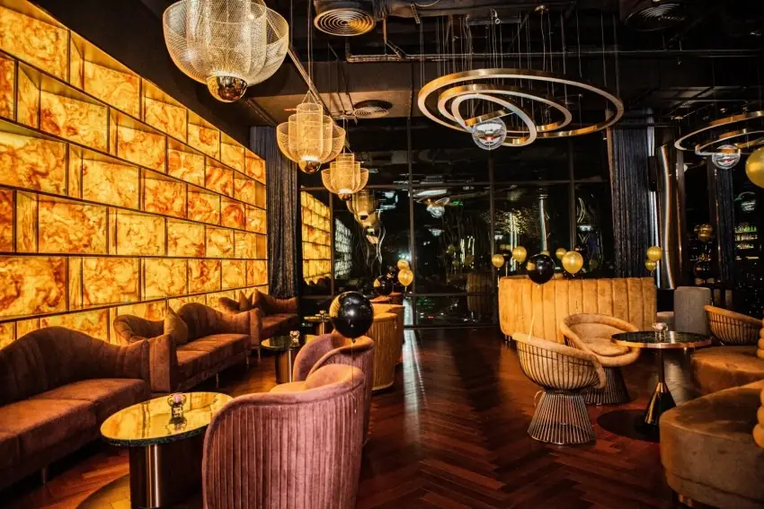
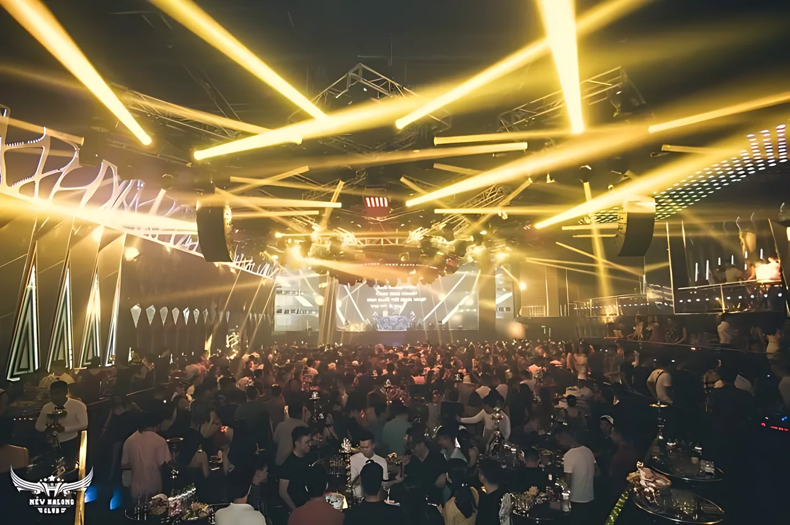

**Bar Hạ Long** tập trung ở hai khu: Bãi Cháy với bãi biển, phố cổ Sun World và các khách sạn ven vịnh, và Hồng Gai với những quán cocktail nhỏ. Sau một ngày đi vịnh, bạn có thể ngắm hoàng hôn trên rooftop, ngồi beach bar hóng gió hoặc ra club quẩy đến khuya. Bài này gom 12 quán theo từng kiểu, kèm địa chỉ và mức chi tham khảo để bạn chọn nhanh.

## Bar Hạ Long tập trung ở đâu?

- **Bãi Cháy:** khu du lịch chính, có bãi tắm Sun Group, phố cổ Sun World Halong Park, nhiều khách sạn cao tầng và hầu hết các club, pub, beach club.
- **Hồng Gai:** phía bên kia cầu Bãi Cháy, yên tĩnh hơn, có các quán cocktail nhỏ như Love Drunkery và Circle Mixology.
- **Rooftop khách sạn:** nằm rải rác ở Bãi Cháy, Hồng Gai và Hùng Thắng, nhìn thẳng ra vịnh Hạ Long.

Xem toàn bộ danh sách tại trang [bar Hạ Long](/bar-ha-long/).

## Beach club và beach bar ven biển

### Valley Beach Club

[Valley Beach Club](/bar/valley-beach-club/) nằm trên bãi tắm Sun Group, đường bao biển Bãi Cháy. Ban ngày bạn có thể thư giãn và xuống tắm biển, buổi tối quán tổ chức các sự kiện âm nhạc. Không gian rộng và thường rất đông vào mùa du lịch hè.

- Khu vực: Bãi Cháy
- Phù hợp: nhóm bạn thích tiệc bãi biển
- Mức chi tham khảo: từ 500.000đ/người

### Chill Beach Bar

[Chill Beach Bar](/bar/chill-beach-bar/) ở đường Kỳ Quan, Bãi Cháy, gần Valley Beach Club và nhìn ra vịnh với những dãy núi đá vôi. So với các điểm xung quanh, quán yên tĩnh hơn, phục vụ bia thủ công, đồ ăn nhanh và có biểu diễn acoustic.

- Khu vực: Bãi Cháy
- Phù hợp: ai muốn thư giãn bên biển, không khí nhẹ nhàng
- Mức chi tham khảo: từ 500.000đ/người

## Rooftop ngắm vịnh Hạ Long

### Sky21 Bar & Lounge

[Sky21 Bar & Lounge](/bar/sky21-bar-va-lounge/) nằm trên tầng 21 khách sạn FLC Grand Hạ Long, đường Nguyễn Văn Cừ, nhìn toàn cảnh vịnh. Không gian lounge lịch sự, hay được chọn để tiếp khách, gặp đối tác hoặc hẹn hò ngắm vịnh về đêm.

- Khu vực: Hồng Gai
- Mức chi tham khảo: từ 400.000đ/người

### On The Rocks

[On The Rocks](/bar/on-the-rocks/) là rooftop bar trong khách sạn Citadines Marina Hạ Long, đường Hoàng Quốc Việt, cạnh hồ bơi trên cao và nhìn ra vịnh. Thực đơn có cocktail, cognac, whisky, rượu mùi và cả lựa chọn món chay.

- Khu vực: Bãi Cháy
- Phù hợp: hẹn hò, gặp bạn bè lúc hoàng hôn
- Mức chi tham khảo: từ 500.000đ/người

### Sky Bar – Royal Lotus Hạ Long

[Sky Bar – Royal Lotus Hạ Long](/bar/sky-bar-royal-lotus-ha-long/) ở tầng 16 khách sạn Royal Lotus, tận dụng gần như toàn bộ sân thượng làm không gian ngoài trời. Từ đây bạn ngắm khu Bãi Cháy và vịnh, đẹp nhất vào những ngày trời quang.

- Khu vực: Bãi Cháy
- Mức chi tham khảo: từ 400.000đ/người

### Skylight Restaurant & Pool Bar

[Skylight Restaurant & Pool Bar](/bar/skylight-restaurant-va-pool-bar/) là nhà hàng kết hợp pool bar trên tầng 22 khách sạn Central Luxury Hạ Long, phường Hùng Thắng. Thực đơn có các món Á và Âu, hợp ai muốn kết hợp bữa tối, đồ uống và ngắm vịnh.

- Mức chi tham khảo: từ 500.000đ/người

## Club quẩy đêm ở Bãi Cháy

### H Club

[H Club](/bar/h-club/) ở Tổ 7, Khu 4, Bãi Cháy, diện tích lớn với sức chứa khoảng 1.200 khách. Âm nhạc là các bản hit quốc tế phối lại theo phong cách club, khách có thể ngồi bàn hoặc ngồi quầy bar.

- Mức chi tham khảo: từ 500.000đ/người

### New Hạ Long Club

[New Hạ Long Club](/bar/new-ha-long-club/) là vũ trường quy mô lớn ở phường Yết Kiêu, sức chứa khoảng 1.500 khách, nhạc dance sôi động và có khu VIP riêng ở tầng 3.

- Mức chi tham khảo: từ 600.000đ/người

### FOM Club

[FOM Club](/bar/fom-club/) nằm đối diện khách sạn Novotel, Bãi Cháy, gần khu khách sạn ven biển và phố cổ Sun World. Không gian theo chủ đề đại dương, có hệ thống âm thanh, ánh sáng và DJ.

- Mức chi tham khảo: từ 600.000đ/người

## Pub và cocktail bar

### Brothers Pub và The Mine Bar

Cả hai nằm trong phố cổ Bãi Cháy, Sun World Halong Park. [Brothers Pub](/bar/brothers-pub/) ở kiot A116, thường đông khách mỗi tối nhờ nhạc sôi động. [The Mine Bar](/bar/the-mine-bar/) ở kiot C107–C108, tiện ghé ngồi nghỉ khi dạo phố đi bộ về đêm.

- Mức chi tham khảo: từ 300.000đ đến 350.000đ/người

### Love Drunkery Cocktail Bar

[Love Drunkery Cocktail Bar](/bar/love-drunkery-cocktail-bar/) ở số 154 Tô Hiến Thành, khu Hồng Gai, không gian ấm cúng với ghế ngồi êm và mở cửa đến khuya. Hợp cặp đôi hoặc nhóm bạn nhỏ muốn thưởng thức cocktail trong không khí riêng tư.

- Mức chi tham khảo: từ 300.000đ/người

## So sánh nhanh bar Hạ Long

| Bar | Loại hình | Khu vực | Mức chi tham khảo |
|---|---|---|---|
| Valley Beach Club | Beach club | Bãi Cháy | Từ 500k/người |
| Chill Beach Bar | Beach bar | Bãi Cháy | Từ 500k/người |
| Sky21 Bar & Lounge | Rooftop | Hồng Gai | Từ 400k/người |
| On The Rocks | Rooftop | Bãi Cháy | Từ 500k/người |
| H Club | Club | Bãi Cháy | Từ 500k/người |
| New Hạ Long Club | Club | Yết Kiêu | Từ 600k/người |
| FOM Club | Club | Bãi Cháy | Từ 600k/người |
| Brothers Pub | Pub | Phố cổ Bãi Cháy | Từ 300k/người |
| Love Drunkery | Cocktail bar | Hồng Gai | Từ 300k/người |

Mức chi là giá tham khảo, thay đổi theo đồ uống bạn chọn. Giờ mở cửa có thể đổi theo mùa và sự kiện, gọi tổng đài để xác nhận trước khi đi.

:::cta
Đặt bàn bar Hạ Long tối nay
Gọi 0838 000 222 hoặc để lại số điện thoại, tổng đài TopChill giữ bàn giúp bạn, không cần cọc.
:::

## Kinh nghiệm đi bar ở Hạ Long

1. **Đi vịnh ban ngày, đi bar buổi tối.** Tour vịnh thường kết thúc chiều muộn, nên bạn dễ kịp lên rooftop ngắm hoàng hôn.
2. **Mùa hè và dịp lễ rất đông,** nhất là Valley Beach Club và các club lớn. Hãy đặt bàn trước.
3. **Phố cổ Bãi Cháy đi bộ được,** có thể ghé 2–3 quán trong một tối.
4. **Kiểm tra thời tiết.** Mưa bão có thể làm đóng khu ngoài trời ở rooftop và beach bar.
5. **Uống có trách nhiệm,** không lái xe sau khi uống rượu bia. Gọi taxi hoặc xe công nghệ về khách sạn.

Đi các thành phố biển khác? Xem thêm [bar Vũng Tàu](/bar-vung-tau/) và [bar Đà Nẵng](/bar-da-nang/).

## Câu hỏi thường gặp

### Bar Hạ Long ở đâu?

Phần lớn bar Hạ Long nằm ở khu Bãi Cháy (bãi tắm Sun Group, phố cổ Sun World, các khách sạn ven biển). Khu Hồng Gai có các quán cocktail nhỏ yên tĩnh hơn.

### Rooftop nào ngắm vịnh Hạ Long đẹp?

Sky21 Bar & Lounge (tầng 21 FLC Grand), On The Rocks (Citadines Marina), Sky Bar Royal Lotus (tầng 16) và Skylight Pool Bar (tầng 22 Central Luxury) đều nhìn ra vịnh.

### Đi bar ở Hạ Long hết bao nhiêu tiền?

Mức chi tham khảo khoảng 300.000đ–600.000đ mỗi người trở lên cho 2–3 đồ uống, tuỳ quán. Rooftop và club thường cao hơn pub.

### Đặt bàn bar Hạ Long qua TopChill có cần cọc không?

Không. Bạn gọi 0838 000 222, nhắn Zalo hoặc để lại số trên web, tổng đài sẽ gọi lại xác nhận bàn.
