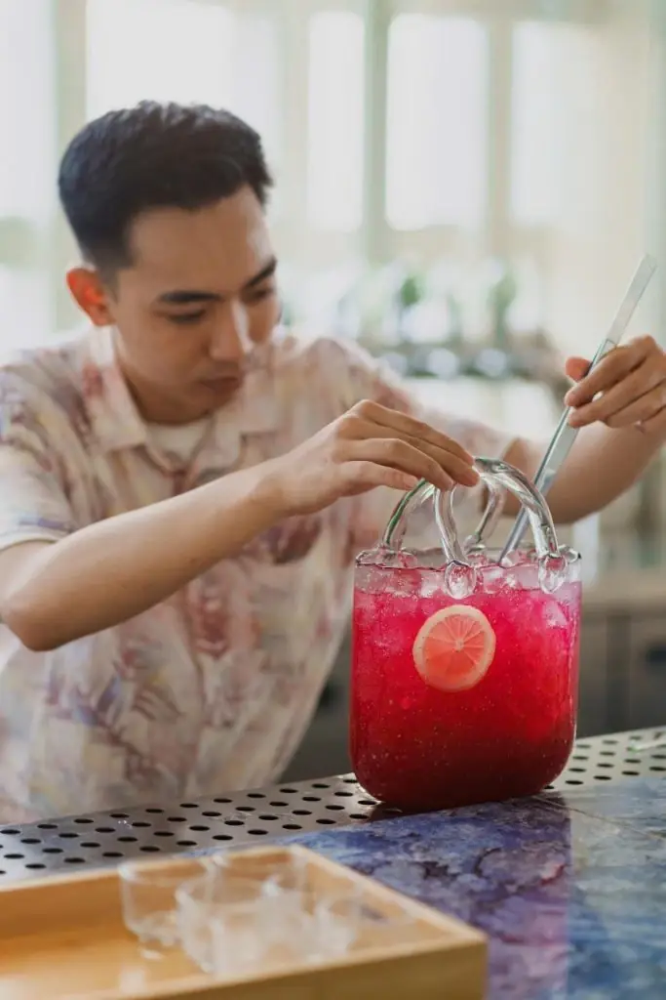
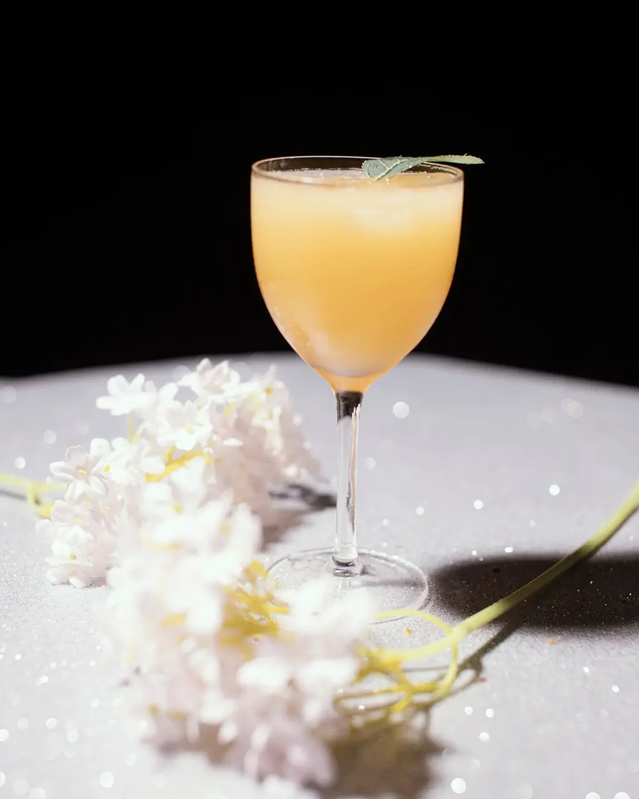
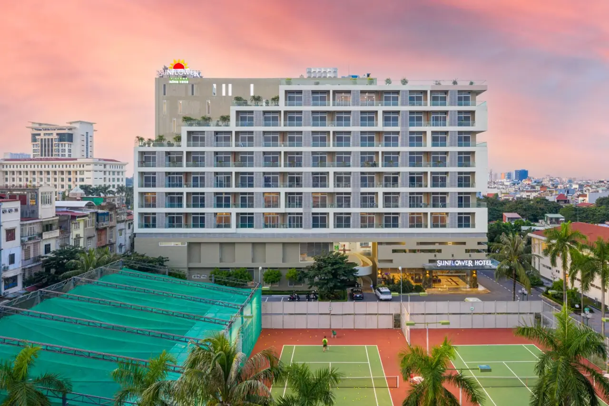

**Bar Hải Phòng** tập trung ở khu trung tâm Hồng Bàng và Lê Chân, cộng thêm vài điểm quẩy đêm quen thuộc trên trục Lạch Tray, Ngô Quyền. Thành phố cảng có đủ kiểu: rooftop hồ bơi nhìn toàn cảnh trung tâm, cocktail bar nhỏ yên tĩnh, pub bia thủ công và club nhạc house, EDM. Bài này gom 11 quán theo từng kiểu, kèm địa chỉ và mức chi tham khảo để bạn chọn nhanh.

## Bar Hải Phòng tập trung ở đâu?

- **Hồng Bàng:** trung tâm thành phố, có rooftop khách sạn, cocktail bar, pub và club lâu năm.
- **Lê Chân:** nhiều quán cocktail, quán trong các khu đô thị mới như Vinhomes Marina, Waterfront.
- **Ngô Quyền, Hải An:** trục Lạch Tray, Văn Cao có vũ trường và pub phong cách châu Âu.

Xem toàn bộ danh sách tại trang [bar Hải Phòng](/bar-hai-phong/) và [bar Hồng Bàng](/bar-hong-bang/).

## Rooftop nhìn toàn cảnh trung tâm

### Endless Summer Rooftop Bar & Lounge

[Endless Summer Rooftop Bar & Lounge](/bar/endless-summer-rooftop-bar-va-lounge-hai-phong/) nằm trên tầng 22 của Wink Hotel Hai Phong, số 135 Điện Biên Phủ, Hồng Bàng, nhìn 360 độ ra trung tâm thành phố. Điểm nhấn là hồ bơi vô cực trên mái được làm ấm vào mùa đông, có không gian thư thả bên hồ để ngắm hoàng hôn và các buổi tiệc hồ bơi cuối tuần.

- Phù hợp: cặp đôi, nhóm bạn muốn ngắm cảnh từ trên cao
- Mức chi tham khảo: từ 450.000đ/người

## Cocktail bar yên tĩnh

### Atelier Cocktail Bar

[Atelier Cocktail Bar](/bar/atelier-cocktail-bar/) ở số 9 Trần Nguyên Hãn, Lê Chân, không gian mang chất nghệ thuật, gọn gàng và thư thái, coi pha chế cocktail như một môn nghệ thuật. Quán thường có mặt trong các danh sách bar đáng ghé ở Hải Phòng.

- Giờ mở cửa: 18:00 – 02:00
- Mức chi tham khảo: từ 300.000đ/người

### Insider Cocktail Bar

[Insider Cocktail Bar](/bar/insider-cocktail-bar/) ở số 80 Hoàng Văn Thụ, Hồng Bàng. Quán nhỏ, ấm cúng nhưng chỉn chu, nổi bật với cocktail pha theo khẩu vị riêng của từng khách, hợp hẹn hò hoặc nhóm bạn nhỏ.

- Mức chi tham khảo: từ 350.000đ/người

### Eyeconic Cocktail Club

[Eyeconic Cocktail Club](/bar/eyeconic-cocktail-club/) ở số 21A Trần Hưng Đạo, Hồng Bàng, mở từ tối đến khuya. Hợp nhóm bạn muốn kéo dài cuộc vui sau bữa tối.

- Giờ mở cửa: 20:30 – 02:30
- Mức chi tham khảo: từ 400.000đ/người

### EYWA Cocktail & Eatery

[EYWA Cocktail & Eatery](/bar/eywa-cocktail-va-eatery/) ở HD18 Vinhomes Marina, Cầu Rào 2, Lê Chân. Không gian lấy cảm hứng từ thiên nhiên với ý tưởng nhà trên cây, có thực đơn đồ ăn fusion, nhạc nhẹ và bartender gợi ý đồ uống.

- Giờ mở cửa: 18:00 – 02:00
- Mức chi tham khảo: từ 300.000đ/người

### People Cocktail

[People Cocktail](/bar/people-cocktail/) ở số 159 Quán Nam, Lê Chân, phong cách hiện đại với đèn neon, thực đơn từ cocktail cổ điển đến công thức sáng tạo, trình bày bắt mắt. Hợp nhóm bạn trẻ thích chụp ảnh.

- Mức chi tham khảo: từ 400.000đ/người

## Pub và bia thủ công

### T-Pub Craft Beer Station

[T-Pub Craft Beer Station](/bar/t-pub-craft-beer-station/) ở BH03-05 Manhattan 10, Vinhomes Imperia, Hồng Bàng, nhìn ra quảng trường Ánh Sáng. Quán có nhiều bia thủ công trong nước, kể cả bia nặng độ, kèm đồ ăn nhẹ và món fusion. Xem thêm bài [bia thủ công](/blog/bia-thu-cong-craft-beer/).

- Mức chi tham khảo: từ 350.000đ/người

### Buzz Pub

[Buzz Pub](/bar/buzz-pub/) ở số 335 Văn Cao, Hải An, theo phong cách pub Ireland truyền thống với nhiều gỗ, ánh sáng dịu và quầy bar dài. Quán có đồ ăn nhanh, cocktail, mocktail, bia tươi và các buổi biểu diễn của nghệ sĩ trẻ, quen thuộc với cả khách địa phương và người nước ngoài.

- Mức chi tham khảo: từ 300.000đ/người

### Chill Pub

[Chill Pub](/bar/chill-pub/) ở số 22C Minh Khai, Hồng Bàng, được khách khen về đồ ăn và cách phục vụ, nhạc mở khá to tạo không khí sôi nổi.

- Mức chi tham khảo: từ 300.000đ/người

## Club quẩy đêm

### Fleur d'Or Maison Bar

[Fleur d'Or Maison Bar](/bar/fleur-d-or-maison-bar/) là điểm vui chơi đêm lâu năm ở số 50 Đinh Tiên Hoàng, Hồng Bàng. Tầng trệt là sảnh chờ với quầy bar, tầng hai là khu âm nhạc với DJ chơi House, Vietnam House, EDM, Electro.

- Giờ mở cửa: 20:30 – 01:00
- Mức chi tham khảo: từ 550.000đ/người

### Royal Disco

[Royal Disco](/bar/royal-disco/) ở số 53 Lạch Tray, Ngô Quyền, trước đây mang tên King Disco, còn gọi là Hoàng Gia Disco, là địa chỉ quẩy đêm quen thuộc trên trục Lạch Tray.

- Mức chi tham khảo: từ 450.000đ/người

## So sánh nhanh bar Hải Phòng

| Bar | Loại hình | Địa chỉ | Mức chi tham khảo |
|---|---|---|---|
| Endless Summer | Rooftop, hồ bơi | 135 Điện Biên Phủ, Hồng Bàng | Từ 450k/người |
| Atelier Cocktail Bar | Cocktail bar | 9 Trần Nguyên Hãn, Lê Chân | Từ 300k/người |
| Insider Cocktail Bar | Cocktail bar | 80 Hoàng Văn Thụ, Hồng Bàng | Từ 350k/người |
| Eyeconic Cocktail Club | Cocktail bar | 21A Trần Hưng Đạo, Hồng Bàng | Từ 400k/người |
| EYWA Cocktail & Eatery | Cocktail, ăn uống | Vinhomes Marina, Lê Chân | Từ 300k/người |
| T-Pub Craft Beer Station | Pub bia thủ công | Vinhomes Imperia, Hồng Bàng | Từ 350k/người |
| Buzz Pub | Pub kiểu Ireland | 335 Văn Cao, Hải An | Từ 300k/người |
| Fleur d'Or Maison Bar | Club | 50 Đinh Tiên Hoàng, Hồng Bàng | Từ 550k/người |
| Royal Disco | Club | 53 Lạch Tray, Ngô Quyền | Từ 450k/người |

Mức chi là giá tham khảo, thay đổi theo đồ uống bạn chọn. Giờ mở cửa có thể thay đổi, gọi tổng đài để xác nhận trước khi đi.

:::cta
Đặt bàn bar Hải Phòng tối nay
Gọi 0838 000 222 hoặc để lại số điện thoại, tổng đài TopChill giữ bàn giúp bạn, không cần cọc.
:::

## Kinh nghiệm đi bar ở Hải Phòng

1. **Bắt đầu ở rooftop hoặc cocktail bar** đầu buổi tối, sau 22h chuyển sang club nếu muốn quẩy.
2. **Cuối tuần các club đông,** nhất là Fleur d'Or và Royal Disco, nên đặt bàn trước và hỏi mức chi tối thiểu bàn VIP.
3. **Quán ở khu đô thị mới** (Vinhomes Marina, Waterfront, Vinhomes Imperia) cách trung tâm một đoạn, hãy tính đường đi.
4. **Mùa đông Hải Phòng lạnh,** mang áo khoác nếu lên rooftop.
5. **Mang CCCD,** club có thể kiểm tra giấy tờ ở cửa.
6. **Uống có trách nhiệm,** không lái xe sau khi uống rượu bia. Gọi taxi hoặc xe công nghệ.

Đi tiếp Hạ Long? Xem thêm [bar Hạ Long](/blog/bar-ha-long/). Ở Hà Nội thì xem [top bar Hà Nội](/blog/top-bar-ha-noi/).

## Câu hỏi thường gặp

### Bar Hải Phòng tập trung ở đâu?

Phần lớn ở quận Hồng Bàng (trung tâm) và Lê Chân. Trục Lạch Tray (Ngô Quyền) và Văn Cao (Hải An) có thêm vũ trường và pub.

### Hải Phòng có rooftop bar không?

Có. Endless Summer Rooftop Bar & Lounge trên tầng 22 Wink Hotel Hai Phong có hồ bơi vô cực và tầm nhìn 360 độ ra trung tâm thành phố.

### Đi bar ở Hải Phòng hết bao nhiêu tiền?

Mức chi tham khảo khoảng 300.000đ–550.000đ mỗi người trở lên cho 2–3 đồ uống. Club và rooftop thường cao hơn pub và cocktail bar.

### Club nào ở Hải Phòng sôi động?

Fleur d'Or Maison Bar (50 Đinh Tiên Hoàng) có DJ chơi House, EDM ở tầng hai, còn Royal Disco (53 Lạch Tray) là vũ trường quen thuộc của thành phố.

### Đặt bàn bar Hải Phòng qua TopChill có cần cọc không?

Không. Bạn gọi 0838 000 222, nhắn Zalo hoặc để lại số trên web, tổng đài sẽ gọi lại xác nhận bàn.
