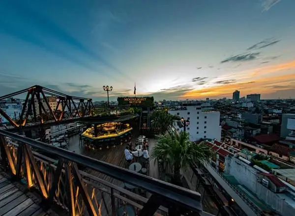
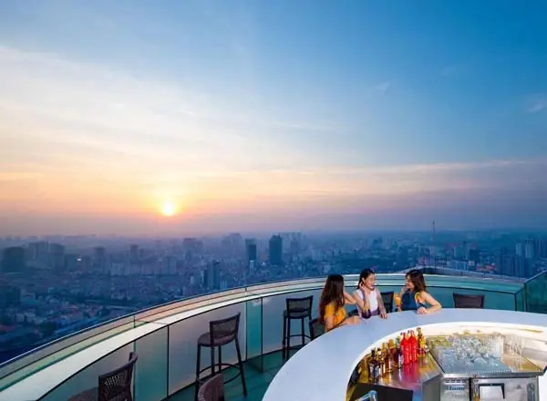
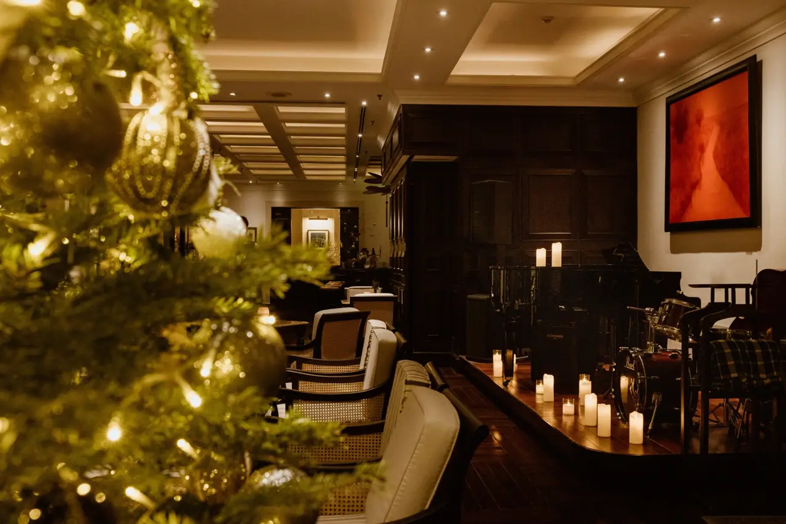

**Bar hẹn hò Hà Nội** cần đủ ba thứ: không gian đẹp, nhạc vừa đủ để trò chuyện và đồ uống ngon. Hà Nội có sky bar nhìn xuống phố cổ, lounge trên cao ngắm Hồ Tây lúc hoàng hôn, jazz bar trong khách sạn cổ và những speakeasy nhỏ ánh nến. Bài này gom 9 quán hợp cho cặp đôi, kèm địa chỉ, giờ mở cửa và mức chi tham khảo.

## Chọn kiểu quán cho buổi hẹn

- **Buổi hẹn đầu, muốn ấn tượng:** sky bar hoặc lounge trên cao, view đẹp tự tạo chủ đề trò chuyện.
- **Đã thân, muốn riêng tư:** speakeasy nhỏ, ánh sáng mờ, ít người.
- **Kỷ niệm, dịp đặc biệt:** bar khách sạn cổ điển có nhạc jazz sống.

## Sky bar ngắm phố cổ

### Moonlight Sky Bar

[Moonlight Sky Bar](/bar/moonlight-sky-bar/) trên tầng cao khách sạn La Siesta Classic, 94 Mã Mây, có **mô hình cầu Long Biên thu nhỏ** bắc ngang quầy bar, nhìn toàn cảnh phố cổ và hồ Hoàn Kiếm về đêm. Được giới thiệu là không gian lãng mạn, trang nhã.

- Mức chi tham khảo: từ 400.000đ/người

### Lighthouse Sky Bar

[Lighthouse Sky Bar](/bar/lighthouse-sky-bar/) trên tầng 10–11 khách sạn La Siesta Premium, 27 Hàng Bè, thiết kế như con thuyền neo trên mái với **ngọn hải đăng** nhấp nháy về đêm, nhìn ra hồ Hoàn Kiếm và sông Hồng.

- Giờ mở cửa: 17:00 – 00:00
- Mức chi tham khảo: từ 500.000đ/người

## Lounge trên cao, ngắm hoàng hôn

### Top of Hanoi

[Top of Hanoi](/bar/top-of-hanoi/) trên tầng thượng khách sạn Lotte, 54 Liễu Giai, ngắm **toàn cảnh thành phố 360 độ**, hợp hẹn hò hoặc dịp đặc biệt.

- Giờ mở cửa: 17:00 – 00:00
- Mức chi tham khảo: từ 450.000đ/người

### The Summit

[The Summit](/bar/the-summit-pan-pacific-hanoi/) trên tầng 20 Pan Pacific, 1 Thanh Niên, nhìn ra Hồ Tây và hồ Trúc Bạch, có cocktail signature, hợp ngắm hoàng hôn trước bữa tối.

- Mức chi tham khảo: từ 450.000đ/người

## Jazz bar và bar khách sạn cổ điển

### Le Club Bar – Sofitel Legend Metropole

[Le Club Bar](/bar/le-club-bar-sofitel-legend-metropole/) trong khách sạn Metropole, 15 Ngô Quyền, nhìn ra khu vườn khách sạn, có **jazz và swing sống từ 20:00, thứ Ba đến Chủ nhật**. Lựa chọn thanh lịch cho dịp kỷ niệm.

- Mức chi tham khảo: từ 350.000đ/người

### Polite & Co

[Polite & Co](/bar/polite-va-co/) ở 5B Bảo Khánh, vài bước từ hồ Hoàn Kiếm, hoạt động từ năm 1995, không gian hoài cổ, ấm cúng, khoảng 25 loại cocktail kinh điển. Nên đặt trước nếu muốn ngồi quầy.

- Mức chi tham khảo: từ 400.000đ/người

## Speakeasy và quán nhỏ riêng tư

### Bee'Znees

[Bee'Znees](/bar/bee-znees/) ở 163 Phùng Hưng, lối vào ngụy trang như kệ sách, không gian thập niên 1920 với rèm đỏ, nhạc jazz chủ đạo, nhạc sống tối thứ Tư. Bước qua "kệ sách" đã là một khoảnh khắc thú vị cho buổi hẹn.

- Giờ mở cửa: 19:00 – 00:00
- Mức chi tham khảo: từ 300.000đ/người

### Tadioto

[Tadioto](/bar/tadioto/) ở 24B Tông Đản, gần Nhà hát Lớn, phong cách bohemian, tường treo tranh đương đại, vài tối có buổi nghe đĩa than jazz. Hợp cặp đôi yêu nghệ thuật.

- Mức chi tham khảo: từ 450.000đ/người

### Workshop14 (Tây Hồ)

[Workshop14](/bar/workshop14/) chỉ khoảng 14 chỗ, ẩn sau cánh cổng gỗ trong ngõ 5 Từ Hoa, gần Hồ Tây, tối giản và yên tĩnh. Nên đặt trước vì rất ít chỗ.

- Giờ mở cửa: 16:00 – 00:30
- Mức chi tham khảo: từ 350.000đ/người

## So sánh nhanh

| Quán | Kiểu | Địa chỉ | Mức chi tham khảo |
|---|---|---|---|
| Moonlight Sky Bar | Sky bar phố cổ | 94 Mã Mây | Từ 400k/người |
| Lighthouse Sky Bar | Sky bar phố cổ | 27 Hàng Bè | Từ 500k/người |
| Top of Hanoi | Rooftop 360 độ | 54 Liễu Giai | Từ 450k/người |
| The Summit | Lounge nhìn Hồ Tây | 1 Thanh Niên | Từ 450k/người |
| Le Club Bar | Jazz, khách sạn cổ | 15 Ngô Quyền | Từ 350k/người |
| Polite & Co | Cocktail cổ điển | 5B Bảo Khánh | Từ 400k/người |
| Bee'Znees | Speakeasy | 163 Phùng Hưng | Từ 300k/người |
| Tadioto | Bohemian, nghệ thuật | 24B Tông Đản | Từ 450k/người |
| Workshop14 | Cocktail nhỏ | Ngõ 5 Từ Hoa | Từ 350k/người |

Mức chi là giá tham khảo, thay đổi theo đồ uống bạn chọn. Giờ mở cửa có thể thay đổi, gọi tổng đài để xác nhận trước khi đi.

:::cta
Giữ bàn đẹp cho buổi hẹn
Gọi 0838 000 222, tổng đài TopChill giữ bàn sát cửa kính hoặc góc riêng tư giúp bạn, không cần cọc.
:::

## Mẹo cho buổi hẹn ở bar

1. **Đặt bàn trước và dặn "bàn đôi, view đẹp"** để có chỗ sát cửa kính hoặc góc yên tĩnh.
2. **Sky bar, lounge: đến trước hoàng hôn** khoảng 30 phút.
3. **Mặc lịch sự:** bar khách sạn thường yêu cầu áo có cổ, giày kín.
4. **Gọi mocktail nếu một người không uống rượu.** Xem [mocktail không cồn](/blog/mocktail-do-uong-khong-con-o-bar/).
5. **Về bằng taxi hoặc xe công nghệ,** không lái xe sau khi uống rượu bia.

Xem thêm [bar phố cổ Hà Nội](/blog/bar-pho-co-ha-noi/), [bar Hồ Tây](/blog/bar-ho-tay/) và [jazz bar](/blog/jazz-bar/).

## Câu hỏi thường gặp

### Bar nào ở Hà Nội hợp hẹn hò lần đầu?

Sky bar và lounge trên cao như Moonlight Sky Bar, Top of Hanoi, The Summit có view đẹp, nhạc vừa phải, dễ trò chuyện.

### Bar nào ở Hà Nội có nhạc jazz cho cặp đôi?

Le Club Bar trong Sofitel Legend Metropole có jazz và swing sống từ 20:00, thứ Ba đến Chủ nhật. Bee'Znees có nhạc sống tối thứ Tư.

### Hẹn hò ở bar Hà Nội hết bao nhiêu tiền?

Mức chi tham khảo khoảng 300.000đ–500.000đ mỗi người cho 2 đồ uống. Sky bar và bar khách sạn thường cao hơn speakeasy nhỏ.

### Đặt bàn hẹn hò qua TopChill có cần cọc không?

Không. Gọi 0838 000 222, nhắn Zalo hoặc để lại số trên web, tổng đài sẽ gọi lại xác nhận bàn.
