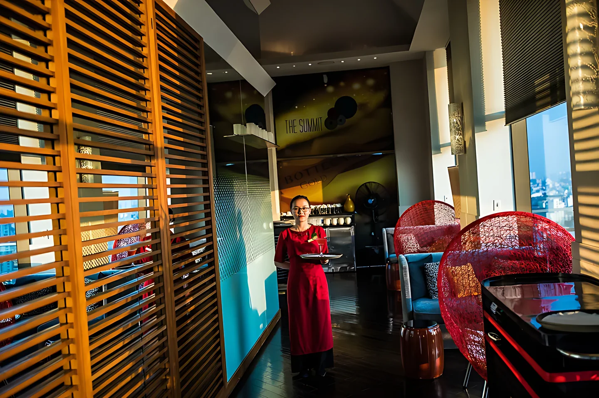
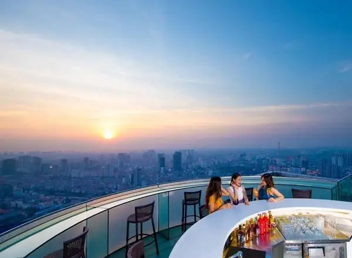
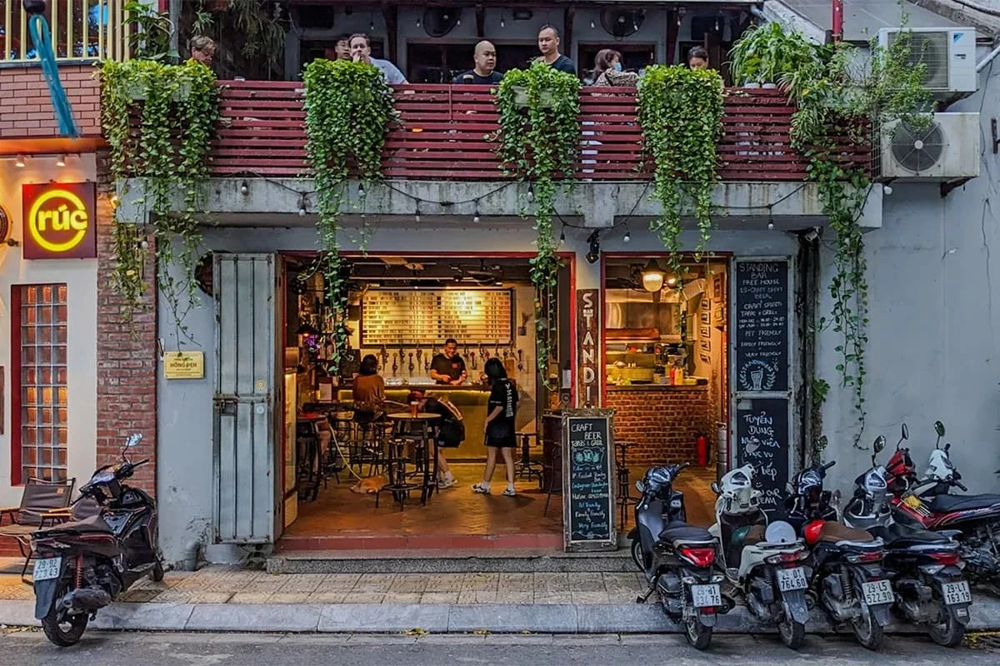
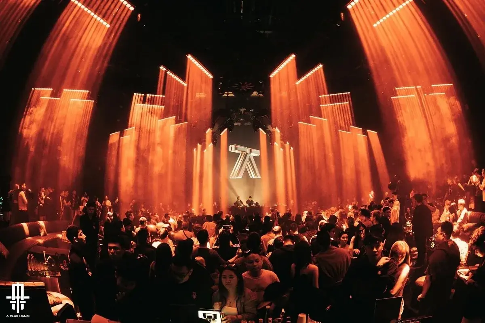

**Bar Hồ Tây** là lựa chọn khi bạn muốn đi chơi tối ở Hà Nội mà tránh được sự đông đúc của phố cổ: lounge trên cao nhìn ra mặt hồ lúc hoàng hôn, cocktail bar nhỏ trong ngõ Tây Hồ, quán bia thủ công bên hồ Trúc Bạch, và phố Yên Phụ ven hồ tập trung nhiều club lớn. Bài này gom 8 quán quanh Hồ Tây và hồ Trúc Bạch, kèm địa chỉ, giờ mở cửa và mức chi tham khảo.

## Bar quanh Hồ Tây tập trung ở đâu?

- **Đường Thanh Niên, Liễu Giai (Ba Đình):** lounge và rooftop trên tầng cao khách sạn, nhìn ra hồ.
- **Quảng An, Từ Hoa (Tây Hồ):** cocktail bar và brewpub yên tĩnh, nhiều khách nước ngoài.
- **Trấn Vũ (Trúc Bạch):** quán bia thủ công có ban công nhìn hồ.
- **Phố Yên Phụ:** club lớn nằm sát nhau, đi bộ đổi quán được.

Xem thêm [bar Ba Đình](/bar-ba-dinh/) và [bar Hà Nội](/bar-ha-noi/).

## Ngắm hồ từ trên cao

### The Summit (Pan Pacific Hanoi)

[The Summit](/bar/the-summit-pan-pacific-hanoi/) trên tầng 20 khách sạn Pan Pacific, 1 Thanh Niên, nằm giữa Hồ Tây và hồ Trúc Bạch. Tầm nhìn **360 độ** ra hai hồ, đường chân trời và sông Hồng, có cocktail signature và đồ ăn nhẹ kiểu châu Á. Đẹp nhất lúc hoàng hôn.

- Mức chi tham khảo: từ 450.000đ/người

### Top of Hanoi (Lotte Center)

[Top of Hanoi](/bar/top-of-hanoi/) là quầy bar ngoài trời trên tầng thượng khách sạn Lotte, 54 Liễu Giai, phía trên đài quan sát của tòa nhà, ngắm **toàn cảnh thành phố 360 độ**, nhất là khi trời tối. Hợp hẹn hò hoặc tiếp khách.

- Giờ mở cửa: 17:00 – 00:00
- Mức chi tham khảo: từ 450.000đ/người

Xem thêm [rooftop bar Hà Nội](/blog/rooftop-bar-ha-noi/).

## Cocktail và bia thủ công bên hồ

### Workshop14 (Tây Hồ)

[Workshop14](/bar/workshop14/) chỉ khoảng 14 chỗ, ẩn sau cánh cổng gỗ trong ngõ 5 Từ Hoa, Quảng An, gần chùa Kim Liên ven Hồ Tây. Quán xếp hạng 83 trong danh sách mở rộng Asia's 50 Best Bars 2025. Nên đặt chỗ trước.

- Giờ mở cửa: 16:00 – 00:30
- Mức chi tham khảo: từ 350.000đ/người

### Standing Bar (Trúc Bạch)

[Standing Bar](/bar/standing-bar/) ở 170 Trấn Vũ, có **ban công nhìn ra hồ Trúc Bạch**, gần 20 vòi bia từ các nhà nấu bia độc lập Việt Nam, đồ ăn kiểu yakitori và tapas.

- Mức chi tham khảo: từ 400.000đ/người

### Turtle Lake Brewing Company (Tây Hồ)

[Turtle Lake Brewing](/bar/turtle-lake-brewing-company/) ở 105 Quảng Khánh, Quảng An, gần Hồ Tây, xưởng bia thủ công kiêm brewpub với IPA, pale ale, stout, lager tự nấu, có bàn shuffleboard, hợp nhóm đông.

- Mức chi tham khảo: từ 350.000đ/người

Xem thêm [cocktail bar Hà Nội](/blog/cocktail-bar-ha-noi/) và [bia thủ công](/blog/bia-thu-cong-craft-beer/).

## Club phố Yên Phụ

Sau khi ngắm hồ, nhiều nhóm chuyển sang phố Yên Phụ ven hồ, nơi có ba club lớn cách nhau vài phút đi bộ:

- [APLUS HANOI](/bar/aplus-hanoi/), 78 Yên Phụ: super club EDM, trance, techno, mở 19:00 – 04:00, từ 300.000đ/người.
- [Hero Club](/bar/hero-club/), 42M Yên Phụ: deep house, hip-hop, R&B, quầy DJ đặt trong xe tải cũ, từ 400.000đ/người.
- [Track 42](/bar/track-42/), 42 Yên Phụ: mainstream, EDM, bàn SVIP và dịch vụ chai, từ 500.000đ/người.

Xem thêm [club Hà Nội](/blog/club-ha-noi/).

## So sánh nhanh bar Hồ Tây, Trúc Bạch

| Quán | Loại hình | Địa chỉ | Mức chi tham khảo |
|---|---|---|---|
| The Summit | Lounge tầng 20 | 1 Thanh Niên | Từ 450k/người |
| Top of Hanoi | Rooftop | 54 Liễu Giai | Từ 450k/người |
| Workshop14 | Cocktail bar | Ngõ 5 Từ Hoa, Tây Hồ | Từ 350k/người |
| Standing Bar | Bia thủ công | 170 Trấn Vũ | Từ 400k/người |
| Turtle Lake Brewing | Brewpub | 105 Quảng Khánh | Từ 350k/người |
| APLUS HANOI | Club | 78 Yên Phụ | Từ 300k/người |
| Hero Club | Club | 42M Yên Phụ | Từ 400k/người |
| Track 42 | Club | 42 Yên Phụ | Từ 500k/người |

Mức chi là giá tham khảo, thay đổi theo đồ uống bạn chọn. Giờ mở cửa có thể thay đổi, gọi tổng đài để xác nhận trước khi đi.

:::cta
Đặt bàn bar Hồ Tây tối nay
Gọi 0838 000 222 hoặc để lại số điện thoại, tổng đài TopChill giữ bàn và báo ưu đãi giúp bạn, không cần cọc. Đi ít người? Thử ghép bàn tại topchill.vn/ghep-ban.
:::

## Lộ trình một tối quanh Hồ Tây

1. **17h30–19h:** ngắm hoàng hôn trên The Summit hoặc Top of Hanoi.
2. **19h–21h:** ăn tối, uống cocktail ở Workshop14 hoặc bia thủ công ở Standing Bar, Turtle Lake.
3. **Sau 22h:** sang phố Yên Phụ quẩy ở APLUS, Hero Club hoặc Track 42.

**Lưu ý:** Hồ Tây buổi tối mùa đông khá lạnh và gió, mang áo khoác nếu ngồi ngoài trời. Không lái xe sau khi uống rượu bia, gọi taxi hoặc xe công nghệ.

## Câu hỏi thường gặp

### Bar nào ở Hồ Tây nhìn ra hồ đẹp?

The Summit trên tầng 20 Pan Pacific (1 Thanh Niên) nhìn ra cả Hồ Tây và hồ Trúc Bạch. Standing Bar (170 Trấn Vũ) có ban công nhìn hồ Trúc Bạch.

### Club gần Hồ Tây ở đâu?

Phố Yên Phụ ven hồ có APLUS HANOI (78 Yên Phụ), Hero Club (42M Yên Phụ) và Track 42 (42 Yên Phụ), đi bộ vài phút là tới nhau.

### Đi bar Hồ Tây hết bao nhiêu tiền?

Mức chi tham khảo khoảng 300.000đ–450.000đ mỗi người trở lên cho 2–3 đồ uống. Lounge khách sạn trên cao thường cao hơn brewpub.

### Đặt bàn bar Hồ Tây qua TopChill có cần cọc không?

Không. Gọi 0838 000 222, nhắn Zalo hoặc để lại số trên web, tổng đài sẽ gọi lại xác nhận bàn.
