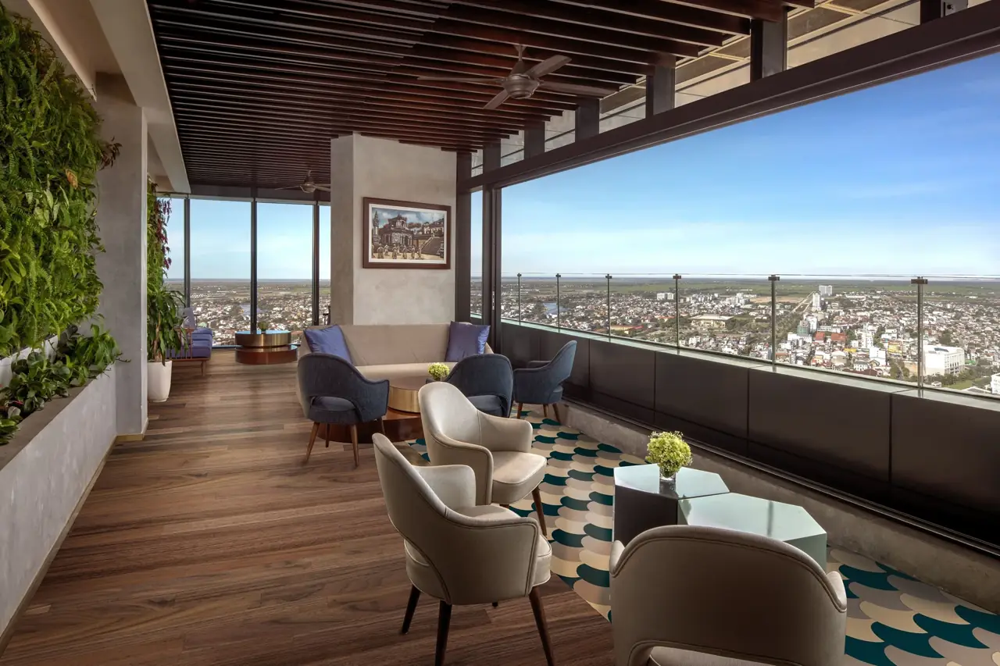
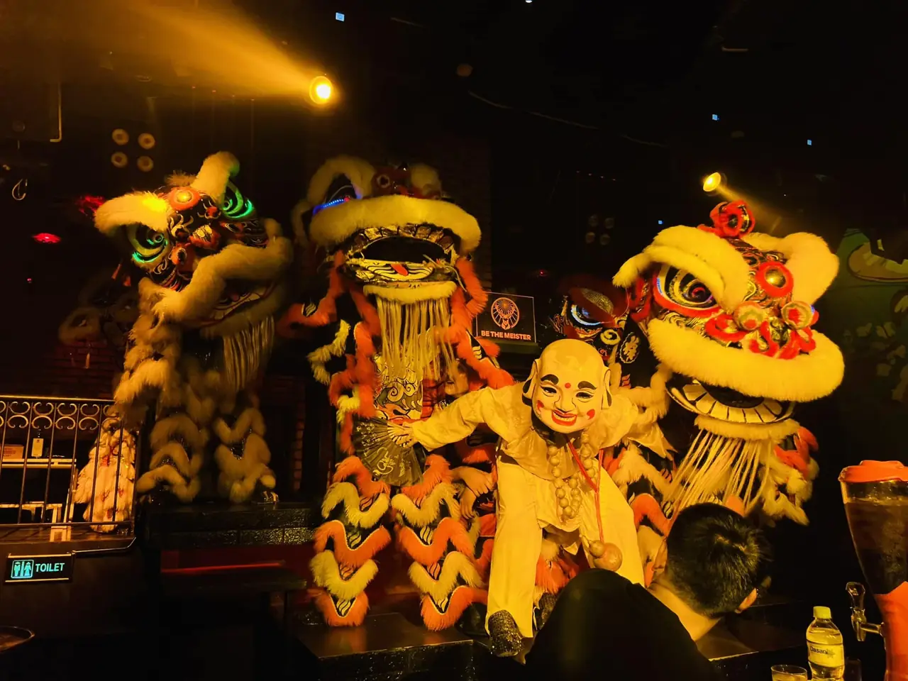

**Bar Huế** không ồn ào như Hà Nội hay Sài Gòn, nhưng khu phố Tây quanh Phạm Ngũ Lão, Chu Văn An, Võ Thị Sáu và Lê Lợi vẫn sáng đèn đến khuya. Bạn có thể lên rooftop ngắm sông Hương lúc hoàng hôn, ngồi quán bia sân vườn, rồi ghé club nghe DJ sau khi tham quan cố đô cả ngày. Bài này gom 12 quán theo từng kiểu, kèm địa chỉ và mức chi tham khảo.

## Bar Huế tập trung ở đâu?

- **Phố Tây (Phạm Ngũ Lão, Chu Văn An, Võ Thị Sáu, Lê Lợi):** khu đông vui nhất, nhiều pub, club, bar nhỏ nằm sát nhau, đi bộ được.
- **Đường Hùng Vương:** có club lớn và sky bar trong khách sạn cao tầng.
- **Các hẻm trung tâm:** quán bia thủ công và lounge nhỏ yên tĩnh.

Xem toàn bộ danh sách tại trang [bar Huế](/bar-hue/) và [bar phố Tây Huế](/bar-pho-tay-hue/).

## Rooftop ngắm sông Hương

### Zenith Bar

[Zenith Bar](/bar/zenith-bar/) là sky bar trên tầng trên cùng của khách sạn Meliá Vinpearl Hue, 50A Hùng Vương, nhìn toàn cảnh thành phố và sông Hương. Không gian ngoài trời, có cocktail và nhạc DJ vào buổi tối, là chỗ đẹp để ngắm hoàng hôn trên cố đô.

- Phù hợp: cặp đôi, nhóm nhỏ
- Mức chi tham khảo: từ 450.000đ/người

### BarLab

[BarLab](/bar/barlab/) là bar sân thượng ở 62 Chu Văn An, khu phố Tây, lên bằng cầu thang dẫn tới khu vườn trên mái nhiều cây xanh. Không gian ấm cúng, bartender pha đồ uống theo khẩu vị riêng của từng khách.

- Phù hợp: cặp đôi, nhóm nhỏ muốn yên tĩnh
- Mức chi tham khảo: từ 500.000đ/người

## Club và bar có DJ

### Đông Bar

[Đông Bar](/bar/dong-bar/) ở số 3 Phạm Ngũ Lão, trang trí phong cách retro tông đỏ gạch. Quán được giới trẻ địa phương yêu thích nhờ các set DJ trực tiếp chơi EDM, house, tech-house, thường mời DJ trong và ngoài thành phố.

- Giờ mở cửa: 21:00 – 02:00
- Mức chi tham khảo: từ 500.000đ/người

### Brown Eyes Bar

[Brown Eyes Bar](/bar/brown-eyes-bar/) là quán lâu năm ở 56 Chu Văn An, quen thuộc với dân du lịch ba lô và người nước ngoài. Có sàn nhảy, DJ chơi EDM, hip-hop, R&B và house đến khuya, đồ uống giá mềm, kèm sân vườn phía sau.

- Giờ mở cửa: 17:00 – 03:00
- Mức chi tham khảo: từ 500.000đ/người

### Asta The Club

[Asta The Club](/bar/asta-the-club/) ở 9 Hùng Vương, không gian rộng có tầng trên, thiết kế hơi hướng châu Âu, đầu tư âm thanh ánh sáng, chơi hip-hop và dance cùng DJ và nghệ sĩ biểu diễn.

- Mức chi tham khảo: từ 450.000đ/người

### Xà Bần Bar và New DTV Bar

[Xà Bần Bar](/bar/xa-ban-bar/) ở 40 Nguyễn Tri Phương, gần phố Tây, ấn tượng với màn trình diễn của DJ và vũ công. [New DTV Bar](/bar/new-dtv-bar/) ở 102 Lê Lợi, thiết kế hiện đại, phục vụ rượu nhập khẩu và đồ ăn nhẹ. Cả hai hợp nhóm bạn trẻ muốn nghe nhạc mạnh cuối tuần.

- Mức chi tham khảo: từ 450.000đ (Xà Bần) và 600.000đ (New DTV) mỗi người

## Pub, quán bia và lounge

### DMZ Bar & Restaurant

[DMZ Bar & Restaurant](/bar/dmz-bar-va-restaurant/) ở 60 Lê Lợi, trên tuyến phố về đêm của khu phố Tây, trang trí theo chủ đề quân sự. Quán có cocktail, rượu vang cùng món Việt và Âu, nhân viên phục vụ nhanh và thân thiện.

- Mức chi tham khảo: từ 400.000đ/người

### Century Pub & Beer Garden

[Century Pub & Beer Garden](/bar/century-pub-va-beer-garden/) là quán bia sân vườn rộng ở 49 Lê Lợi, một trong những quán bia lớn của thành phố. Không gian ngoài trời thoáng, có DJ, đồ ăn và đồ uống giá phải chăng, hợp nhóm đông và cả gia đình.

- Mức chi tham khảo: từ 300.000đ/người

### Tà Vẹt Coffee & Pub

[Tà Vẹt Coffee & Pub](/bar/ta-vet-coffee-va-pub/) ở 11 Võ Thị Sáu, ngay phố Tây, kết hợp cà phê và pub với không gian rộng, nội thất gỗ mộc. Có nhiều lựa chọn bia, món Việt giá phải chăng, nhạc sôi động, đông khách khi phố lên đèn.

- Mức chi tham khảo: từ 300.000đ/người

### Imperial Craft Bia Brewpub

[Imperial Craft Bia Brewpub](/bar/imperial-craft-bia-brewpub/) trong hẻm 21 Ngô Gia Tự có 14 vòi bia, phần lớn nấu tại chỗ gồm IPA, pale ale, stout và lager, nhân viên am hiểu và sẵn lòng tư vấn. Xem thêm bài [bia thủ công](/blog/bia-thu-cong-craft-beer/).

- Giờ mở cửa: 14:00 – 23:00
- Mức chi tham khảo: từ 300.000đ/người

### Secret Lounge Hue

[Secret Lounge Hue](/bar/secret-lounge-hue/) nằm trong hẻm 42 Nguyễn Công Trứ, có sân vườn ngoài trời thư thái. Quán được giới thiệu với whisky, bia thủ công và thực đơn cocktail. Chỗ ngồi có hạn nên nên đặt trước.

- Mức chi tham khảo: từ 300.000đ/người

## So sánh nhanh bar Huế

| Bar | Loại hình | Địa chỉ | Mức chi tham khảo |
|---|---|---|---|
| Zenith Bar | Sky bar | 50A Hùng Vương | Từ 450k/người |
| BarLab | Rooftop vườn | 62 Chu Văn An | Từ 500k/người |
| Đông Bar | Club, DJ | 3 Phạm Ngũ Lão | Từ 500k/người |
| Brown Eyes Bar | Club | 56 Chu Văn An | Từ 500k/người |
| Asta The Club | Club | 9 Hùng Vương | Từ 450k/người |
| DMZ Bar | Pub | 60 Lê Lợi | Từ 400k/người |
| Century Pub | Quán bia sân vườn | 49 Lê Lợi | Từ 300k/người |
| Tà Vẹt | Pub, cà phê | 11 Võ Thị Sáu | Từ 300k/người |
| Imperial Craft Bia | Bia thủ công | 21/4 Ngô Gia Tự | Từ 300k/người |

Mức chi là giá tham khảo, thay đổi theo đồ uống bạn chọn. Giờ mở cửa có thể thay đổi, gọi tổng đài để xác nhận trước khi đi.

:::cta
Đặt bàn bar Huế tối nay
Gọi 0838 000 222 hoặc để lại số điện thoại, tổng đài TopChill giữ bàn giúp bạn, không cần cọc.
:::

## Kinh nghiệm đi bar ở Huế

1. **Lên rooftop lúc chiều tà** để ngắm hoàng hôn trên sông Hương, rồi xuống phố Tây ăn tối và đi tiếp.
2. **Phố Tây đi bộ được,** các quán trên Phạm Ngũ Lão, Chu Văn An, Võ Thị Sáu, Lê Lợi cách nhau vài phút.
3. **Club đông nhất từ 22h** và cuối tuần, nên đặt bàn trước nếu đi nhóm.
4. **Mùa mưa Huế kéo dài** (khoảng tháng 9 đến tháng 12), mang áo mưa và hỏi quán có khu có mái che không.
5. **Mang CCCD,** club có thể kiểm tra giấy tờ ở cửa.
6. **Uống có trách nhiệm,** không lái xe sau khi uống rượu bia. Gọi taxi hoặc xe công nghệ về khách sạn.

Đi tiếp Đà Nẵng? Xem thêm [bar Đà Nẵng](/bar-da-nang/). Muốn biết gọi gì, đọc [đi bar nên uống gì](/blog/di-bar-nen-uong-gi/).

## Câu hỏi thường gặp

### Bar Huế tập trung ở đâu?

Phần lớn ở khu phố Tây quanh Phạm Ngũ Lão, Chu Văn An, Võ Thị Sáu và Lê Lợi. Đường Hùng Vương có thêm club lớn và sky bar trong khách sạn.

### Rooftop nào ở Huế ngắm sông Hương đẹp?

Zenith Bar trên tầng trên cùng khách sạn Meliá Vinpearl Hue (50A Hùng Vương) nhìn toàn cảnh thành phố và sông Hương. BarLab ở phố Tây là rooftop vườn nhỏ, yên tĩnh hơn.

### Đi bar ở Huế hết bao nhiêu tiền?

Mức chi tham khảo khoảng 300.000đ–500.000đ mỗi người trở lên cho 2–3 đồ uống. Quán bia, pub phố Tây thường mềm hơn club và sky bar.

### Huế có club nghe nhạc EDM không?

Có. Đông Bar (3 Phạm Ngũ Lão) có DJ chơi EDM, house, tech-house; Brown Eyes Bar (56 Chu Văn An) có sàn nhảy và DJ đến khuya; Asta The Club (9 Hùng Vương) chơi hip-hop và dance.

### Đặt bàn bar Huế qua TopChill có cần cọc không?

Không. Bạn gọi 0838 000 222, nhắn Zalo hoặc để lại số trên web, tổng đài sẽ gọi lại xác nhận bàn.
