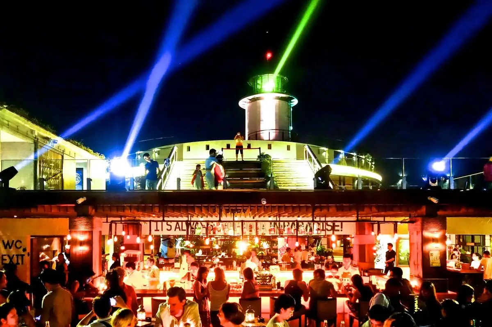
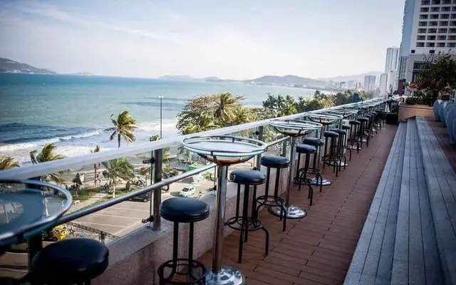
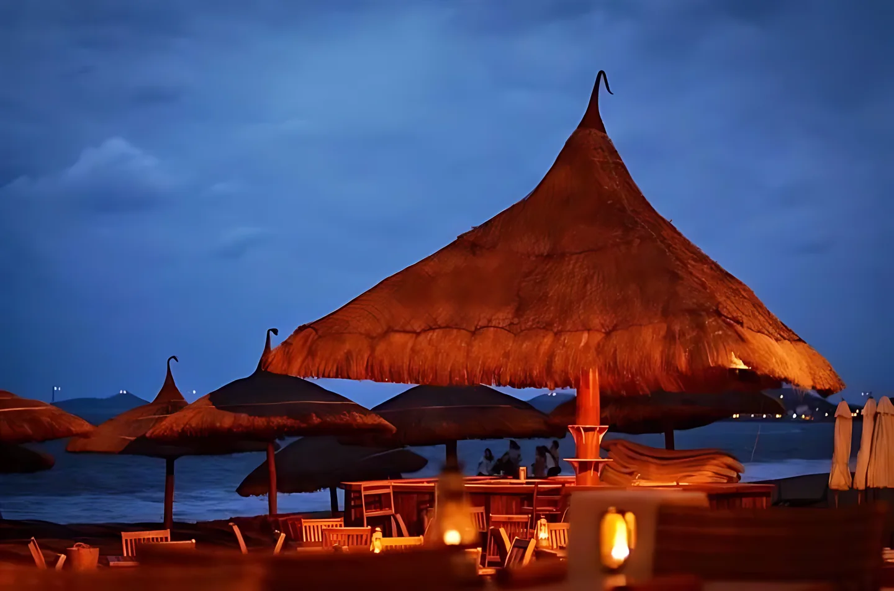

**Bar Nha Trang** gắn với biển: phần lớn quán nằm dọc đường Trần Phú nhìn ra vịnh, cộng với khu phố Tây quanh Nguyễn Thiện Thuật và Trần Quang Khải. Bạn có thể ngắm hoàng hôn trên rooftop, ngồi beach club sát bãi biển hoặc đi tiếp sang club đến khuya. Bài này gom 12 quán theo từng kiểu, kèm địa chỉ và mức chi tham khảo để bạn chọn nhanh.

## Bar Nha Trang tập trung ở đâu?

- **Đường Trần Phú (ven biển):** rooftop khách sạn, beach club và club lớn nằm gần nhau, đi bộ được giữa các quán.
- **Phố Tây Nguyễn Thiện Thuật, Trần Quang Khải:** pub, bar sôi động, nhiều quán mở rất khuya.
- **Các hẻm khu Lộc Thọ:** nơi có những quán cocktail kín đáo, ít khách du lịch hơn.

Xem toàn bộ danh sách tại trang [bar Nha Trang](/bar-nha-trang/).

## Rooftop ngắm vịnh Nha Trang

### Skylight Nha Trang

[Skylight Nha Trang](/bar/skylight-nha-trang/) là tổ hợp giải trí trên nóc khách sạn Premier Havana, số 38 Trần Phú, gồm Skydeck 360°, Skywalk và Rooftop Beach Club. Ban ngày là điểm tham quan, khi đêm xuống chuyển thành sân thượng sôi động với DJ và nhạc EDM. Khu sàn nhảy không nhận khách dưới 18 tuổi sau 21h.

- Giờ mở cửa: 17:30 – 01:00
- Phù hợp: nhóm bạn, khách du lịch muốn ngắm toàn cảnh thành phố
- Mức chi tham khảo: từ 350.000đ/người

### Altitude Rooftop Bar

[Altitude Rooftop Bar](/bar/altitude-rooftop-bar/) ở tầng 28 khách sạn Sheraton, số 26–28 Trần Phú, nhìn ra vịnh và ánh đèn thành phố. Quán có không gian trong nhà cùng sân hiên mở. Không khí yên tĩnh, lịch sự, hợp buổi hẹn hò hoặc gặp gỡ nhẹ nhàng bên ly cocktail.

- Giờ mở cửa: 17:00 – 00:00
- Mức chi tham khảo: từ 350.000đ/người

### Lunar Rooftop Bar & Grill

[Lunar Rooftop Bar & Grill](/bar/lunar-rooftop-bar-va-grill/) nằm trên tầng 4 trung tâm thương mại Nha Trang Center, số 20 Trần Phú. Quán có tông màu tím và trắng, nhiều khu vực như lounge rượu vang, sân khấu biểu diễn, bếp mở và khu ngoài trời nhìn ra biển bên hồ bơi. Không gian rộng, hợp nhóm bạn hoặc buổi tụ tập đông người.

- Mức chi tham khảo: từ 350.000đ/người

### Riviera Rooftop Bar & Restaurant

[Riviera Rooftop Bar & Restaurant](/bar/riviera-rooftop-bar-va-restaurant/) là rooftop nhỏ kết hợp nhà hàng, ở số 54K Nguyễn Thiện Thuật. Thiết kế ấm cúng, mở nhạc hiện đại, hợp tối tụ tập bạn bè hoặc hẹn hò nhẹ nhàng giữa phố biển.

- Mức chi tham khảo: từ 350.000đ/người

## Beach club sát biển Trần Phú

### Sailing Club Nha Trang

[Sailing Club Nha Trang](/bar/sailing-club-nha-trang/) là beach club rộng hơn 2.400 m² ngay trên bãi biển Trần Phú, số 72–74, gắn bó với đời sống về đêm Nha Trang từ năm 1994. Ban ngày bạn thư giãn trên ghế tắm nắng ven biển, thực đơn kết hợp món Âu, Ấn và Việt. Cuối tuần có đêm nhạc DJ và biểu diễn, ngoài ra còn có đêm salsa và bachata.

- Giờ mở cửa: 07:00 – 02:00
- Phù hợp: cả du khách lẫn nhóm bạn
- Mức chi tham khảo: từ 450.000đ/người

## Club quẩy đêm

### HK Club Nha Trang

[HK Club Nha Trang](/bar/hk-club-nha-trang/) (trước đây là Havana Club) ở số 38 Trần Phú, nằm dưới tầng hầm đối diện và kết nối với khách sạn Havana. Club hoạt động từ năm 2014, nổi bật với DJ và không khí sôi động đến khuya.

- Giờ mở cửa: 20:00 – 02:00
- Mức chi tham khảo: từ 450.000đ/người

### Paradise Club

[Paradise Club](/bar/paradise-club/) là club ven biển trong khu Công viên Bốn Mùa trên đường Trần Phú, thuộc nhóm club hoạt động lâu năm của thành phố. Quán được biết đến với nhạc EDM và các đêm hip-hop, thu hút nhiều khách quốc tế.

- Giờ mở cửa: 18:00 – 02:30
- Mức chi tham khảo: từ 500.000đ/người

### Why Not Bar

[Why Not Bar](/bar/why-not-bar/) ở số 24 Trần Quang Khải, trong khu phố Tây và chỉ cách biển Trần Phú một quãng đi bộ ngắn. Quán đông khách trẻ với không khí tiệc tùng và là một trong số ít nơi ở Nha Trang mở rất khuya, thường đông hơn sau khi các quán ven biển đóng cửa.

- Mức chi tham khảo: từ 400.000đ/người

## Pub và quán bia

### Louisiane Brewhouse

[Louisiane Brewhouse](/bar/louisiane-brewhouse/) là nhà hàng kiêm xưởng bia thủ công sát biển trên đường Trần Phú, với bia nấu ngay tại chỗ. Thực đơn kết hợp món Việt, Âu và Nhật, khách còn có thể dùng hồ bơi và ghế tắm nắng của quán. Tối thứ Sáu và thứ Bảy có nhạc sống.

- Mức chi tham khảo: từ 350.000đ/người

### Booze Cruise Sports Bar & Grill

[Booze Cruise Sports Bar & Grill](/bar/booze-cruise-sports-bar-va-grill/) là pub thể thao kiêm quán nướng ở số 110 Nguyễn Thiện Thuật, cách biển Trần Phú khoảng 10 phút đi bộ. Quán chiếu các sự kiện thể thao quốc tế, phục vụ burger, pizza, sandwich kiểu Mỹ cùng nhiều loại bia, mở đến 03:00. Giữa tuần có nhạc sống.

- Giờ mở cửa: 18:00 – 03:00
- Mức chi tham khảo: từ 350.000đ/người

## Cocktail bar kín đáo

### Hybrid Nha Trang

[Hybrid Nha Trang](/bar/hybrid-nha-trang/) là speakeasy cocktail đương đại nằm khuất trong một con hẻm ở khu Lộc Thọ. Không gian ấm cúng, sức chứa khoảng 40 khách, hợp người mê cocktail muốn tìm quán kín đáo, tinh tế.

- Mức chi tham khảo: từ 300.000đ/người

### Wolpertinger Cocktail Vault

[Wolpertinger Cocktail Vault](/bar/wolpertinger-cocktail-vault/) là quán cocktail kiểu ẩn mình, ra mắt năm 2023. Không gian ấm cúng mang chút bí ẩn, có máy lạnh và board game, cocktail dùng siro tự làm. Hợp khách muốn tìm lựa chọn khác ngoài các quán đông khách du lịch.

- Mức chi tham khảo: từ 350.000đ/người

## So sánh nhanh bar Nha Trang

| Bar | Loại hình | Khu vực | Mức chi tham khảo |
|---|---|---|---|
| Skylight Nha Trang | Rooftop | Trần Phú | Từ 350k/người |
| Altitude Rooftop Bar | Rooftop | Trần Phú | Từ 350k/người |
| Lunar Rooftop Bar & Grill | Rooftop | Trần Phú | Từ 350k/người |
| Sailing Club | Beach club | Trần Phú | Từ 450k/người |
| HK Club | Club | Trần Phú | Từ 450k/người |
| Paradise Club | Club | Trần Phú | Từ 500k/người |
| Why Not Bar | Club | Trần Quang Khải | Từ 400k/người |
| Louisiane Brewhouse | Pub, bia thủ công | Trần Phú | Từ 350k/người |
| Booze Cruise | Pub thể thao | Nguyễn Thiện Thuật | Từ 350k/người |
| Hybrid Nha Trang | Cocktail bar | Lộc Thọ | Từ 300k/người |

Mức chi là giá tham khảo, thay đổi theo đồ uống bạn chọn. Giờ mở cửa có thể đổi theo mùa và sự kiện, gọi tổng đài để xác nhận trước khi đi.

:::cta
Đặt bàn bar Nha Trang tối nay
Gọi 0838 000 222 hoặc để lại số điện thoại, tổng đài TopChill giữ bàn giúp bạn, không cần cọc.
:::

## Kinh nghiệm đi bar ở Nha Trang

1. **Lên rooftop trước hoàng hôn** khoảng 30–45 phút để có chỗ đẹp và chụp ảnh.
2. **Mùa du lịch hè và dịp lễ rất đông,** nhất là beach club và club ven biển. Hãy đặt bàn trước.
3. **Đường Trần Phú đi bộ được,** có thể ghé 2–3 quán trong một tối, rooftop trước rồi club sau.
4. **Kiểm tra thời tiết.** Mùa mưa bão có thể làm đóng khu ngoài trời ở rooftop và beach club.
5. **Mang CCCD,** một số club kiểm tra giấy tờ ở cửa và không nhận khách dưới 18 tuổi.
6. **Uống có trách nhiệm,** không lái xe sau khi uống rượu bia. Gọi taxi hoặc xe công nghệ về khách sạn.

Đi các thành phố biển khác? Xem thêm [bar Đà Nẵng](/bar-da-nang/), [bar Phú Quốc](/bar-phu-quoc/) và [bar Vũng Tàu](/bar-vung-tau/).

## Câu hỏi thường gặp

### Bar Nha Trang ở đâu?

Phần lớn bar Nha Trang nằm dọc đường Trần Phú ven biển và khu phố Tây quanh Nguyễn Thiện Thuật, Trần Quang Khải. Các quán cocktail kín đáo nằm trong hẻm khu Lộc Thọ.

### Rooftop nào ngắm vịnh Nha Trang đẹp?

Skylight Nha Trang (trên nóc khách sạn Premier Havana), Altitude Rooftop Bar (tầng 28 Sheraton) và Lunar Rooftop Bar & Grill (tầng 4 Nha Trang Center) đều nhìn ra biển và thành phố.

### Đi bar ở Nha Trang hết bao nhiêu tiền?

Mức chi tham khảo khoảng 300.000đ–500.000đ mỗi người trở lên cho 2–3 đồ uống, tuỳ quán. Rooftop và beach club thường cao hơn pub.

### Quán nào ở Nha Trang mở khuya nhất?

Booze Cruise Sports Bar & Grill mở đến 03:00, Paradise Club đến 02:30, HK Club và Sailing Club đến 02:00. Why Not Bar cũng nổi tiếng mở rất khuya, bạn nên gọi tổng đài xác nhận giờ trước khi đi.

### Đặt bàn bar Nha Trang qua TopChill có cần cọc không?

Không. Bạn gọi 0838 000 222, nhắn Zalo hoặc để lại số trên web, tổng đài sẽ gọi lại xác nhận bàn.
