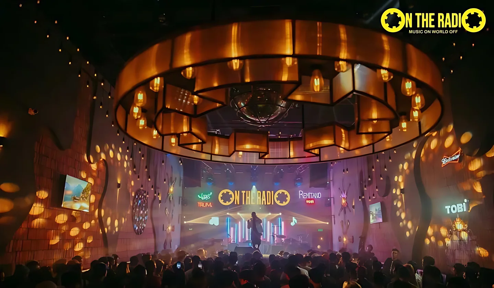
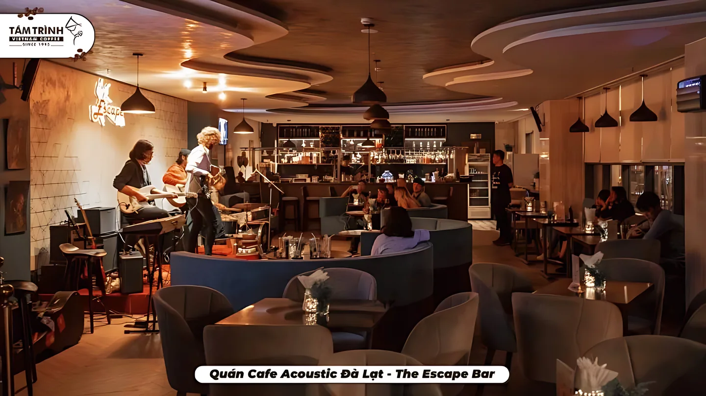

**Bar nhạc sống** là nơi bạn vừa uống vừa nghe ban nhạc chơi ngay trước mặt: rock, ballad, nhạc xưa, acoustic hay country, khác hẳn không khí DJ ở club. Bài này gom 12 quán có nhạc sống theo thông tin quán công bố, từ rooftop khách sạn ở Sài Gòn đến pub phố Tây Nha Trang, Phú Quốc, Vũng Tàu, kèm địa chỉ và mức chi tham khảo. Muốn nghe jazz thì xem riêng bài [jazz bar](/blog/jazz-bar/).

## Sài Gòn

### Saigon Saigon Rooftop Bar

[Saigon Saigon](/bar/saigon-saigon-rooftop-bar/) trên sân thượng khách sạn Caravelle, 19-23 Công trường Lam Sơn, hoạt động từ năm 1959, có **ban nhạc thường trú** biểu diễn nhạc sống.

- Mức chi tham khảo: từ 450.000đ/người

### Rooftop Garden Bar – Rex Hotel

[Rooftop Garden Bar](/bar/rooftop-garden-bar-rex-hotel/) trên tầng 5 khách sạn Rex, đầu phố đi bộ Nguyễn Huệ, **nhạc sống hằng đêm**, thường là nhạc xưa, đôi khi jazz hoặc acoustic.

- Mức chi tham khảo: từ 350.000đ/người

## Đà Nẵng

### On The Radio Bar

[On The Radio Bar](/bar/on-the-radio-bar/) ở 76 Thái Phiên, Hải Châu, chủ đề radio cổ, đèn vàng ấm, **ban nhạc chơi rock, ballad, nhạc Anh và nhạc Việt**, có đêm open mic.

- Giờ mở cửa: 19:00 – 02:00
- Mức chi tham khảo: từ 350.000đ/người

### Esco Beach Bar

[Esco Beach](/bar/esco-beach-bar-lounge-va-restaurant/) ở Lô 12 Võ Nguyên Giáp, sát bãi biển Mỹ Khê, buổi tối có **nhạc sống của nghệ sĩ địa phương** và múa lửa.

- Mức chi tham khảo: từ 350.000đ/người

## Đà Lạt

### Heyla Cocktail Bar

[Heyla](/bar/heyla-cocktail-bar/) ở 10 Tản Đà, **ban nhạc acoustic biểu diễn hằng đêm**, tầng trên có trò chơi cổ điển.

- Giờ mở cửa: 17:00 – 00:00
- Mức chi tham khảo: từ 300.000đ/người

### The Escape Bar & Café

[The Escape](/bar/the-escape-bar-va-cafe/) ở tầng 1 khách sạn Golf Valley, 94 Bùi Thị Xuân, phong cách thập niên 1970, buổi tối có ban nhạc chơi **country, blues, rock 'n' roll và reggae**, có bàn bi-a.

- Giờ mở cửa: 14:00 – 23:45
- Mức chi tham khảo: từ 300.000đ/người

## Nha Trang và Phú Quốc

### Booze Cruise Sports Bar & Grill (Nha Trang)

[Booze Cruise](/bar/booze-cruise-sports-bar-va-grill/) ở 110 Nguyễn Thiện Thuật, phố Tây, chiếu thể thao quốc tế, món Mỹ, **giữa tuần có nhạc sống**, mở đến khuya.

- Giờ mở cửa: 18:00 – 03:00
- Mức chi tham khảo: từ 350.000đ/người

### The Cheeky Traveller (Phú Quốc)

[The Cheeky Traveller](/bar/the-cheeky-traveller-english-pub-va-bar/) trong hẻm 118 Trần Hưng Đạo, Dương Đông, pub kiểu Anh, **điểm nhấn mỗi tối là nhạc sống**. Quán không mở tất cả các ngày, nên hỏi trước.

- Mức chi tham khảo: từ 300.000đ/người

### Luna Bar (Phú Quốc)

[Luna Bar](/bar/luna-bar/) ở 100 Trần Hưng Đạo, sân vườn, bàn bi-a và **nhạc sống**, mở từ tối đến gần sáng.

- Giờ mở cửa: 20:00 – 03:00
- Mức chi tham khảo: từ 400.000đ/người

## Vũng Tàu và Hạ Long

### Black Pearl Bar (Vũng Tàu)

[Black Pearl Bar](/bar/black-pearl-bar/) ở 64 Hạ Long, Bãi Trước, ca sĩ, **ban nhạc rock** và DJ thay phiên biểu diễn.

- Giờ mở cửa: 19:30 – 01:00
- Mức chi tham khảo: từ 600.000đ/người

### Fang Pub (Vũng Tàu)

[Fang Pub](/bar/fang-pub/) ở 3 Lý Tự Trọng, **ban nhạc biểu diễn**, hay được chọn tổ chức sinh nhật.

- Mức chi tham khảo: từ 300.000đ/người

### Funky Bar Halong (Hạ Long)

[Funky Bar Halong](/bar/funky-bar-halong/) ở 78 Hạ Long, Bãi Cháy, gần các khách sạn ven biển, **có nhạc sống**, đi bộ ra từ khách sạn được.

- Mức chi tham khảo: từ 350.000đ/người

## So sánh nhanh

| Quán | Thành phố | Thể loại nhạc sống | Mức chi tham khảo |
|---|---|---|---|
| Saigon Saigon | Sài Gòn | Ban nhạc thường trú | Từ 450k/người |
| Rex Garden Bar | Sài Gòn | Nhạc xưa, acoustic | Từ 350k/người |
| On The Radio Bar | Đà Nẵng | Rock, ballad, open mic | Từ 350k/người |
| Heyla | Đà Lạt | Acoustic hằng đêm | Từ 300k/người |
| The Escape | Đà Lạt | Country, blues, rock | Từ 300k/người |
| Booze Cruise | Nha Trang | Nhạc sống giữa tuần | Từ 350k/người |
| The Cheeky Traveller | Phú Quốc | Nhạc sống mỗi tối | Từ 300k/người |
| Black Pearl Bar | Vũng Tàu | Rock, ca sĩ, DJ | Từ 600k/người |

Lịch nhạc theo thông tin quán công bố, có thể thay đổi. Gọi tổng đài để xác nhận tối nay có ban nhạc trước khi đi.

:::cta
Giữ bàn gần sân khấu tối nay
Gọi 0838 000 222, tổng đài TopChill hỏi lịch ban nhạc và giữ bàn gần sân khấu giúp bạn, không cần cọc.
:::

## Kinh nghiệm đi bar nhạc sống

1. **Hỏi giờ ban nhạc lên sân khấu,** thường từ 20h–21h.
2. **Đến sớm 20–30 phút** để có bàn gần sân khấu.
3. **Muốn yêu cầu bài hát?** Hỏi nhân viên, nhiều quán nhận yêu cầu.
4. **Vỗ tay ủng hộ ban nhạc,** một số quán có hộp tip cho nghệ sĩ.
5. **Uống có trách nhiệm,** không lái xe sau khi uống rượu bia.

## Câu hỏi thường gặp

### Bar nhạc sống khác bar DJ thế nào?

Bar nhạc sống có ban nhạc hoặc ca sĩ biểu diễn trực tiếp (rock, acoustic, ballad, nhạc xưa), dễ trò chuyện hơn. Bar DJ và club chơi nhạc điện tử, nhạc mạnh để nhảy.

### Sài Gòn có bar nhạc sống nào trên rooftop?

Saigon Saigon Rooftop Bar (khách sạn Caravelle) có ban nhạc thường trú. Rooftop Garden Bar khách sạn Rex có nhạc sống hằng đêm.

### Đi bar nhạc sống hết bao nhiêu tiền?

Mức chi tham khảo khoảng 300.000đ–600.000đ mỗi người cho 2–3 đồ uống. Một số quán có phụ thu nhạc sống, nên hỏi trước.

### Đặt bàn bar nhạc sống qua TopChill có cần cọc không?

Không. Gọi 0838 000 222, nhắn Zalo hoặc để lại số trên web, tổng đài sẽ gọi lại xác nhận bàn.
