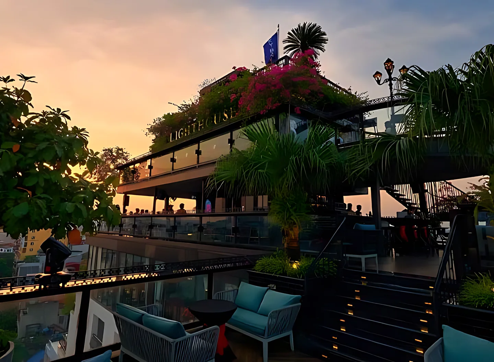
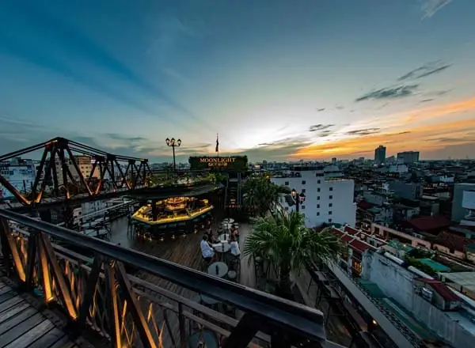
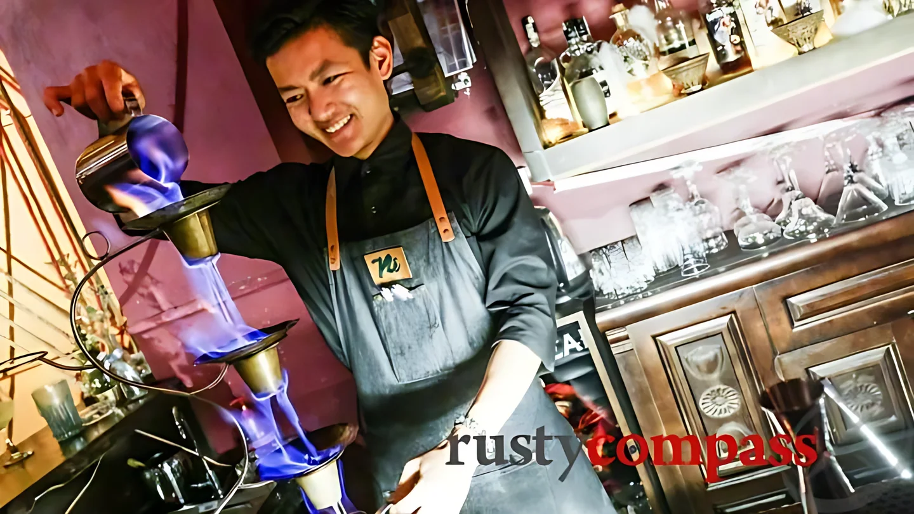
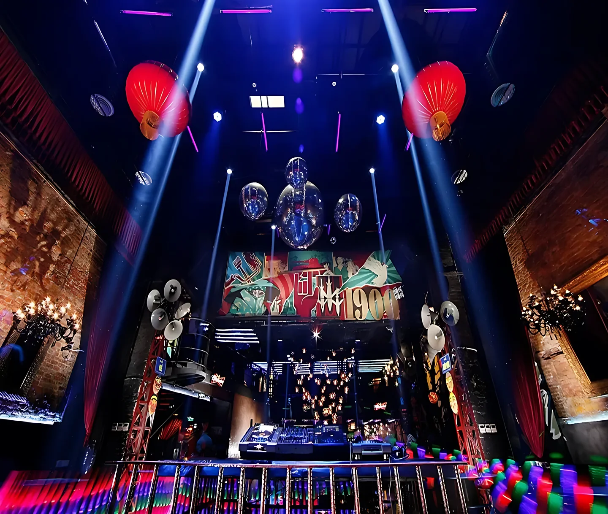

**Bar phố cổ Hà Nội** gói gọn trong vài con phố quanh hồ Hoàn Kiếm, đi bộ là tới. Bạn có thể lên sky bar ở Hàng Bè, Mã Mây, Hàng Da ngắm mái nhà phố cổ lúc chiều tối, rẽ sang Tống Duy Tân, Phùng Hưng uống cocktail, nghe jazz ở Tràng Tiền rồi kết thúc ở club Tạ Hiện. Bài này gom 12 quán theo lộ trình một tối, kèm địa chỉ, giờ mở cửa và mức chi tham khảo.

## Bar phố cổ tập trung ở đâu?

- **Hàng Bè, Mã Mây, Hàng Da:** sky bar trên nóc khách sạn, nhìn ra phố cổ và hồ Hoàn Kiếm.
- **Tống Duy Tân, Phùng Hưng, Hàng Mã:** cocktail bar và speakeasy nhỏ.
- **Tràng Tiền, Ngô Quyền:** jazz club và bar khách sạn cổ điển.
- **Tạ Hiện, Tràng Tiền:** club quẩy khuya.

Xem toàn bộ danh sách tại trang [bar Hoàn Kiếm](/bar-hoan-kiem/) và [bar Hà Nội](/bar-ha-noi/).

## Chặng 1: sky bar ngắm phố cổ lúc chiều tối

### Lighthouse Sky Bar

[Lighthouse Sky Bar](/bar/lighthouse-sky-bar/) trên tầng 10–11 khách sạn La Siesta Premium Hàng Bè, 27 Hàng Bè. Quán thiết kế như một con thuyền neo trên mái, có **ngọn hải đăng đỏ trắng cao khoảng 6 m** nhấp nháy về đêm, nhìn ra hồ Hoàn Kiếm, mái nhà phố cổ và sông Hồng.

- Giờ mở cửa: 17:00 – 00:00
- Mức chi tham khảo: từ 500.000đ/người

### Moonlight Sky Bar

[Moonlight Sky Bar](/bar/moonlight-sky-bar/) trên tầng cao khách sạn La Siesta Classic Mã Mây, 94 Mã Mây. Điểm đặc trưng là **mô hình cầu Long Biên thu nhỏ** bắc ngang phía trên quầy bar, cùng tầm nhìn toàn cảnh phố cổ và hồ Hoàn Kiếm.

- Mức chi tham khảo: từ 400.000đ/người

### Cloud Sky Bar

[Cloud Sky Bar](/bar/cloud-sky-bar/) trên tầng 9 khách sạn JM Marvel, 16 Hàng Da, nhìn thẳng xuống phố Hàng Da, đẹp nhất lúc hoàng hôn. Không khí thoải mái, hợp du khách lưu trú quanh phố cổ.

- Mức chi tham khảo: từ 400.000đ/người

Xem thêm [rooftop bar Hà Nội](/blog/rooftop-bar-ha-noi/).

## Chặng 2: cocktail bar và speakeasy

### Nê Cocktail Bar và The Black Sheep (Tống Duy Tân)

[Nê Cocktail Bar](/bar/ne-cocktail-bar/) ở 3B Tống Duy Tân nổi tiếng với **cocktail Phở** và các ly dùng nguyên liệu Việt. Cách vài bước, [The Black Sheep](/bar/the-black-sheep/) ở 28 Tống Duy Tân theo concept nhà hát cocktail tông đen rèm đỏ, có DJ sau 22 giờ.

- Mức chi tham khảo: từ 300.000đ/người (Nê), 350.000đ/người (The Black Sheep)

### Gallery Bespoke và Bee'Znees (Phùng Hưng)

[Gallery Bespoke](/bar/gallery-bespoke-cocktail-bar/) ở 95 Phùng Hưng, phía sau một phòng tranh nhỏ, pha cocktail theo yêu cầu. [Bee'Znees](/bar/bee-znees/) ở 163 Phùng Hưng có lối vào ngụy trang như kệ sách, nhạc jazz, nhạc sống tối thứ Tư.

- Mức chi tham khảo: từ 300.000đ/người

### The Haflington và Polite & Co

[The Haflington](/bar/the-haflington/) ở 94 Hàng Mã có **bộ xương khủng long** treo trên quầy bar, mở 15:00 – 01:00. [Polite & Co](/bar/polite-va-co/) ở 5B Bảo Khánh, vài bước từ hồ Hoàn Kiếm, hoạt động từ năm 1995 với khoảng 25 loại cocktail kinh điển.

- Mức chi tham khảo: từ 300.000đ (Haflington), 400.000đ (Polite & Co) mỗi người

Xem thêm [cocktail bar Hà Nội](/blog/cocktail-bar-ha-noi/) và [speakeasy Việt Nam](/blog/speakeasy-viet-nam/).

## Chặng 3: jazz và club quẩy khuya

### Binh Minh Jazz Club

[Binh Minh Jazz Club](/bar/binh-minh-jazz-club/) ở 1 Tràng Tiền, phía sau Nhà hát Lớn, do nghệ sĩ saxophone Quyền Văn Minh sáng lập, có **jazz sống mỗi tối từ khoảng 21:00**.

- Mức chi tham khảo: từ 300.000đ/người

### 1900 Le Théâtre

[1900 Le Théâtre](/bar/1900-le-theatre/) ở 8B Tạ Hiện, trong tòa nhà nhà hát Quảng Lạc cũ, sức chứa khoảng 1.500 khách, từng vào top 100 club DJ Mag 2024. Thường có DJ quốc tế, live band và tiệc chủ đề.

- Mức chi tham khảo: từ 600.000đ/người

### Cosmos Club

[Cosmos Club](/bar/cosmos-club/) ở 21 Tràng Tiền, mái vòm LED và màn hình cong 360 độ quanh sân khấu, nhạc house, tech house, EDM.

- Giờ mở cửa: 21:00 – 04:00
- Mức chi tham khảo: từ 500.000đ/người

Xem thêm [club Hà Nội](/blog/club-ha-noi/) và [jazz bar](/blog/jazz-bar/).

## So sánh nhanh bar phố cổ Hà Nội

| Bar | Loại hình | Địa chỉ | Mức chi tham khảo |
|---|---|---|---|
| Lighthouse Sky Bar | Sky bar | 27 Hàng Bè | Từ 500k/người |
| Moonlight Sky Bar | Sky bar | 94 Mã Mây | Từ 400k/người |
| Cloud Sky Bar | Sky bar | 16 Hàng Da | Từ 400k/người |
| Nê Cocktail Bar | Cocktail vị Việt | 3B Tống Duy Tân | Từ 300k/người |
| The Black Sheep | Cocktail, DJ | 28 Tống Duy Tân | Từ 350k/người |
| Bee'Znees | Speakeasy, jazz | 163 Phùng Hưng | Từ 300k/người |
| The Haflington | Cocktail | 94 Hàng Mã | Từ 300k/người |
| Binh Minh Jazz Club | Jazz sống | 1 Tràng Tiền | Từ 300k/người |
| 1900 Le Théâtre | Club | 8B Tạ Hiện | Từ 600k/người |
| Cosmos Club | Club | 21 Tràng Tiền | Từ 500k/người |

Mức chi là giá tham khảo, thay đổi theo đồ uống bạn chọn. Giờ mở cửa có thể thay đổi, gọi tổng đài để xác nhận trước khi đi.

:::cta
Đặt bàn bar phố cổ tối nay
Gọi 0838 000 222 hoặc để lại số điện thoại, tổng đài TopChill giữ bàn và báo ưu đãi giúp bạn, không cần cọc. Đi ít người? Thử ghép bàn tại topchill.vn/ghep-ban.
:::

## Kinh nghiệm đi bar phố cổ

1. **Lên sky bar trước hoàng hôn** khoảng 30–45 phút để có chỗ đẹp nhìn ra hồ.
2. **Đi bộ giữa các quán:** từ Hàng Bè sang Tống Duy Tân hay Tràng Tiền chỉ 10–15 phút.
3. **Cuối tuần phố đi bộ quanh hồ đông,** xe khó vào, nên đi bộ hoặc gửi xe sớm.
4. **Club Tạ Hiện, Tràng Tiền đông nhất từ 23h,** đặt bàn trước nếu đi nhóm.
5. **Mang CCCD,** club kiểm tra tuổi ở cửa.
6. **Uống có trách nhiệm,** không lái xe sau khi uống rượu bia.

Hát karaoke sau khi đi bar? Xem [karaoke Hà Nội](/karaoke-ha-noi/).

## Câu hỏi thường gặp

### Bar phố cổ Hà Nội tập trung ở đâu?

Quanh hồ Hoàn Kiếm: sky bar ở Hàng Bè, Mã Mây, Hàng Da; cocktail bar ở Tống Duy Tân, Phùng Hưng, Hàng Mã; jazz và club ở Tràng Tiền, Tạ Hiện.

### Sky bar nào ở phố cổ nhìn ra hồ Hoàn Kiếm?

Lighthouse Sky Bar (27 Hàng Bè) và Moonlight Sky Bar (94 Mã Mây) đều nhìn ra phố cổ và hồ Hoàn Kiếm từ trên cao.

### Đi bar phố cổ hết bao nhiêu tiền?

Mức chi tham khảo khoảng 300.000đ–600.000đ mỗi người trở lên cho 2–3 đồ uống. Club và sky bar thường cao hơn cocktail bar nhỏ.

### Đặt bàn bar phố cổ qua TopChill có cần cọc không?

Không. Gọi 0838 000 222, nhắn Zalo hoặc để lại số trên web, tổng đài sẽ gọi lại xác nhận bàn.
