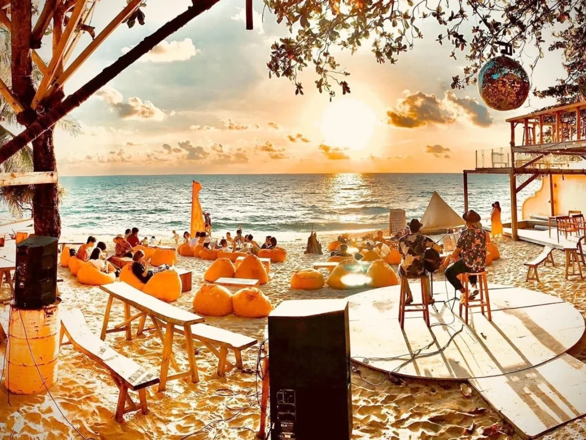
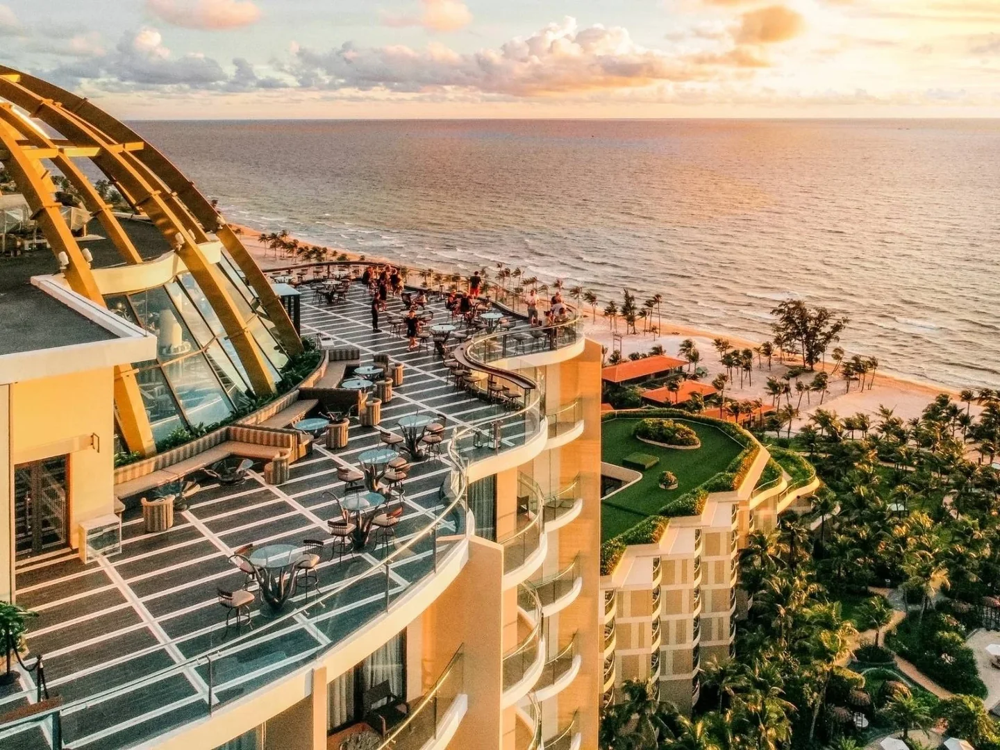

**Bar Phú Quốc** gắn với hai thứ: biển và hoàng hôn. Phần lớn quán nằm dọc đường Trần Hưng Đạo ở Dương Đông và Bãi Trường, một nhóm khác ở khu Sunset Town phía nam đảo và các khu nghỉ dưỡng Bãi Dài. Bạn có thể ngồi beach club sát bờ biển lúc chiều tà, lên rooftop ngắm cả đảo, rồi tìm một quán speakeasy hay pub nhạc sống cho buổi khuya. Bài này gom 12 quán theo từng kiểu, kèm địa chỉ và mức chi tham khảo.

## Bar Phú Quốc tập trung ở đâu?

- **Dương Đông, đường Trần Hưng Đạo:** trục chính của đời sống về đêm, có pub, cocktail bar, quán nhạc sống và nhiều beach bar nhỏ.
- **Bãi Trường:** bờ biển phía tây, nơi có beach club, rooftop khách sạn và hoàng hôn đẹp nhất đảo.
- **Sunset Town, An Thới (phía nam):** khu phức hợp có club và sky bar, thường có biểu diễn, pháo hoa buổi tối.
- **Bãi Dài, Gành Dầu:** quầy bar trong các khu nghỉ dưỡng, hợp khách lưu trú.

Xem toàn bộ danh sách tại trang [bar Phú Quốc](/bar-phu-quoc/).

## Beach club ngắm hoàng hôn

### OCSEN Beach Bar & Club

[OCSEN Beach Bar & Club](/bar/ocsen-beach-bar-va-club/) nằm sát biển Bãi Trường, trong hẻm 124 Trần Hưng Đạo, Dương Tơ. Không gian trang trí đơn giản bằng gỗ, có ghế lười và nhiều chỗ ngồi hướng ra biển. Buổi tối quán có biểu diễn múa lửa.

- Giờ mở cửa: 16:00 – 00:00
- Phù hợp: nhóm bạn, du khách muốn thư giãn bên biển
- Mức chi tham khảo: từ 350.000đ/người

### Sailing Club Phu Quoc

[Sailing Club Phu Quoc](/bar/sailing-club-phu-quoc/) là beach club bên bờ Bãi Trường, thuộc khu phức hợp Phu Quoc Marina, cạnh InterContinental. Quán có hồ bơi vô cực với quầy bar dưới nước, ghế tắm nắng và lounge bar ven biển, phục vụ cả đồ ăn châu Á. Khi đêm xuống có múa lửa và DJ.

- Mức chi tham khảo: từ 400.000đ/người

### Sunset Sanato Beach Club

[Sunset Sanato Beach Club](/bar/sunset-sanato-beach-club/) là tổ hợp beach club, nhà hàng và quầy bar ven biển trên đường Bào, Dương Tơ. Bãi biển nổi bật với các tác phẩm điêu khắc lớn, tác phẩm sắp đặt và cây cầu gỗ vươn ra biển, là điểm quen thuộc để ngắm hoàng hôn và chụp ảnh.

- Phù hợp: gia đình, cặp đôi, nhóm bạn
- Mức chi tham khảo: từ 500.000đ/người

### Night Beach

[Night Beach](/bar/night-beach/) ở 34–36 Trần Hưng Đạo, Dương Đông, có thiết kế chỉn chu với ghế lounge kê sát mép nước, mở ra tầm nhìn thoáng ra biển. Hợp giới trẻ và du khách muốn ngồi thư giãn, ngắm biển nhẹ nhàng.

- Mức chi tham khảo: từ 500.000đ/người

## Rooftop và sky bar ngắm đảo

### INK 360 Rooftop Bar

[INK 360 Rooftop Bar](/bar/ink-360-rooftop-bar/) nằm trên tầng 19 của InterContinental Phu Quoc Long Beach Resort, nhìn toàn cảnh biển Bãi Trường và hoàng hôn. Nội thất theo chủ đề thần thoại biển cả. Thực đơn có cocktail đa dạng, danh sách Champagne cùng rượu ngâm tự làm, kèm nhạc sống.

- Giờ mở cửa: 17:00 – 00:00
- Phù hợp: hẹn hò, gặp gỡ bạn bè
- Mức chi tham khảo: từ 450.000đ/người

### Chuồn Chuồn Bistro & Skybar

[Chuồn Chuồn Bistro & Skybar](/bar/chuon-chuon-bistro-va-skybar/) nằm trên đồi Sao Mai, số 69 Trần Hưng Đạo, nhìn xuống thị trấn Dương Đông và bờ biển. Ban ngày là bistro với món Việt và món Âu, về chiều tối trở thành điểm hẹn uống nước ngắm hoàng hôn.

- Giờ mở cửa: 07:30 – 22:30
- Phù hợp: cặp đôi, gia đình, nhóm bạn
- Mức chi tham khảo: từ 450.000đ/người

### Times Corner Sky Bar

[Times Corner Sky Bar](/bar/times-corner-sky-bar/) là quầy bar trên cao ở 52 Amalfi, Sunset Town, An Thới. Từ đây có thể ngắm hoàng hôn trên biển và màn pháo hoa của thị trấn vào buổi tối.

- Mức chi tham khảo: từ 500.000đ/người

## Club, speakeasy và pub nhạc sống

### Teatro Club

[Teatro Club](/bar/teatro-club/) ở CV1B Sunset Town, An Thới, phía nam đảo, có DJ thường trú và khách mời chơi EDM, house, hip-hop. Cạnh club là Teatro Sky Bar mở 360 độ hướng biển.

- Mức chi tham khảo: từ 550.000đ/người

### Bittersweet & Co.

[Bittersweet & Co.](/bar/bittersweet-va-co/) ở số 185 Trần Hưng Đạo, mở từ năm 2016 và được xem là quán speakeasy đầu tiên trên đảo. Lối vào là một cánh cửa bí mật trong một cửa hàng sô-cô-la, không có thực đơn cố định mà mỗi ly cocktail được pha riêng theo sở thích của khách.

- Giờ mở cửa: 18:00 – 01:00
- Phù hợp: người thích khám phá, cocktail cá nhân hoá
- Mức chi tham khảo: từ 300.000đ/người

### Luna Bar

[Luna Bar](/bar/luna-bar/) ở số 100 Trần Hưng Đạo, Dương Đông, hoạt động từ tối đến gần sáng. Quán có khu sân vườn, bàn bi-a và nhạc sống, ấm cúng nhưng vẫn sôi động, hợp đi chơi khuya sau bữa tối.

- Giờ mở cửa: 20:00 – 03:00
- Mức chi tham khảo: từ 400.000đ/người

### The Cheeky Traveller English Pub & Bar

[The Cheeky Traveller](/bar/the-cheeky-traveller-english-pub-va-bar/) là pub kiểu Anh trong hẻm 118 Trần Hưng Đạo, mở từ tháng 11/2019. Quán trang trí gỗ và tranh tường, phục vụ cocktail riêng và bia nhập khẩu, mỗi tối có nhạc sống. Quán không mở cửa tất cả các ngày, nên xem fanpage hoặc gọi tổng đài trước khi ghé.

- Mức chi tham khảo: từ 300.000đ/người

### Happy Bear Beer Bar

[Happy Bear Beer Bar](/bar/happy-bear-beer-bar/) là quán bia thủ công ở Phu Quoc Centre, 01 Trần Hưng Đạo, với nhiều bia thủ công trong nước và quốc tế, đồ ăn kèm, nhạc sống và DJ cuối tuần. Có khu vui chơi cho trẻ em nên hợp cả gia đình lẫn nhóm bạn. Xem thêm bài [bia thủ công](/blog/bia-thu-cong-craft-beer/).

- Mức chi tham khảo: từ 350.000đ/người

## So sánh nhanh bar Phú Quốc

| Bar | Loại hình | Khu vực | Mức chi tham khảo |
|---|---|---|---|
| OCSEN Beach Bar & Club | Beach club | Bãi Trường | Từ 350k/người |
| Sailing Club Phu Quoc | Beach club | Bãi Trường | Từ 400k/người |
| Sunset Sanato Beach Club | Beach club | Dương Tơ | Từ 500k/người |
| INK 360 Rooftop Bar | Rooftop | Bãi Trường | Từ 450k/người |
| Chuồn Chuồn Skybar | Rooftop | Dương Đông | Từ 450k/người |
| Times Corner Sky Bar | Rooftop | Sunset Town | Từ 500k/người |
| Teatro Club | Club | Sunset Town | Từ 550k/người |
| Bittersweet & Co. | Cocktail bar | Dương Đông | Từ 300k/người |
| Luna Bar | Pub | Dương Đông | Từ 400k/người |
| Happy Bear Beer Bar | Pub bia thủ công | Dương Đông | Từ 350k/người |

Mức chi là giá tham khảo, thay đổi theo đồ uống bạn chọn. Giờ mở cửa có thể đổi theo mùa và sự kiện, gọi tổng đài để xác nhận trước khi đi.

:::cta
Đặt bàn bar Phú Quốc tối nay
Gọi 0838 000 222 hoặc để lại số điện thoại, tổng đài TopChill giữ bàn giúp bạn, không cần cọc.
:::

## Kinh nghiệm đi bar ở Phú Quốc

1. **Đến trước hoàng hôn 30–60 phút** để có chỗ đẹp ở beach club và rooftop. Hoàng hôn là thời điểm đông nhất.
2. **Mùa khô (khoảng tháng 11 đến tháng 4) ít mưa** và hoàng hôn thường đẹp. Mùa mưa nên kiểm tra thời tiết vì khu ngoài trời có thể đóng cửa.
3. **Sunset Town ở phía nam đảo,** cách Dương Đông khá xa. Hãy tính thời gian di chuyển và cách về khách sạn.
4. **Dương Đông đi bộ được** giữa các quán trên đường Trần Hưng Đạo.
5. **Quán trong hẻm** như OCSEN, The Cheeky Traveller, Bittersweet khó thấy từ ngoài đường, hãy xem bản đồ trước.
6. **Uống có trách nhiệm,** không lái xe máy sau khi uống rượu bia. Gọi taxi hoặc xe của khách sạn.

Đi các thành phố biển khác? Xem thêm [bar Nha Trang](/bar-nha-trang/), [bar Vũng Tàu](/bar-vung-tau/), [bar Hạ Long](/bar-ha-long/) và [bar Đà Nẵng](/bar-da-nang/).

## Câu hỏi thường gặp

### Bar Phú Quốc ở đâu?

Phần lớn bar nằm dọc đường Trần Hưng Đạo ở Dương Đông và Bãi Trường (phía tây đảo). Khu Sunset Town ở An Thới phía nam có club và sky bar, còn Bãi Dài, Gành Dầu có quầy bar trong các khu nghỉ dưỡng.

### Ngắm hoàng hôn ở Phú Quốc nên ngồi quán nào?

Beach club ven Bãi Trường như OCSEN, Sailing Club, Sunset Sanato, và rooftop như INK 360 (tầng 19 InterContinental) hoặc Chuồn Chuồn Skybar (đồi Sao Mai) đều là điểm ngắm hoàng hôn quen thuộc.

### Đi bar ở Phú Quốc hết bao nhiêu tiền?

Mức chi tham khảo khoảng 300.000đ–550.000đ mỗi người trở lên cho 2–3 đồ uống, tuỳ quán. Rooftop, beach club và club thường cao hơn pub.

### Phú Quốc có bar nhạc sống không?

Có. Luna Bar, The Cheeky Traveller, Happy Bear Beer Bar và INK 360 đều có nhạc sống theo thông tin tổng hợp. Lịch biểu diễn có thể đổi, bạn nên gọi tổng đài để xác nhận.

### Đặt bàn bar Phú Quốc qua TopChill có cần cọc không?

Không. Bạn gọi 0838 000 222, nhắn Zalo hoặc để lại số trên web, tổng đài sẽ gọi lại xác nhận bàn.
