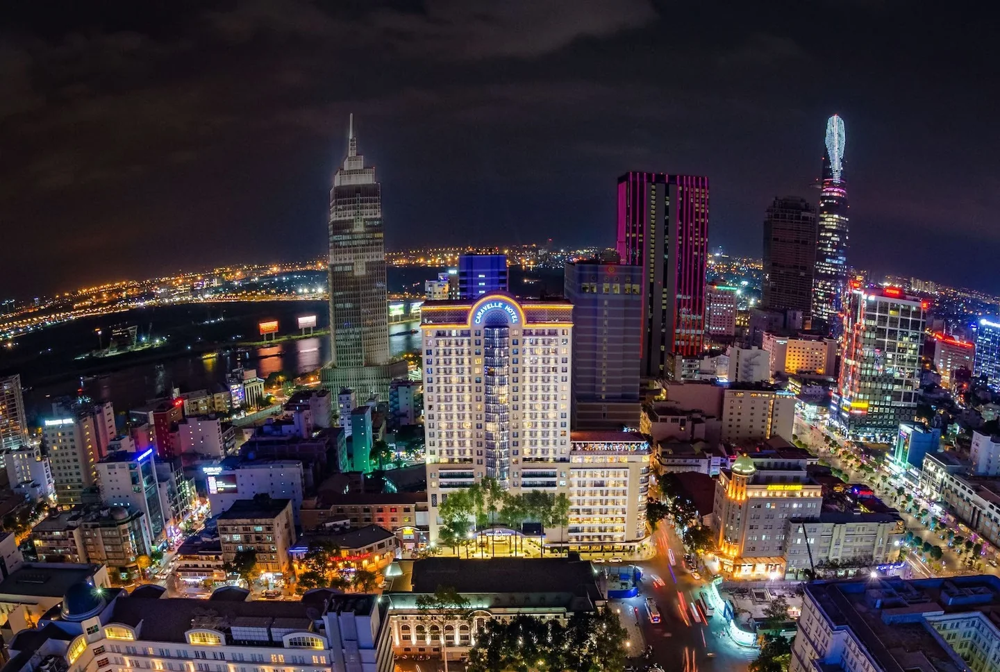
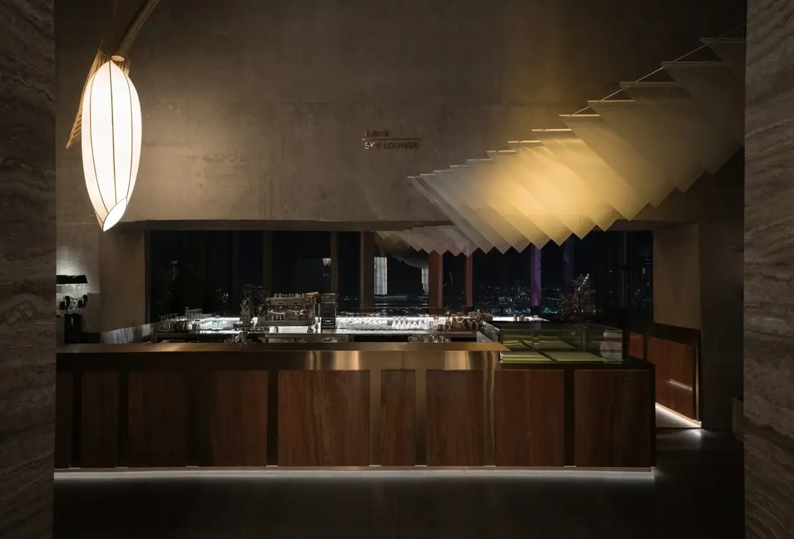
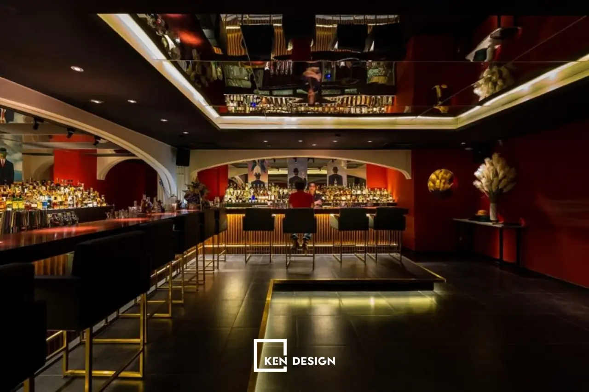

**Bar Sài Gòn** đa dạng nhất cả nước: rooftop khách sạn nhìn ra Nhà hát Thành phố, lounge trên tầng 75 Landmark 81, speakeasy ẩn sau bốt điện thoại hay cầu thang không biển hiệu, jazz club có nhạc sống mỗi tối và club mở tới gần sáng. Phần lớn quán nằm trong Quận 1, đi bộ hoặc đi xe vài phút là tới. Bài này gom 15 quán theo từng kiểu, kèm địa chỉ và mức chi tham khảo.

## Bar Sài Gòn tập trung ở đâu?

- **Quanh Công trường Lam Sơn, Nguyễn Huệ, Lê Lợi:** rooftop khách sạn cổ điển, lounge sang trọng và jazz club.
- **Quanh chợ Bến Thành, Lê Thánh Tôn, Tôn Thất Đạm:** nhiều cocktail bar và speakeasy nhỏ.
- **Phố Tây Bùi Viện, Phạm Ngũ Lão:** rooftop giá mềm, quán đông khách du lịch.
- **Bình Thạnh, Thảo Điền:** Landmark 81 và các quán cocktail yên tĩnh hơn.

Xem toàn bộ danh sách tại trang [bar Sài Gòn](/bar-sai-gon/) và [bar Quận 1](/bar-quan-1/).

## Rooftop ngắm trung tâm Sài Gòn

### Saigon Saigon Rooftop Bar

[Saigon Saigon Rooftop Bar](/bar/saigon-saigon-rooftop-bar/) là bar sân thượng khách sạn Caravelle, 19-23 Công trường Lam Sơn, gần Nhà hát Thành phố. Hoạt động từ năm 1959, nơi đây từng là điểm tụ họp quen thuộc của phóng viên chiến trường thời chiến tranh, có ban nhạc thường trú biểu diễn nhạc sống.

- Mức chi tham khảo: từ 450.000đ/người

### Chill Skybar

[Chill Skybar](/bar/chill-skybar/) trên tầng cao tòa AB Tower, 76A Lê Lai, vài phút đi bộ từ chợ Bến Thành. Không gian mở nhìn bao quát trung tâm, có khu ngoài trời và lounge, buổi tối sôi động với DJ. Quán áp dụng dress code lịch sự.

- Mức chi tham khảo: từ 350.000đ/người

### Social Club Rooftop Bar

[Social Club Rooftop Bar](/bar/social-club-rooftop-bar/) trên tầng 24 khách sạn Hôtel des Arts Saigon, 76-78 Nguyễn Thị Minh Khai, sang trọng với bàn cao, ghế bành và tầm nhìn rộng ra đường chân trời thành phố.

- Giờ mở cửa: 15:00 – 00:00
- Mức chi tham khảo: từ 450.000đ/người

### Banana Mama Rooftop Bar & Kitchen

[Banana Mama](/bar/banana-mama-rooftop-bar-va-kitchen-saigon/) trên tầng 10 tòa WMC Tower, 102 Cống Quỳnh, khu Phạm Ngũ Lão, hay được gợi ý là điểm ngắm hoàng hôn. Có chỗ ngồi sát lan can, bàn dài cho nhóm đông và sofa.

- Mức chi tham khảo: từ 450.000đ/người

### Blank Lounge (Landmark 81)

[Blank Lounge](/bar/blank-lounge/) trên tầng 75–76 tòa Landmark 81, 720A Điện Biên Phủ, Bình Thạnh. Khu ngoài trời tầng 75 có vách kính nhô ra khỏi tòa nhà, nhìn gần như toàn cảnh thành phố, là góc chụp ảnh được nhiều người tìm đến.

- Mức chi tham khảo: từ 350.000đ/người

### Rooftop Garden Bar – Rex Hotel

[Rooftop Garden Bar](/bar/rooftop-garden-bar-rex-hotel/) là khu vườn trên tầng 5 khách sạn Rex, đầu phố đi bộ Nguyễn Huệ, phong cách cổ điển với cây xanh, có nhạc sống hằng đêm, thường là nhạc xưa, đôi khi jazz hoặc acoustic.

- Mức chi tham khảo: từ 350.000đ/người

## Lounge, speakeasy và cocktail bar

### 2 Lam Son

[2 Lam Son](/bar/2-lam-son/) là quầy bar sảnh khách sạn Park Hyatt Saigon, đối diện Nhà hát Thành phố, quen thuộc với khách lâu năm dưới tên Martini Bar. Nội thất gỗ tối màu, ánh sáng ấm, có tầng lửng riêng tư hơn.

- Mức chi tham khảo: từ 400.000đ/người

### Stir

[Stir](/bar/stir/) là cocktail bar nhỏ ở tầng 1, 136 Lê Thánh Tôn, trong một khu nhà cũ gần chợ Bến Thành. Quán làm mới công thức cocktail cổ điển bằng chất liệu đường phố Việt Nam, với các ly signature như Nuoc Mia Highball.

- Mức chi tham khảo: từ 300.000đ/người

### Snuffbox Speakeasy

[Snuffbox Speakeasy](/bar/snuffbox-speakeasy/) phong cách thập niên 1920 ở 14 Tôn Thất Đạm, hoạt động từ năm 2015, tập trung vào cocktail thủ công, một số tối có nhạc sống jazz, swing hoặc DJ khách mời.

- Mức chi tham khảo: từ 300.000đ/người

### The Rabbit Hole

[The Rabbit Hole](/bar/the-rabbit-hole/) là bar ngầm ở tầng hầm 138 Nam Kỳ Khởi Nghĩa, lối vào đi qua một bốt điện thoại. Ánh sáng mờ, ghế nệm êm, có jazz sống tối thứ Hai, thứ Tư và Chủ nhật từ 20:00 đến 23:00.

- Giờ mở cửa: 18:00 – 02:00
- Mức chi tham khảo: từ 400.000đ/người

### Drinking & Healing

[Drinking & Healing](/bar/drinking-va-healing/) là quán speakeasy nhỏ trên tầng 2 một tòa nhà Pháp cổ ở 25 Hồ Tùng Mậu, lối lên là cầu thang hẹp không biển hiệu. Thực đơn nổi bật với nhiều biến tấu gin tonic.

- Giờ mở cửa: 18:00 – 01:00
- Mức chi tham khảo: từ 300.000đ/người

### Firkin Bar

[Firkin Bar](/bar/firkin-bar/) là whisky bar nhỏ kín đáo ở 20 Mạc Thị Bưởi, có bộ sưu tập hơn 200 loại whisky, chủ yếu single malt Nhật Bản và Scotland, chỉ khoảng 30 chỗ. Xem thêm bài [whisky cho người mới](/blog/whisky-cho-nguoi-moi/).

- Mức chi tham khảo: từ 350.000đ/người

## Jazz, club và bia thủ công

### Sax n' Art Jazz Club

[Sax n' Art Jazz Club](/bar/sax-n-art-jazz-club/) là câu lạc bộ jazz lâu năm ở 28 Lê Lợi, do nghệ sĩ saxophone Trần Mạnh Tuấn làm chủ. Có nhạc sống mỗi tối, các set thường bắt đầu khoảng 20–21 giờ và kéo dài qua nửa đêm.

- Mức chi tham khảo: từ 300.000đ/người

### Apocalypse Now

[Apocalypse Now](/bar/apocalypse-now/) là bar và club lâu đời ở 2B Thi Sách, thu hút khách du lịch, người nước ngoài và khách địa phương, nổi tiếng vì mở muộn hơn phần lớn club trong thành phố, tới khoảng 4 giờ sáng.

- Mức chi tham khảo: từ 550.000đ/người

### Heart of Darkness Craft Brewery

[Heart of Darkness](/bar/heart-of-darkness-craft-brewery/) là taproom bia thủ công ở 31D Lý Tự Trọng, của nhà nấu bia thành lập tại TP.HCM năm 2016, hơn 30 loại bia tự nấu cùng món ăn kiểu pub. Xem thêm bài [bia thủ công](/blog/bia-thu-cong-craft-beer/).

- Giờ mở cửa: 11:00 – 00:00
- Mức chi tham khảo: từ 300.000đ/người

## So sánh nhanh bar Sài Gòn

| Bar | Loại hình | Địa chỉ | Mức chi tham khảo |
|---|---|---|---|
| Saigon Saigon | Rooftop, nhạc sống | 19-23 Công trường Lam Sơn | Từ 450k/người |
| Chill Skybar | Rooftop, DJ | 76A Lê Lai | Từ 350k/người |
| Blank Lounge | Lounge trên cao | Landmark 81, Bình Thạnh | Từ 350k/người |
| Banana Mama | Rooftop | 102 Cống Quỳnh | Từ 450k/người |
| 2 Lam Son | Lounge khách sạn | Park Hyatt, Lam Sơn | Từ 400k/người |
| Stir | Cocktail bar | 136 Lê Thánh Tôn | Từ 300k/người |
| The Rabbit Hole | Speakeasy, jazz | 138 Nam Kỳ Khởi Nghĩa | Từ 400k/người |
| Firkin Bar | Whisky bar | 20 Mạc Thị Bưởi | Từ 350k/người |
| Sax n' Art | Jazz club | 28 Lê Lợi | Từ 300k/người |
| Apocalypse Now | Club | 2B Thi Sách | Từ 550k/người |

Mức chi là giá tham khảo, thay đổi theo đồ uống bạn chọn. Giờ mở cửa và lịch nhạc có thể thay đổi, gọi tổng đài để xác nhận trước khi đi.

:::cta
Đặt bàn bar Sài Gòn tối nay
Gọi 0838 000 222 hoặc để lại số điện thoại, tổng đài TopChill giữ bàn giúp bạn, không cần cọc.
:::

## Kinh nghiệm đi bar ở Sài Gòn

1. **Lên rooftop trước hoàng hôn** khoảng 30–60 phút để có chỗ đẹp.
2. **Mùa mưa (khoảng tháng 5 đến tháng 11)** hay có mưa chiều, hỏi quán có khu có mái che không.
3. **Rooftop khách sạn thường có dress code:** nam nên mặc áo có cổ, giày kín, không mặc quần đùi, dép lê.
4. **Speakeasy thường không có biển hiệu,** xem kỹ địa chỉ hoặc gọi tổng đài để được chỉ lối vào.
5. **Jazz bar có lịch biểu diễn riêng,** hỏi giờ nhạc khi đặt bàn.
6. **Uống có trách nhiệm,** không lái xe sau khi uống rượu bia. Gọi taxi hoặc xe công nghệ.

Mới đi bar lần đầu? Đọc [đi bar nên uống gì](/blog/di-bar-nen-uong-gi/) và [các loại cocktail phổ biến](/blog/cac-loai-cocktail-pho-bien/).

## Câu hỏi thường gặp

### Bar Sài Gòn tập trung ở đâu?

Phần lớn ở Quận 1: quanh Công trường Lam Sơn, Nguyễn Huệ, Lê Lợi, chợ Bến Thành và phố Tây Bùi Viện. Landmark 81 (Bình Thạnh) và Thảo Điền có thêm vài quán.

### Rooftop nào ở Sài Gòn view đẹp?

Saigon Saigon (Caravelle), Chill Skybar (AB Tower), Social Club (Hôtel des Arts) nhìn trung tâm Quận 1; Blank Lounge trên tầng 75–76 Landmark 81 nhìn gần như toàn cảnh thành phố.

### Đi bar ở Sài Gòn hết bao nhiêu tiền?

Mức chi tham khảo khoảng 300.000đ–550.000đ mỗi người trở lên cho 2–3 đồ uống, tuỳ quán. Rooftop khách sạn và club thường cao hơn speakeasy nhỏ.

### Sài Gòn có quán jazz nhạc sống không?

Có. Sax n' Art Jazz Club (28 Lê Lợi) có nhạc sống mỗi tối, The Rabbit Hole có jazz sống tối thứ Hai, thứ Tư và Chủ nhật, Rooftop Garden Bar Rex có nhạc sống hằng đêm.

### Đặt bàn bar Sài Gòn qua TopChill có cần cọc không?

Không. Bạn gọi 0838 000 222, nhắn Zalo hoặc để lại số trên web, tổng đài sẽ gọi lại xác nhận bàn.
