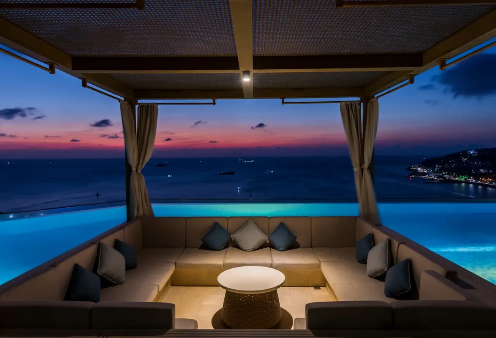
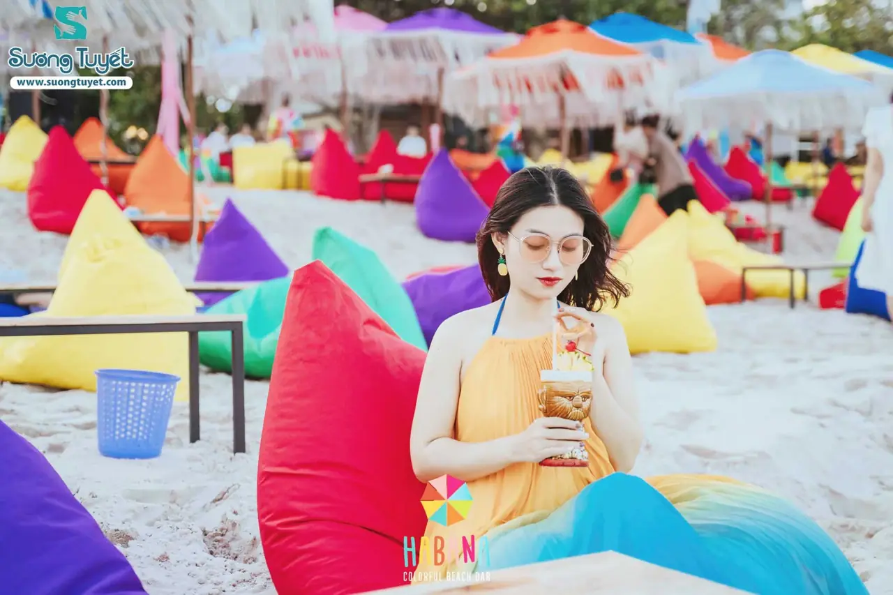
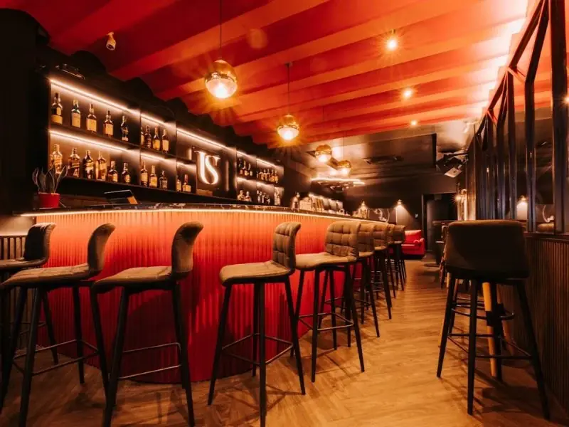

**Bar Vũng Tàu** hợp nhất cho chuyến đi biển cuối tuần: chiều ngắm hoàng hôn trên rooftop, tối ra Bãi Sau ngồi beach bar, khuya ghé phố Tây nghe nhạc sống. Bài này gom 11 quán theo từng kiểu, kèm địa chỉ và mức chi tham khảo để bạn chọn nhanh.

## Bar Vũng Tàu tập trung ở đâu?

- **Bãi Trước, phường 1 và 2:** đường Hạ Long, Quang Trung, Lý Tự Trọng có nhiều pub, cocktail bar, quán nhạc sống. Đi bộ qua lại giữa các quán được.
- **Bãi Sau, đường Thùy Vân:** beach bar, pub ven biển và rooftop của các khách sạn, hợp ngồi hóng gió.
- **Tòa nhà cao tầng trung tâm:** rooftop nhìn bao quát thành phố và biển.

Danh sách đầy đủ có ở trang [bar Vũng Tàu](/bar-vung-tau/).

## Rooftop bar Vũng Tàu ngắm hoàng hôn

### OASKY Restaurant & Lounge

[OASKY Restaurant & Lounge](/bar/oasky-restaurant-va-lounge/) nằm trên tầng 36 tòa Oasky (Sơn Thịnh 2), 02 Lê Hồng Phong. Từ độ cao này bạn nhìn bao quát cả thành phố lẫn biển, đẹp nhất lúc hoàng hôn. Tối cuối tuần quán thường có sự kiện.

- Khu vực: phường Thắng Tam
- Phù hợp: hẹn hò, gặp bạn bè, tiếp khách
- Mức chi tham khảo: từ 400.000đ/người

### Breeze Rooftop Bar

[Breeze Rooftop Bar](/bar/breeze-rooftop-bar/) ở tầng 20 khách sạn Fusion Suites, 2 Trương Công Định, có hồ bơi vô cực nhìn ra biển. Quán phục vụ cocktail, bia thủ công, mocktail và đồ ăn nhẹ, mở từ sáng nên ngắm được cả bình minh lẫn hoàng hôn.

- Khu vực: phường 2
- Phù hợp: cặp đôi, du khách nghỉ dưỡng
- Mức chi tham khảo: từ 500.000đ/người

### On The Top Bar – ibis Styles

[On The Top Bar](/bar/on-the-top-bar-ibis-styles/) là rooftop trên tầng thượng khách sạn ibis Styles, 117 Thùy Vân, cạnh hồ bơi và nhìn ra Bãi Sau. Một số đêm có DJ lên nhạc.

- Khu vực: Bãi Sau
- Phù hợp: thư giãn sau ngày tắm biển
- Mức chi tham khảo: từ 400.000đ/người

### FINNO Messymood

[FINNO Messymood](/bar/finno-messymood/) là quầy cocktail trên tầng 8 khách sạn Rex, 01 Lê Quý Đôn, được nhiều người chọn làm điểm ngắm hoàng hôn trên biển. Không khí ấm cúng, hợp nhóm nhỏ.

- Khu vực: phường 1
- Mức chi tham khảo: từ 400.000đ/người

## Beach bar, lounge sát biển

### Habana Colorful Beach Bar

[Habana Colorful Beach Bar](/bar/habana-colorful-beach-bar/) là beach bar ngoài trời ngay bờ biển Thùy Vân, phong cách nhiệt đới với ghế nằm, ô dù nhiều màu và nhiều góc chụp ảnh. Quán thường tổ chức tiệc cùng acoustic, DJ và biểu diễn.

- Khu vực: Bãi Sau, 1A Thùy Vân
- Phù hợp: nhóm bạn trẻ, thích chụp ảnh
- Mức chi tham khảo: từ 500.000đ/người

### Gazebo Beach Front Lounge & Cafe

[Gazebo Beach Front Lounge & Cafe](/bar/gazebo-beach-front-lounge-va-cafe/) nằm trên đường Hạ Long, ngay mặt Bãi Trước, tông trắng xanh, có cả khu trong nhà và ngoài trời. Ban ngày là quán cà phê, buổi tối chuyển sang phục vụ cocktail.

- Khu vực: Bãi Trước
- Phù hợp: gia đình, nhóm bạn muốn ngồi ngắm biển
- Mức chi tham khảo: từ 400.000đ/người

## Cocktail bar yên tĩnh

### No 21 Eatery & Bar

[No 21 Eatery & Bar](/bar/no-21-eatery-va-bar/) ở 73 Lý Tự Trọng, quầy bar nhỏ, không khí thân mật, có ban công rộng nhìn về phía Bãi Trước. Hợp ngồi trò chuyện lâu bên ly cocktail hoặc rượu vang.

### Déjà Vu Cocktail Bar

[Déjà Vu Cocktail Bar](/bar/deja-vu-cocktail-bar/) ở 3 Lê Ngọc Hân, phường 1, không gian sang mà vẫn ấm cúng, nhạc mở vừa phải để nói chuyện. Hợp buổi tối thư giãn cùng người thương hoặc nhóm nhỏ.

### U.S Bar - The Art Of Mixology

[U.S Bar](/bar/u-s-bar-the-art-of-mixology/) ở 120 Ba Cu, phong cách lounge phương Tây tông đen đỏ, menu cocktail và mocktail do bartender pha chế. Cuối tuần thường có acoustic hoặc DJ.

## Quán nhạc sống, club về đêm

### Black Pearl Bar

[Black Pearl Bar](/bar/black-pearl-bar/) ở 64 Hạ Long, phường 2, náo nhiệt về đêm với ca sĩ, ban nhạc và DJ thay phiên, có cả ban nhạc rock biểu diễn.

- Mức chi tham khảo: từ 600.000đ/người

### Fang Pub

[Fang Pub](/bar/fang-pub/) ở số 3 Lý Tự Trọng, có ban nhạc biểu diễn và hay được chọn để tổ chức sinh nhật. Hợp nhóm bạn muốn nghe nhạc sống, uống bia và giao lưu.

- Mức chi tham khảo: từ 300.000đ/người

## So sánh nhanh bar Vũng Tàu

| Bar | Loại hình | Khu vực | Mức chi tham khảo |
|---|---|---|---|
| OASKY Restaurant & Lounge | Rooftop | Lê Hồng Phong | Từ 400k/người |
| Breeze Rooftop Bar | Rooftop, hồ bơi | Trương Công Định | Từ 500k/người |
| On The Top Bar | Rooftop | Bãi Sau | Từ 400k/người |
| FINNO Messymood | Cocktail trên cao | Lê Quý Đôn | Từ 400k/người |
| Habana Colorful Beach Bar | Beach bar | Bãi Sau | Từ 500k/người |
| Gazebo Beach Front | Lounge sát biển | Bãi Trước | Từ 400k/người |
| Black Pearl Bar | Nhạc sống | Hạ Long | Từ 600k/người |
| Fang Pub | Pub nhạc sống | Lý Tự Trọng | Từ 300k/người |

Mức chi là giá tham khảo, thay đổi theo đồ uống bạn chọn. Giờ mở cửa có thể đổi theo mùa, gọi tổng đài để xác nhận trước khi đi.

:::cta
Đặt bàn bar Vũng Tàu cuối tuần này
Gọi 0838 000 222 hoặc để lại số điện thoại, tổng đài TopChill giữ bàn giúp bạn, không cần cọc.
:::

## Kinh nghiệm đi bar ở Vũng Tàu

1. **Lên rooftop trước 17h30** nếu muốn có chỗ đẹp ngắm hoàng hôn.
2. **Cuối tuần và ngày lễ rất đông** khách từ Sài Gòn xuống, nên đặt bàn trước.
3. **Đi beach bar nên mang áo khoác mỏng**, gió biển về đêm khá lạnh.
4. **Phố Tây Bãi Trước đi bộ được**, có thể ghé 2–3 quán trong một tối.
5. **Uống có trách nhiệm**, không lái xe sau khi uống. Gọi taxi hoặc xe công nghệ về khách sạn.

Đi Sài Gòn trước khi xuống biển? Xem thêm [bar Sài Gòn](/bar-sai-gon/).

## Câu hỏi thường gặp

### Bar Vũng Tàu nào ngắm hoàng hôn đẹp?

OASKY Restaurant & Lounge (tầng 36), Breeze Rooftop Bar (tầng 20, có hồ bơi vô cực) và FINNO Messymood (tầng 8 khách sạn Rex) đều nhìn ra biển, đẹp nhất lúc chiều tà.

### Đi bar ở Vũng Tàu hết bao nhiêu tiền?

Mức chi tham khảo khoảng 300.000đ–600.000đ mỗi người trở lên cho 2–3 ly, tuỳ quán và đồ uống.

### Bar nhạc sống ở Vũng Tàu ở đâu?

Black Pearl Bar (64 Hạ Long) và Fang Pub (3 Lý Tự Trọng) đều có ban nhạc biểu diễn, gần khu Bãi Trước.

### Đặt bàn bar Vũng Tàu qua TopChill có cần cọc không?

Không. Bạn gọi 0838 000 222, nhắn Zalo hoặc để lại số trên web, tổng đài sẽ gọi lại xác nhận bàn.
