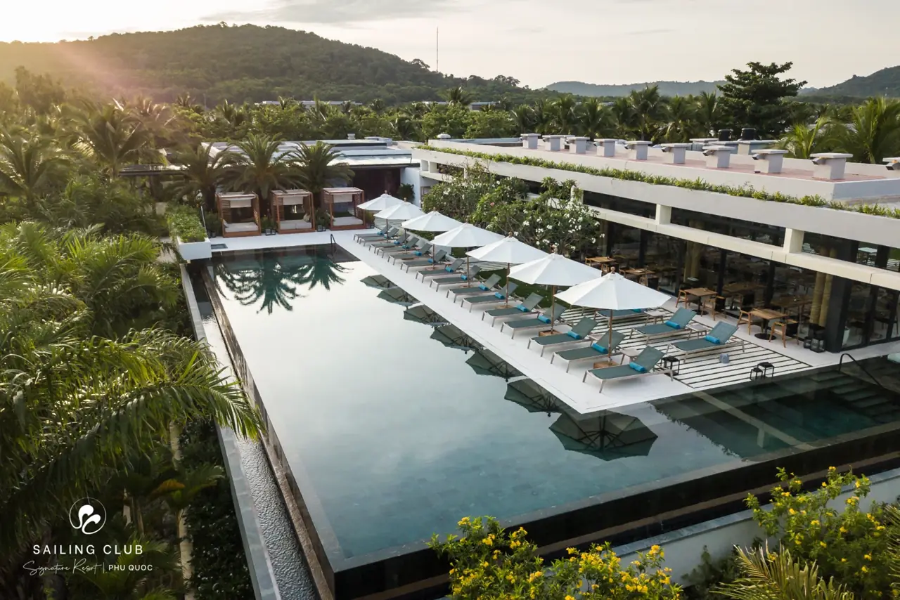
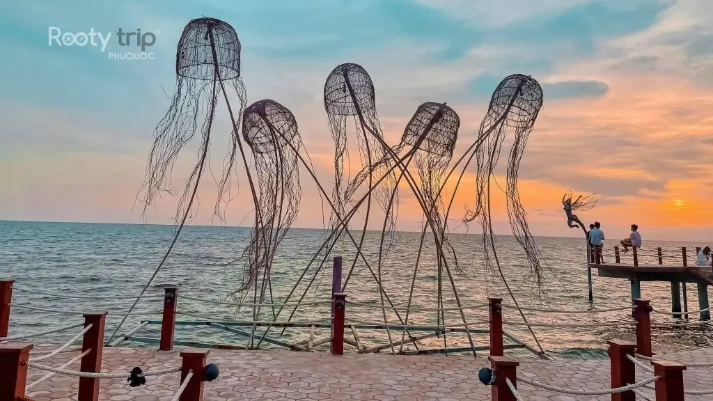
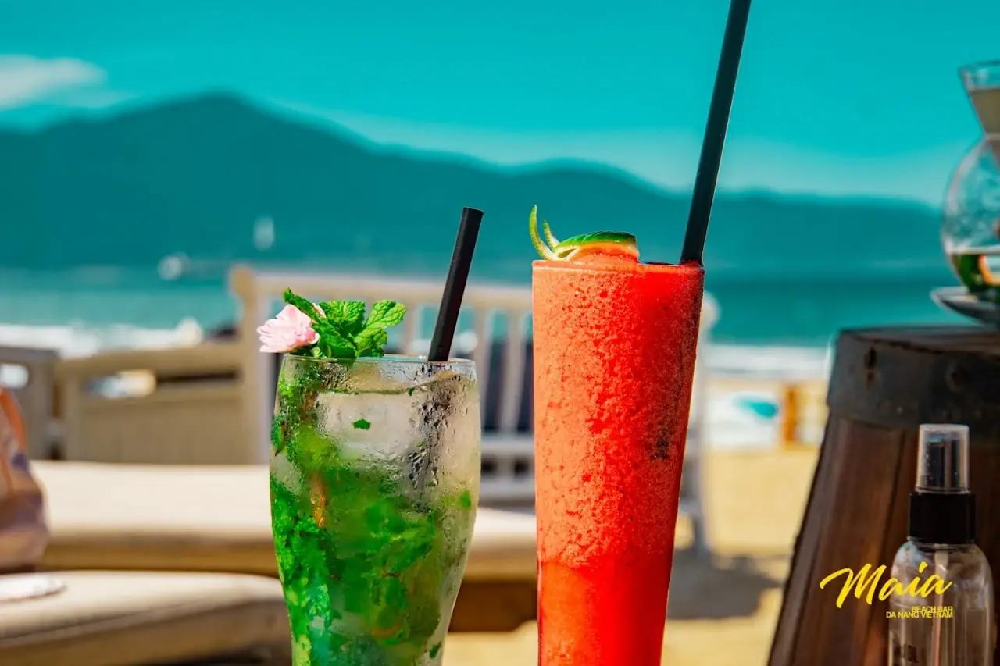
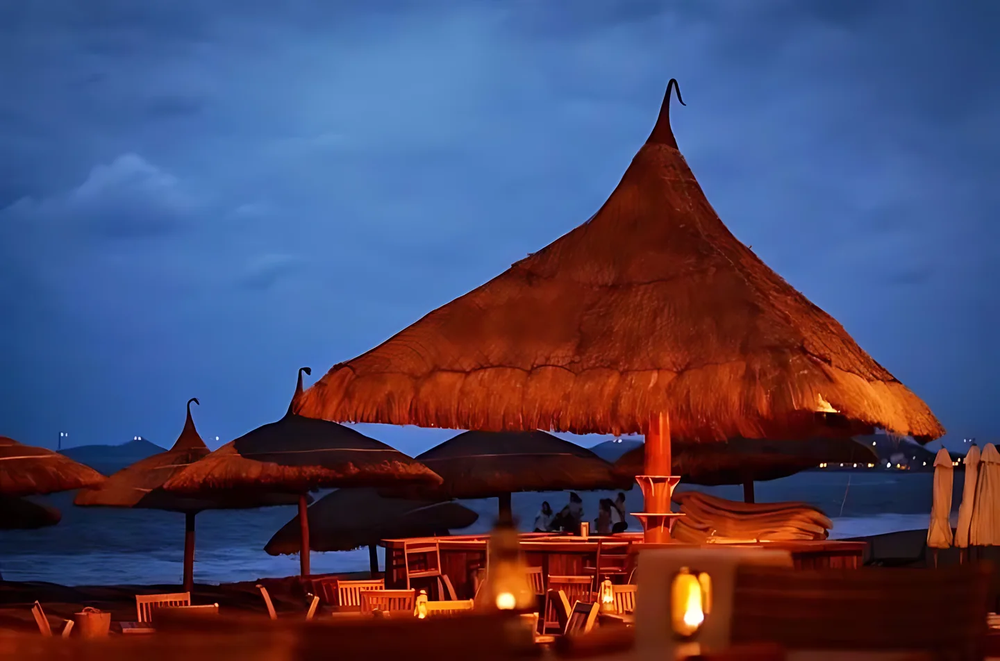
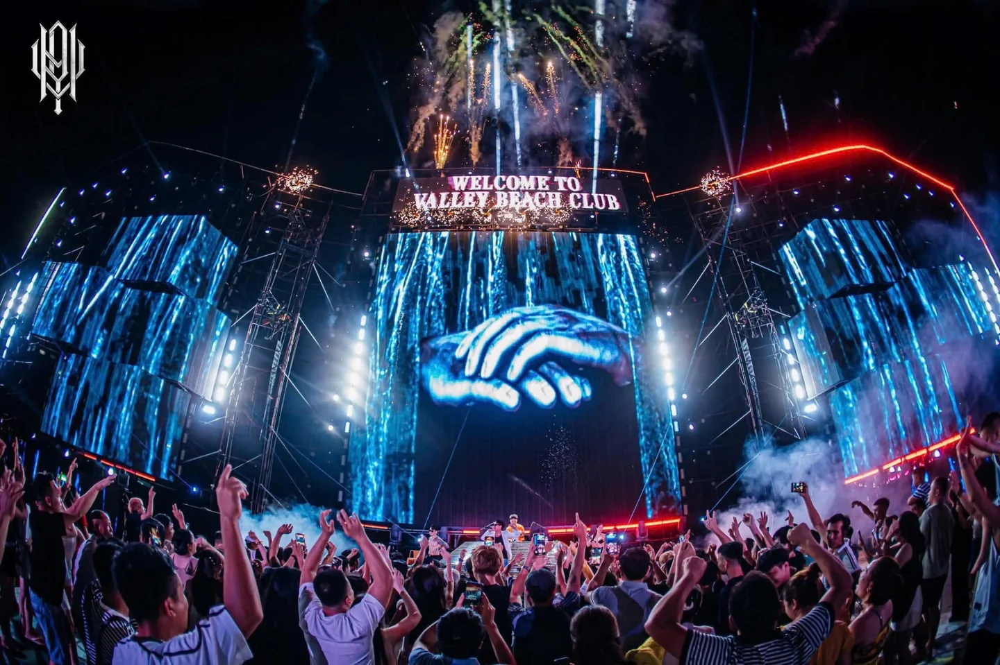

**Beach club** là kiểu quán đặt ngay trên bãi biển: ban ngày nằm ghế tắm nắng, gọi cocktail, chiều ngắm hoàng hôn, tối nghe DJ hoặc xem múa lửa. Ở Việt Nam, beach club tập trung ở Phú Quốc, Đà Nẵng, Nha Trang, Hạ Long và Vũng Tàu. Bài này gom 12 quán theo từng thành phố, kèm địa chỉ, giờ mở cửa và mức chi tham khảo.

## Beach club khác bar thường thế nào?

- **Mở từ sáng hoặc trưa,** nhiều quán phục vụ cả ngày chứ không chỉ buổi tối.
- **Có ghế tắm nắng, ô dù, đôi khi có hồ bơi,** khách có thể xuống tắm biển rồi lên gọi đồ uống.
- **Cao điểm là lúc hoàng hôn và buổi tối,** khi có DJ, nhạc sống hoặc múa lửa.
- **Trang phục thoải mái:** đồ đi biển, dép, khác hẳn dress code của rooftop hay club trong phố.

## Beach club Phú Quốc

Phú Quốc có nhiều beach club nhất, phần lớn nằm dọc Bãi Trường và đường Trần Hưng Đạo, nơi ngắm hoàng hôn trên biển đẹp nhất đảo. Xem thêm [beach club Phú Quốc](/beach-club-phu-quoc/) và bài [bar Phú Quốc](/blog/bar-phu-quoc/).

### Sailing Club Phu Quoc

[Sailing Club Phu Quoc](/bar/sailing-club-phu-quoc/) nằm bên bờ Bãi Trường, trong khu phức hợp Phu Quoc Marina, cạnh InterContinental. Có hồ bơi vô cực với quầy bar dưới nước, ghế tắm nắng và lounge ven biển. Tối có múa lửa và DJ.

- Mức chi tham khảo: từ 400.000đ/người

### OCSEN Beach Bar & Club

[OCSEN Beach Bar & Club](/bar/ocsen-beach-bar-va-club/) nằm sát biển Bãi Trường, trong hẻm 124 Trần Hưng Đạo. Không gian gỗ đơn giản, ghế lười hướng ra biển để ngắm hoàng hôn, buổi tối có múa lửa.

- Giờ mở cửa: 16:00 – 00:00
- Mức chi tham khảo: từ 350.000đ/người

### Sunset Sanato Beach Club

[Sunset Sanato Beach Club](/bar/sunset-sanato-beach-club/) trên đường Bào, Dương Tơ, nổi bật với các tác phẩm điêu khắc lớn trên bãi biển và cây cầu gỗ vươn ra biển, là điểm quen thuộc để ngắm hoàng hôn và chụp ảnh.

- Mức chi tham khảo: từ 500.000đ/người

### Shri Beach Club & Bar

[Shri Beach Club & Bar](/bar/shri-beach-club-va-bar/) trên đường Trần Hưng Đạo, khu Dương Tơ, mở từ sáng đến tối, không gian mở ra biển và có nhạc sống, hợp ai muốn dành cả ngày trên bãi biển.

- Giờ mở cửa: 10:00 – 22:00
- Mức chi tham khảo: từ 450.000đ/người

### Sunset Beach Bar & Restaurant

[Sunset Beach Bar & Restaurant](/bar/sunset-beach-bar-va-restaurant/) ở 100C/2 Trần Hưng Đạo, gần trung tâm Dương Đông, bao quanh bởi hàng dừa, phục vụ từ sáng đến khuya với các món như bánh xèo hải sản ăn kèm bia lạnh.

- Giờ mở cửa: 09:00 – 01:00
- Mức chi tham khảo: từ 500.000đ/người

## Beach club Đà Nẵng

Beach club Đà Nẵng trải dọc trục Võ Nguyên Giáp và Trường Sa, nhìn ra biển Mỹ Khê và Non Nước. Xem thêm [beach club Đà Nẵng](/beach-club-da-nang/) và bài [bar Đà Nẵng](/blog/bar-da-nang/).

### Maia Beach Bar

[Maia Beach Bar](/bar/maia-beach-bar/) nằm ngay trên bãi biển, 290 Võ Nguyên Giáp, Ngũ Hành Sơn. Có ghế tắm nắng trên cát, cocktail và DJ vào buổi tối.

- Giờ mở cửa: 08:00 – 01:00
- Mức chi tham khảo: từ 500.000đ/người

### Vive Océane Beach Club

[Vive Océane Beach Club](/bar/vive-oceane-beach-club/) là beach club kiêm nhà hàng của Hyatt Regency Danang, 5 Trường Sa, đặt trên bãi cát Non Nước. Thực đơn kết hợp ẩm thực Pháp, Địa Trung Hải và Việt Nam, chú trọng hải sản, có các buổi cocktail bên bờ biển.

- Giờ mở cửa: 11:00 – 23:00
- Mức chi tham khảo: từ 350.000đ/người

### Esco Beach Bar, Lounge & Restaurant

[Esco Beach](/bar/esco-beach-bar-lounge-va-restaurant/) ở Lô 12 Võ Nguyên Giáp, dọc bãi biển Mỹ Khê. Chỗ ngồi sát bãi cát, buổi tối có nhạc sống của nghệ sĩ địa phương và múa lửa, thực đơn thiên về món Âu.

- Mức chi tham khảo: từ 350.000đ/người

## Beach club Nha Trang

### Sailing Club Nha Trang

[Sailing Club Nha Trang](/bar/sailing-club-nha-trang/) là beach club rộng hơn 2.400 m² ngay trên bãi biển Trần Phú, gắn với đời sống về đêm Nha Trang từ năm 1994. Ban ngày có ghế tắm nắng, cuối tuần có đêm nhạc DJ, biểu diễn, cùng các đêm salsa và bachata.

- Giờ mở cửa: 07:00 – 02:00
- Mức chi tham khảo: từ 450.000đ/người

Xem thêm [beach club Nha Trang](/beach-club-nha-trang/) và bài [bar Nha Trang](/blog/bar-nha-trang/).

## Beach club Hạ Long

### Valley Beach Club

[Valley Beach Club](/bar/valley-beach-club/) là beach club ngoài trời ngay trên bãi tắm Sun Group, đường bao biển Bãi Cháy. Ban ngày tắm biển, buổi tối có sự kiện âm nhạc với hệ thống loa K2-L'Acoustics. Rất đông vào mùa du lịch hè.

- Giờ mở cửa: 08:00 – 02:00
- Mức chi tham khảo: từ 500.000đ/người

### Chill Beach Bar

[Chill Beach Bar](/bar/chill-beach-bar/) trên đường Kỳ Quan, Bãi Cháy, gần Valley Beach Club, nhìn ra vịnh Hạ Long. Yên tĩnh hơn các điểm xung quanh, có bia thủ công, burger và nhạc acoustic.

- Mức chi tham khảo: từ 500.000đ/người

Xem thêm [beach club Hạ Long](/beach-club-ha-long/) và bài [bar Hạ Long](/blog/bar-ha-long/).

## Beach bar Vũng Tàu

### Habana Colorful Beach Bar

[Habana Colorful Beach Bar](/bar/habana-colorful-beach-bar/) ở 1A Thùy Vân, khu Bãi Sau, phong cách nhiệt đới rực rỡ lấy cảm hứng từ beach bar Bali, với ghế nằm, ô dù nhiều màu và nhiều góc chụp ảnh. Thường có tiệc cùng acoustic, DJ và biểu diễn.

- Mức chi tham khảo: từ 500.000đ/người

Xem thêm bài [bar Vũng Tàu](/blog/bar-vung-tau/).

## So sánh nhanh beach club Việt Nam

| Beach club | Thành phố | Địa chỉ | Mức chi tham khảo |
|---|---|---|---|
| Sailing Club Phu Quoc | Phú Quốc | Phu Quoc Marina, Bãi Trường | Từ 400k/người |
| OCSEN Beach Bar & Club | Phú Quốc | 124 Trần Hưng Đạo | Từ 350k/người |
| Sunset Sanato | Phú Quốc | Đường Bào, Dương Tơ | Từ 500k/người |
| Shri Beach Club | Phú Quốc | Trần Hưng Đạo, Dương Tơ | Từ 450k/người |
| Maia Beach Bar | Đà Nẵng | 290 Võ Nguyên Giáp | Từ 500k/người |
| Vive Océane | Đà Nẵng | Hyatt Regency, 5 Trường Sa | Từ 350k/người |
| Esco Beach | Đà Nẵng | Lô 12 Võ Nguyên Giáp | Từ 350k/người |
| Sailing Club Nha Trang | Nha Trang | 72–74 Trần Phú | Từ 450k/người |
| Valley Beach Club | Hạ Long | Bãi tắm Sun Group, Bãi Cháy | Từ 500k/người |
| Habana Colorful | Vũng Tàu | 1A Thùy Vân | Từ 500k/người |

Mức chi là giá tham khảo, thay đổi theo đồ uống bạn chọn. Giờ mở cửa và lịch sự kiện có thể thay đổi theo mùa, gọi tổng đài để xác nhận trước khi đi.

:::cta
Đặt chỗ beach club cuối tuần này
Gọi 0838 000 222 hoặc để lại số điện thoại, tổng đài TopChill giữ chỗ giúp bạn, không cần cọc.
:::

## Kinh nghiệm đi beach club

1. **Đến trước hoàng hôn khoảng 1 tiếng** để có ghế đẹp sát biển.
2. **Hỏi trước về mức chi tối thiểu** cho ghế nằm, cabana hoặc bàn VIP, nhiều beach club áp dụng vào cuối tuần.
3. **Mang kem chống nắng, đồ bơi và áo khoác mỏng,** buổi tối gió biển khá lạnh.
4. **Xem mùa:** Phú Quốc đẹp nhất mùa khô (khoảng tháng 11 đến tháng 4); Đà Nẵng, Hạ Long, Vũng Tàu đông nhất mùa hè.
5. **Không xuống biển sau khi uống rượu bia,** và không lái xe sau khi uống. Gọi taxi hoặc xe công nghệ.

Muốn biết gọi gì bên biển? Đọc [các loại cocktail phổ biến](/blog/cac-loai-cocktail-pho-bien/) và [mocktail không cồn](/blog/mocktail-do-uong-khong-con-o-bar/).

## Câu hỏi thường gặp

### Beach club là gì?

Beach club là quán bar hoặc câu lạc bộ đặt ngay trên bãi biển, có ghế tắm nắng, đồ uống, đồ ăn và thường có DJ, nhạc sống hoặc múa lửa vào buổi tối. Nhiều quán mở từ sáng hoặc trưa.

### Beach club ở Việt Nam tập trung ở đâu?

Nhiều nhất ở Phú Quốc (Bãi Trường, Trần Hưng Đạo), sau đó là Đà Nẵng (Võ Nguyên Giáp, Trường Sa), Nha Trang (Trần Phú), Hạ Long (Bãi Cháy) và Vũng Tàu (Bãi Sau).

### Đi beach club hết bao nhiêu tiền?

Mức chi tham khảo khoảng 350.000đ–500.000đ mỗi người trở lên cho 2–3 đồ uống. Cabana, giường nằm hoặc bàn VIP cuối tuần có thể có mức chi tối thiểu cao hơn.

### Beach club có cần mặc lịch sự không?

Không. Beach club cho mặc đồ đi biển, đồ bơi và đi dép. Riêng beach club trong khuôn viên resort có thể yêu cầu khoác thêm áo khi ngồi khu nhà hàng.

### Đặt chỗ beach club qua TopChill có cần cọc không?

Không. Bạn gọi 0838 000 222, nhắn Zalo hoặc để lại số trên web, tổng đài sẽ gọi lại xác nhận chỗ.
