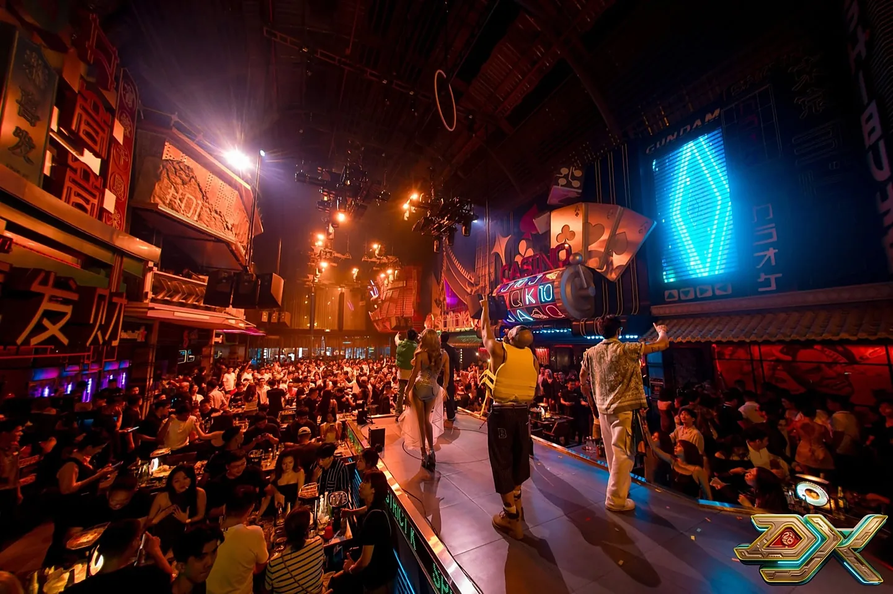
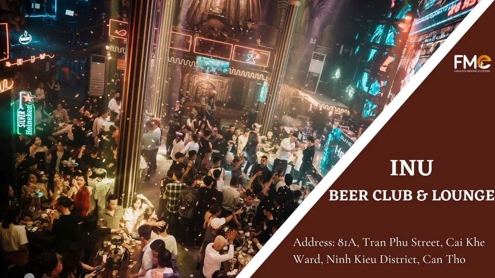
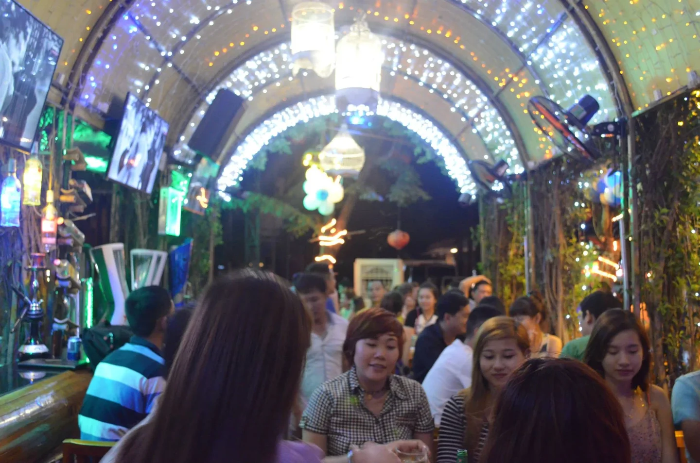

**Beer club** là kiểu quán lai giữa quán bia và club: đồ uống chính là bia, giá mềm hơn bar, nhưng có DJ, nhạc mạnh, đèn sân khấu và đôi khi ca sĩ, vũ công biểu diễn. Đây là lựa chọn quen thuộc cho nhóm bạn đông người muốn quẩy mà không tốn nhiều như club. Bài này giải thích beer club khác bar, pub thế nào và gợi ý 8 quán có thật ở Sài Gòn, Cần Thơ, Huế, Phú Quốc, Bình Dương.

## Beer club khác bar, pub, club thế nào?

| Kiểu quán | Đồ uống chính | Không khí | Mức chi |
|---|---|---|---|
| **Beer club** | Bia, tháp bia, ít cocktail | DJ, nhạc mạnh, đèn sân khấu, nhóm đông | Mềm hơn club |
| **Pub** | Bia tươi, bia thủ công | Nhạc nền, trò chuyện, xem bóng đá | Thấp đến vừa |
| **Club** | Rượu chai, cocktail | Sàn nhảy, DJ, quẩy khuya | Cao, bàn VIP có mức tối thiểu |
| **Cocktail bar** | Cocktail pha chế | Nhẹ nhàng, ánh sáng mờ | Vừa |

Beer club hợp khi bạn **đi nhóm 6–15 người**, muốn nghe nhạc sôi động và gọi bia theo tháp hoặc thùng để chia đều.

## Beer club ở Sài Gòn

### District K

[District K](/bar/district-k/) ở 30 Thủ Khoa Huân, gần chợ Bến Thành, Quận 1, là tổ hợp gastrobar, **beer club** và lounge sức chứa khoảng 400 khách. Không gian thiết kế như "con phố mini" tương lai rực đèn neon. Ngoài DJ và cocktail còn có beer pong, bi-a, bi lắc và múa lửa.

- Giờ mở cửa: 16:00 – 02:00
- Mức chi tham khảo: từ 300.000đ/người

Xem thêm bài [club Sài Gòn](/blog/club-sai-gon/).

## Beer club ở Cần Thơ

Cần Thơ là nơi beer club phát triển mạnh, tập trung ở phường Cái Khế, Ninh Kiều.

### INU Beer Club & Lounge

[INU Beer Club & Lounge](/bar/inu-beer-club-va-lounge/) ở 81A Trần Phú, phường Cái Khế. Không gian rộng có tầng lửng và quầy bar trung tâm, âm thanh tốt, thường có sự kiện hằng tuần với DJ và nghệ sĩ khách mời.

- Giờ mở cửa: 16:00 – 01:00
- Mức chi tham khảo: từ 600.000đ/người

### Knight Beer Club

[Knight Beer Club](/bar/knight-beer-club/) ở 27 Lê Lợi, phường Cái Khế. Bàn đặt thoáng, nhạc mạnh, có shisha, nhân viên được khách khen nhiệt tình.

- Mức chi tham khảo: từ 450.000đ/người

### Tiệm Bia Nhà An và Thôn Yang Kỳ

Muốn quán bia nhẹ nhàng hơn? [Tiệm Bia Nhà An](/bar/tiem-bia-nha-an/) là quán ngoài trời bên hồ Bún Xáng, có bia lên men từ trái cây dễ uống. [Thôn Yang Kỳ](/bar/thon-yang-ky/) ở 01 Trần Văn Giàu mang phong cách làng quê, sân mở nhiều cây xanh, hợp nhóm đông.

- Mức chi tham khảo: từ 300.000–400.000đ/người

Xem thêm bài [bar Cần Thơ](/blog/bar-can-tho/).

## Quán bia sôi động ở Huế, Phú Quốc, Bình Dương

### Century Pub & Beer Garden (Huế)

[Century Pub & Beer Garden](/bar/century-pub-va-beer-garden/) là quán bia sân vườn rộng ở 49 Lê Lợi, khu phố Tây Huế. Không gian ngoài trời thoáng, có DJ, giá phải chăng, hợp nhóm đông và cả gia đình.

- Mức chi tham khảo: từ 300.000đ/người

### Happy Bear Beer Bar (Phú Quốc)

[Happy Bear Beer Bar](/bar/happy-bear-beer-bar/) ở Phu Quoc Centre, 01 Trần Hưng Đạo, Dương Đông, nhiều bia thủ công trong nước và quốc tế, có nhạc sống, cuối tuần có DJ, có khu vui chơi trẻ em.

- Mức chi tham khảo: từ 350.000đ/người

### Beer Zone – Vĩnh Phú 41 (Bình Dương)

[Beer Zone](/bar/beer-zone-vinh-phu-41/) là quán bia dạng beer club bình dân ở 25 Vĩnh Phú 41, phường Lái Thiêu, Thuận An, hợp dân văn phòng tụ tập sau giờ làm.

- Mức chi tham khảo: từ 300.000đ/người

## So sánh nhanh

| Quán | Thành phố | Địa chỉ | Mức chi tham khảo |
|---|---|---|---|
| District K | Sài Gòn | 30 Thủ Khoa Huân, Q.1 | Từ 300k/người |
| INU Beer Club & Lounge | Cần Thơ | 81A Trần Phú | Từ 600k/người |
| Knight Beer Club | Cần Thơ | 27 Lê Lợi | Từ 450k/người |
| Tiệm Bia Nhà An | Cần Thơ | Bờ hồ Bún Xáng | Từ 400k/người |
| Century Pub & Beer Garden | Huế | 49 Lê Lợi | Từ 300k/người |
| Happy Bear Beer Bar | Phú Quốc | 01 Trần Hưng Đạo | Từ 350k/người |
| Beer Zone | Bình Dương | 25 Vĩnh Phú 41, Thuận An | Từ 300k/người |

Mức chi là giá tham khảo, thay đổi theo đồ uống và số người. Giờ mở cửa có thể thay đổi, gọi tổng đài để xác nhận trước khi đi.

:::cta
Đặt bàn beer club cho nhóm đông
Gọi 0838 000 222 hoặc để lại số điện thoại, tổng đài TopChill giữ bàn và báo ưu đãi giúp bạn, không cần cọc. Đi ít người? Thử ghép bàn tại topchill.vn/ghep-ban.
:::

## Kinh nghiệm đi beer club

1. **Gọi bia theo tháp hoặc thùng** sẽ lợi hơn gọi lẻ khi đi nhóm đông.
2. **Hỏi trước phụ thu** sân khấu, ca sĩ hoặc shisha nếu có.
3. **Đến trước 21h** cuối tuần để có bàn gần sân khấu.
4. **Chọn người không uống** để lo đường về, hoặc gọi taxi, xe công nghệ.
5. **Không lái xe sau khi uống rượu bia.**

Thích bia thủ công hơn? Đọc [bia thủ công cho người mới](/blog/bia-thu-cong-craft-beer/) và [đi bar nên uống gì](/blog/di-bar-nen-uong-gi/).

## Câu hỏi thường gặp

### Beer club là gì?

Beer club là quán bia kết hợp không khí club: đồ uống chính là bia, có DJ, nhạc mạnh và đèn sân khấu, giá mềm hơn club, hợp nhóm bạn đông người.

### Beer club khác pub thế nào?

Pub thiên về ngồi uống bia, trò chuyện, xem thể thao với nhạc nền. Beer club ồn hơn, có DJ, ca sĩ hoặc vũ công, giống club nhưng uống bia là chính.

### Đi beer club hết bao nhiêu tiền?

Mức chi tham khảo khoảng 300.000đ–600.000đ mỗi người trở lên, tuỳ quán và số bia gọi. Gọi theo tháp hoặc thùng khi đi nhóm sẽ tiết kiệm hơn.

### Đặt bàn beer club qua TopChill có cần cọc không?

Không. Bạn gọi 0838 000 222, nhắn Zalo hoặc để lại số trên web, tổng đài sẽ gọi lại xác nhận bàn.
