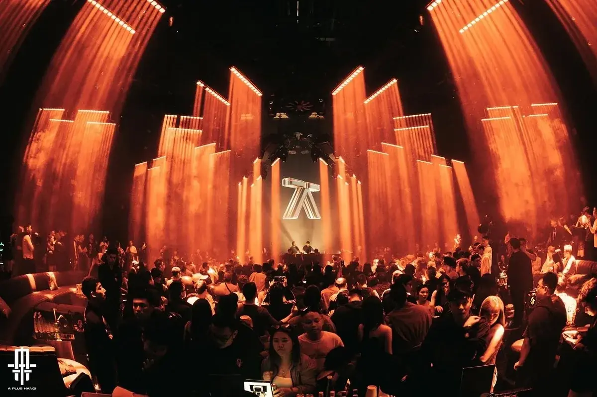
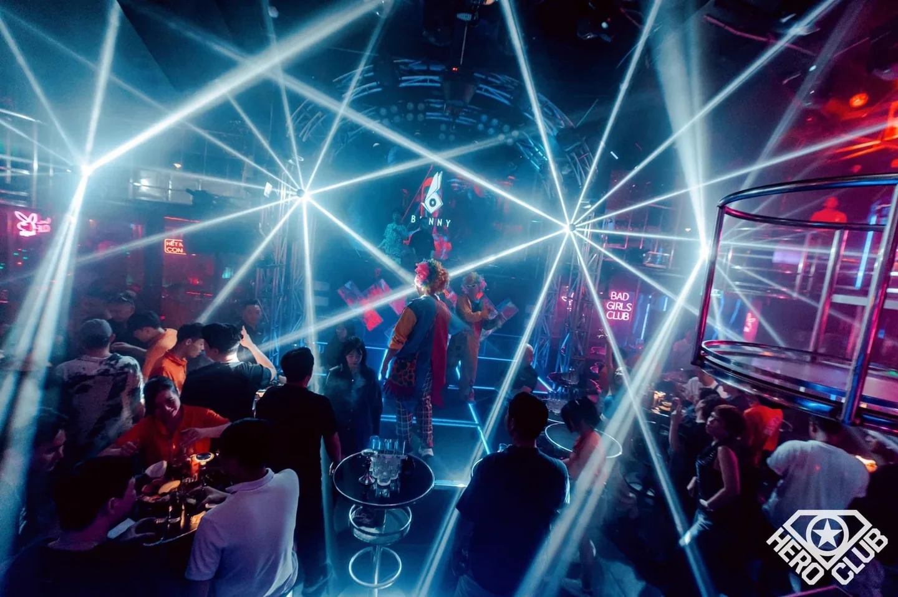
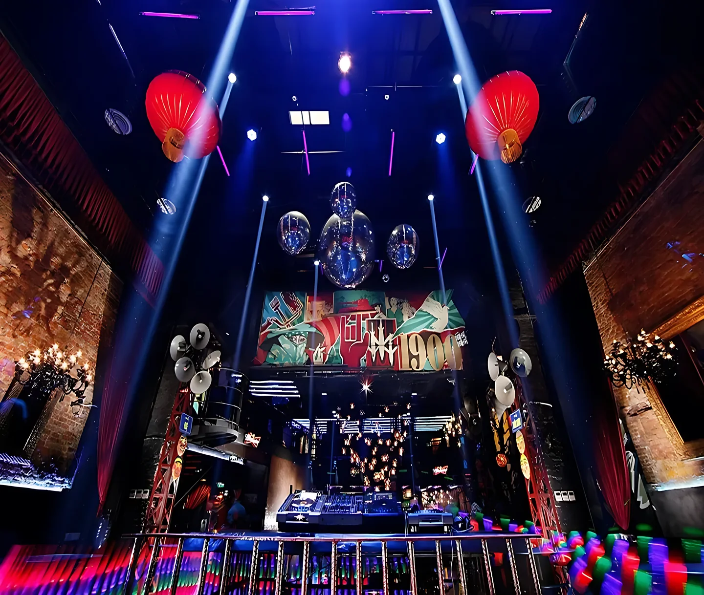
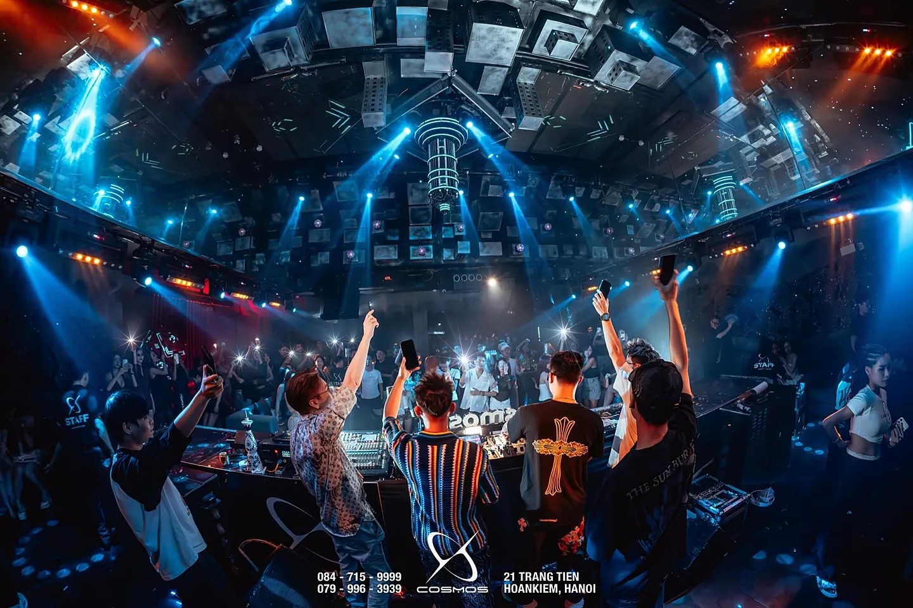

**Club Hà Nội** tập trung ở hai khu: phố **Yên Phụ (Ba Đình)** ven hồ Trúc Bạch, nơi có nhiều club lớn nằm sát nhau, và **phố cổ Hoàn Kiếm** quanh Tạ Hiện, Tràng Tiền, Ngô Văn Sở. Gu nhạc đa dạng: EDM, trance, techno ở super club, deep house và hip-hop ở club cá tính, house và tech house ở club mái vòm LED. Bài này gom 6 club, lounge được đặt nhiều nhất, kèm địa chỉ, giờ mở cửa và mức chi tham khảo.

## Club Hà Nội tập trung ở đâu?

- **Phố Yên Phụ, Ba Đình:** APLUS, Hero Club, Track 42 nằm trên cùng tuyến phố, tiện đổi club trong một tối.
- **Phố cổ Hoàn Kiếm:** 1900 Le Théâtre ở Tạ Hiện, Cosmos Club ở Tràng Tiền, Maxx Bar & Lounge ở Ngô Văn Sở.

Xem toàn bộ danh sách tại trang [club Hà Nội](/club-ha-noi/), [bar Ba Đình](/bar-ba-dinh/) và [bar Hoàn Kiếm](/bar-hoan-kiem/).

## Club phố Yên Phụ

### APLUS HANOI

[APLUS HANOI](/bar/aplus-hanoi/) (APLUS CLUB) là super club ở 78 Yên Phụ, Ba Đình, chuyên nhạc điện tử với không gian quy mô lớn. Âm nhạc xoay quanh big-room EDM, trance dồn dập và techno nặng bass, thường có đêm diễn của DJ. Hợp nhóm bạn muốn quẩy hết mình trên sàn nhảy đông người.

- Giờ mở cửa: 19:00 – 04:00
- Nhạc: EDM, trance, techno
- Mức chi tham khảo: từ 300.000đ/người

### Hero Club

[Hero Club](/bar/hero-club/) ở 42M Yên Phụ, Trúc Bạch, nội thất phong cách công nghiệp, tranh tường siêu anh hùng và quầy DJ đặt trong một chiếc xe tải cũ. Nhạc chủ yếu là deep house, hip-hop và R&B, thường có DJ khách mời cuối tuần, thu hút cả khách địa phương lẫn người nước ngoài.

- Nhạc: deep house, hip-hop, R&B
- Mức chi tham khảo: từ 400.000đ/người

### Track 42

[Track 42](/bar/track-42/) ở 42 Yên Phụ, Ba Đình, theo phong cách "mainstream luxury" với các loại bàn SVIP, bàn đứng và bàn quầy kèm dịch vụ chai. Hợp nhóm bạn thích nhạc mainstream và EDM.

- Mức chi tham khảo: từ 500.000đ/người

## Club phố cổ Hoàn Kiếm

### 1900 Le Théâtre

[1900 Le Théâtre](/bar/1900-le-theatre/) ở 8B Tạ Hiện, nằm trong tòa nhà của nhà hát Quảng Lạc cũ, sức chứa khoảng 1.500 khách. Club có sàn nhảy rộng, khu VIP, thường có DJ quốc tế, live band và tiệc chủ đề, từng vào top 100 club của DJ Mag năm 2024. Khách cần đủ 18 tuổi và mang giấy tờ tùy thân.

- Mức chi tham khảo: từ 600.000đ/người

### Cosmos Club

[Cosmos Club](/bar/cosmos-club/) ở 21 Tràng Tiền, vài phút đi bộ từ hồ Hoàn Kiếm, tập trung vào house, tech house và EDM. Điểm nhấn là mái vòm LED và màn hình LED cong 360 độ bao quanh sân khấu.

- Giờ mở cửa: 21:00 – 04:00
- Mức chi tham khảo: từ 500.000đ/người

### Maxx Bar & Lounge

[Maxx Bar & Lounge](/bar/maxx-bar-va-lounge/) (còn gọi New Fame Bar) ở 25 Ngô Văn Sở, gần trung tâm và hồ Hoàn Kiếm. Phong cách bar lounge có DJ, đặt bàn theo nhóm, hợp tụ tập bạn bè hay tổ chức sinh nhật.

- Mức chi tham khảo: từ 400.000đ/người

## So sánh nhanh club Hà Nội

| Club | Nhạc chính | Địa chỉ | Mức chi tham khảo |
|---|---|---|---|
| APLUS HANOI | EDM, trance, techno | 78 Yên Phụ, Ba Đình | Từ 300k/người |
| 1900 Le Théâtre | DJ quốc tế, live band | 8B Tạ Hiện, Hoàn Kiếm | Từ 600k/người |
| Hero Club | Deep house, hip-hop, R&B | 42M Yên Phụ, Ba Đình | Từ 400k/người |
| Track 42 | Mainstream, EDM | 42 Yên Phụ, Ba Đình | Từ 500k/người |
| Maxx Bar & Lounge | DJ, nhạc sàn | 25 Ngô Văn Sở, Hoàn Kiếm | Từ 400k/người |
| Cosmos Club | House, tech house, EDM | 21 Tràng Tiền, Hoàn Kiếm | Từ 500k/người |

Mức chi là giá tham khảo, thay đổi theo đồ uống và loại bàn. Giờ mở cửa và lịch DJ có thể thay đổi, gọi tổng đài để xác nhận trước khi đi.

:::cta
Đặt bàn club Hà Nội tối nay
Gọi 0838 000 222 hoặc để lại số điện thoại, tổng đài TopChill giữ bàn và báo ưu đãi giúp bạn, không cần cọc.
:::

## Kinh nghiệm đi club ở Hà Nội

1. **Club đông nhất từ khoảng 23h** và tối thứ 6, thứ 7. Đặt bàn trước, nhất là khi có DJ khách mời.
2. **Đi Yên Phụ nếu muốn đổi club trong một tối:** APLUS, Hero Club, Track 42 cách nhau vài phút đi bộ.
3. **Hỏi mức chi tối thiểu** khi đặt bàn VIP, SVIP hoặc sofa, mỗi club áp dụng khác nhau.
4. **Mang CCCD,** club kiểm tra tuổi ở cửa (đủ 18 tuổi). Nam nên mặc áo có cổ, giày kín.
5. **Mùa đông Hà Nội lạnh,** mang áo khoác và gửi đồ ở quầy nếu club có.
6. **Uống có trách nhiệm,** không lái xe sau khi uống rượu bia. Gọi taxi hoặc xe công nghệ.

Muốn ngồi rooftop trước khi vào club? Đọc [rooftop bar Hà Nội](/blog/rooftop-bar-ha-noi/) và [top bar Hà Nội](/blog/top-bar-ha-noi/). Đi Sài Gòn thì xem [club Sài Gòn](/blog/club-sai-gon/).

## Câu hỏi thường gặp

### Club Hà Nội tập trung ở đâu?

Chủ yếu ở phố Yên Phụ (Ba Đình), nơi có APLUS, Hero Club, Track 42, và phố cổ Hoàn Kiếm với 1900 Le Théâtre (Tạ Hiện), Cosmos Club (Tràng Tiền), Maxx Bar & Lounge (Ngô Văn Sở).

### Club nào ở Hà Nội lớn nhất?

1900 Le Théâtre có sức chứa khoảng 1.500 khách và từng vào top 100 club DJ Mag 2024. APLUS HANOI là super club nhạc điện tử quy mô lớn trên phố Yên Phụ.

### Club nào ở Hà Nội mở khuya?

APLUS HANOI mở từ 19:00 đến 04:00 và Cosmos Club mở từ 21:00 đến 04:00. Giờ có thể đổi theo ngày, gọi tổng đài để xác nhận.

### Đi club ở Hà Nội hết bao nhiêu tiền?

Mức chi tham khảo khoảng 300.000đ–600.000đ mỗi người trở lên cho 2–3 đồ uống. Bàn VIP, SVIP thường có mức chi tối thiểu cao hơn, gọi tổng đài để được báo giá.

### Đặt bàn club Hà Nội qua TopChill có cần cọc không?

Không. Bạn gọi 0838 000 222, nhắn Zalo hoặc để lại số trên web, tổng đài sẽ gọi lại xác nhận bàn.
