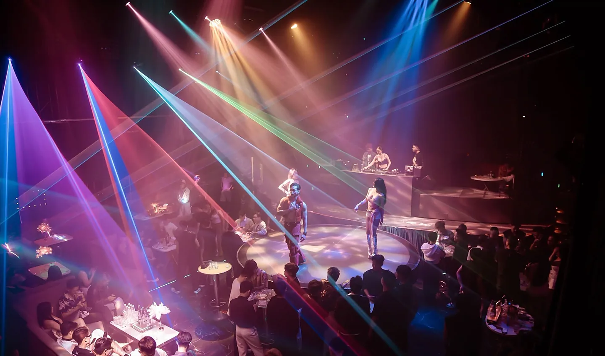
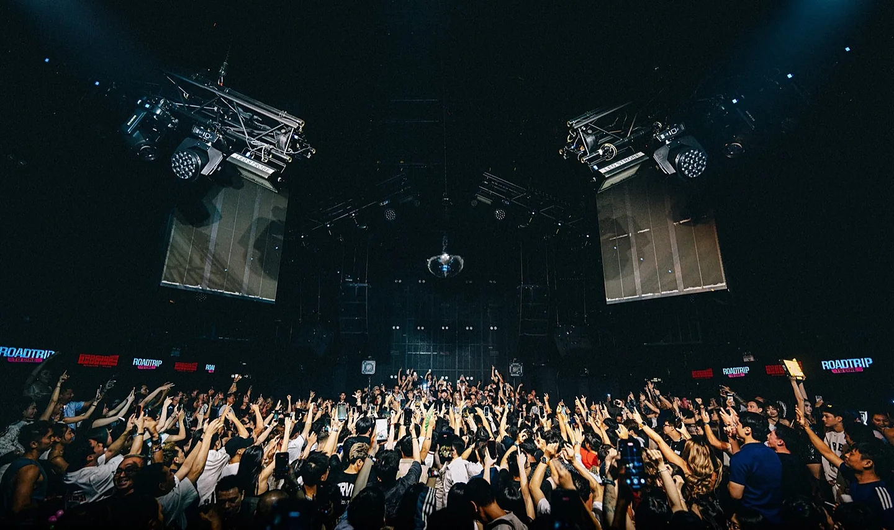
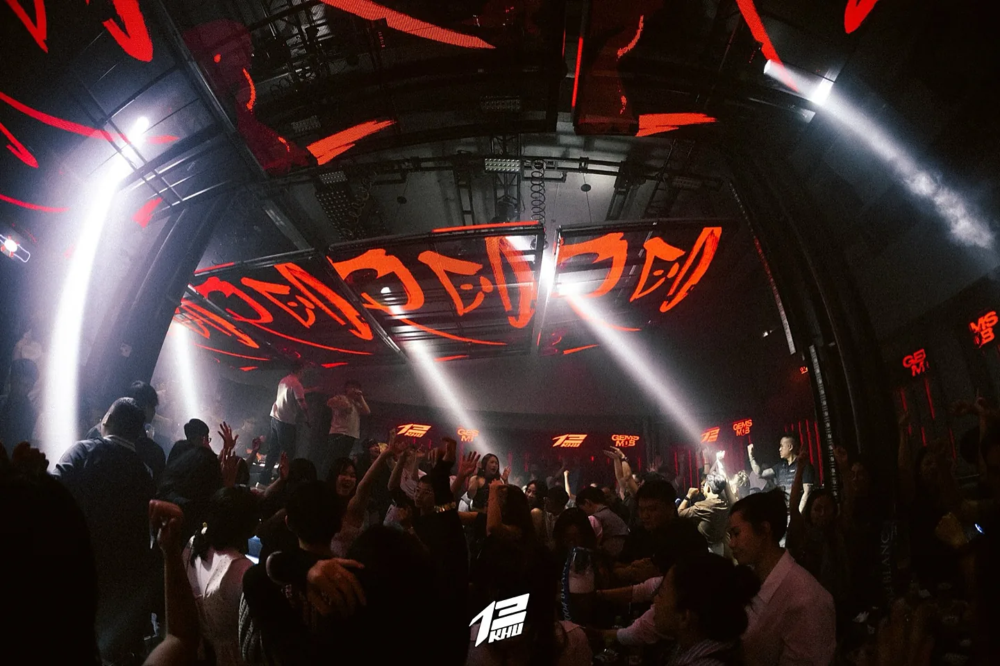
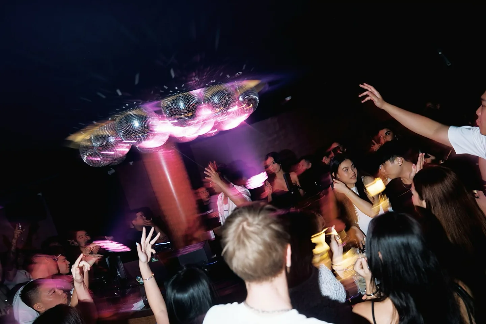
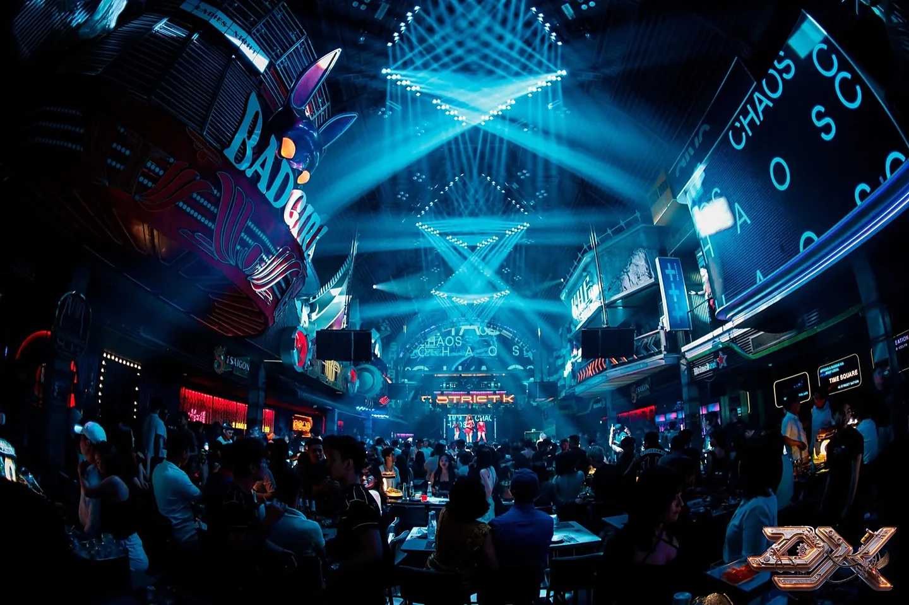

**Club Sài Gòn** tập trung gần như hết ở Quận 1, quanh Hàm Nghi, Phạm Ngũ Lão, Cống Quỳnh, Thủ Khoa Huân và Nguyễn Công Trứ, cộng thêm vài club lớn ở Quận 3. Mỗi club một gu nhạc: Vinahouse, EDM, techno underground, hip-hop và R&B. Bài này gom 9 club, lounge theo gu nhạc, kèm địa chỉ, giờ mở cửa và mức chi tham khảo để bạn chọn nhanh.

## Club Sài Gòn tập trung ở đâu?

- **Quận 1 (Hàm Nghi, Cống Quỳnh, Thủ Khoa Huân, Nguyễn Công Trứ):** phần lớn club lớn và lounge sôi động.
- **Phạm Ngũ Lão, Đề Thám (phố Tây):** club underground và bar mở khuya.
- **Quận 3 (Nam Kỳ Khởi Nghĩa):** club Vinahouse quy mô lớn.

Xem toàn bộ danh sách tại trang [club Sài Gòn](/club-sai-gon/) và [bar Quận 1](/bar-quan-1/).

## Club Vinahouse, EDM quy mô lớn

### Canalis Club

[Canalis Club](/bar/canalis-club/) là hộp đêm quy mô lớn ở 264 Nam Kỳ Khởi Nghĩa, Quận 3, trước đây mang tên Barocco Club. Club nổi tiếng với nhạc Vinahouse, hệ thống màn LED cỡ lớn và dịch vụ đặt bàn, khách chủ yếu là người trẻ trong nước. Có đêm sự kiện hằng tuần với DJ và nghệ sĩ.

- Giờ mở cửa: 20:30 – 03:30
- Nhạc: Vinahouse
- Mức chi tham khảo: từ 500.000đ/người

### CINÉ Saigon

[CINÉ Saigon](/bar/cine-saigon/) ở 148 Cống Quỳnh, Quận 1, cải tạo từ rạp chiếu phim Thăng Long cũ, giữ lại trần cao khoảng 13 mét và dấu ấn kiến trúc của rạp. Các đêm tiệc kết hợp EDM, house, techno và nhạc club Việt, có chuỗi sự kiện với DJ trong và ngoài nước.

- Giờ mở cửa: 21:00 – 03:00
- Mức chi tham khảo: từ 500.000đ/người

### D-Rave Club SGN

[D-Rave Club SGN](/bar/d-rave-club-sgn/) ở 11-21 Hàm Nghi, ngay trung tâm Quận 1. Club có sân khấu trung tâm, âm thanh ánh sáng hiện đại và sàn nhảy mở, sức chứa khoảng 200 khách. Nhạc tập trung vào EDM, techno, house và trap, xen kẽ hip-hop và Vinahouse.

- Mức chi tham khảo: từ 400.000đ/người

## Techno, underground và hip-hop

### Khu 13 Sài Gòn

[Khu 13 Sài Gòn](/bar/khu-13-sai-gon/) là club underground trong hẻm 175 Phạm Ngũ Lão, Quận 1, thiết kế hơi hướng công nghiệp. Nhạc chủ đạo là techno, house và minimal, xen các set hip-hop, có các đêm chủ đề như "Friday 13".

- Giờ mở cửa: 21:00 – 03:00
- Mức chi tham khảo: từ 400.000đ/người

### Weeknd SGN

[Weeknd SGN](/bar/weeknd-sgn/) là club hip-hop và R&B ở tầng 3, 66 Huỳnh Thúc Kháng, Quận 1, cơ sở chị em của Weeknd Hà Nội. Club chỉ mở các đêm cuối tuần từ thứ Sáu đến Chủ nhật, sức chứa khoảng 300 khách, có bàn sofa theo mức chi tối thiểu.

- Giờ mở cửa: 22:00 – 05:00 (thứ Sáu – Chủ nhật)
- Mức chi tham khảo: từ 500.000đ/người

### Frolic Bar

[Frolic Bar](/bar/frolic-bar/) là bar LGBTQ+ ở 151 Đề Thám, Quận 1, gần phố Tây Bùi Viện. Có DJ, vũ công go-go và drag show vào cuối tuần, không gian nhỏ, sôi động và cởi mở.

- Giờ mở cửa: 20:00 – 03:00
- Mức chi tham khảo: từ 300.000đ/người

## Lounge, beer club và club lâu đời

### Fetti Social Club

[Fetti Social Club](/bar/fetti-social-club/) ở 20 Nguyễn Công Trứ, Quận 1, kết hợp social club, lounge và club. Không gian đèn đỏ với điểm nhấn là những quả cầu disco xếp chồng, sức chứa khoảng 200 khách, có Ladies Night vào thứ Tư.

- Giờ mở cửa: 20:00 – 02:00
- Dress code: trang phục dự tiệc, nam không mang dép lê
- Mức chi tham khảo: từ 400.000đ/người

### District K

[District K](/bar/district-k/) là tổ hợp gastrobar, beer club và lounge ở 30 Thủ Khoa Huân, gần chợ Bến Thành, thiết kế như một "con phố mini" tương lai rực đèn neon, sức chứa khoảng 400 khách. Ngoài DJ và cocktail còn có beer pong, bi-a, bi lắc và múa lửa.

- Giờ mở cửa: 16:00 – 02:00
- Mức chi tham khảo: từ 300.000đ/người

### Apocalypse Now

[Apocalypse Now](/bar/apocalypse-now/) là bar và club lâu đời ở 2B Thi Sách, Quận 1, thu hút khách du lịch, người nước ngoài và khách địa phương, nổi tiếng vì mở muộn hơn phần lớn club trong thành phố, tới khoảng 4 giờ sáng.

- Mức chi tham khảo: từ 550.000đ/người

## So sánh nhanh club Sài Gòn

| Club | Nhạc chính | Địa chỉ | Mức chi tham khảo |
|---|---|---|---|
| Canalis Club | Vinahouse | 264 Nam Kỳ Khởi Nghĩa, Q.3 | Từ 500k/người |
| CINÉ Saigon | EDM, house, techno | 148 Cống Quỳnh, Q.1 | Từ 500k/người |
| D-Rave Club SGN | EDM, techno, trap | 11-21 Hàm Nghi, Q.1 | Từ 400k/người |
| Khu 13 Sài Gòn | Techno, underground | 175/22 Phạm Ngũ Lão, Q.1 | Từ 400k/người |
| Weeknd SGN | Hip-hop, R&B | 66 Huỳnh Thúc Kháng, Q.1 | Từ 500k/người |
| Fetti Social Club | EDM, hip-hop, house | 20 Nguyễn Công Trứ, Q.1 | Từ 400k/người |
| District K | DJ, beer club | 30 Thủ Khoa Huân, Q.1 | Từ 300k/người |
| Apocalypse Now | Club lâu đời | 2B Thi Sách, Q.1 | Từ 550k/người |

Mức chi là giá tham khảo, thay đổi theo đồ uống và loại bàn. Giờ mở cửa và lịch sự kiện có thể thay đổi, gọi tổng đài để xác nhận trước khi đi.

:::cta
Đặt bàn club Sài Gòn tối nay
Gọi 0838 000 222 hoặc để lại số điện thoại, tổng đài TopChill giữ bàn và báo ưu đãi giúp bạn, không cần cọc.
:::

## Kinh nghiệm đi club ở Sài Gòn

1. **Club đông nhất từ khoảng 23h** và tối thứ 6, thứ 7. Đặt bàn trước, nhất là khi có DJ khách mời.
2. **Hỏi mức chi tối thiểu** khi đặt bàn VIP hoặc sofa, mỗi club áp dụng khác nhau.
3. **Chọn club theo gu nhạc:** Vinahouse ở Canalis; EDM, techno ở CINÉ, D-Rave, Khu 13; hip-hop, R&B ở Weeknd.
4. **Mang CCCD,** club có thể kiểm tra giấy tờ ở cửa. Nam nên mặc áo có cổ, giày kín.
5. **Uống có trách nhiệm,** không lái xe sau khi uống rượu bia. Gọi taxi hoặc xe công nghệ.

Muốn ngồi rooftop trước khi vào club? Đọc [bar Sài Gòn](/blog/bar-sai-gon/). Chưa biết gọi gì, xem [đi bar nên uống gì](/blog/di-bar-nen-uong-gi/).

## Câu hỏi thường gặp

### Club Sài Gòn tập trung ở đâu?

Phần lớn ở Quận 1, quanh Hàm Nghi, Cống Quỳnh, Thủ Khoa Huân, Nguyễn Công Trứ và phố Tây Phạm Ngũ Lão. Canalis Club nằm ở Quận 3, trên đường Nam Kỳ Khởi Nghĩa.

### Club nào ở Sài Gòn chơi Vinahouse?

Canalis Club (264 Nam Kỳ Khởi Nghĩa) nổi tiếng với Vinahouse. D-Rave, CINÉ Saigon và Fetti cũng xen Vinahouse trong các set EDM, house.

### Club nào ở Sài Gòn chơi techno, hip-hop?

Khu 13 Sài Gòn thiên về techno, house, minimal underground. Weeknd SGN chuyên hip-hop và R&B, chỉ mở thứ Sáu đến Chủ nhật.

### Đi club ở Sài Gòn hết bao nhiêu tiền?

Mức chi tham khảo khoảng 300.000đ–550.000đ mỗi người trở lên cho 2–3 đồ uống. Bàn VIP, sofa thường có mức chi tối thiểu cao hơn, gọi tổng đài để được báo giá.

### Đặt bàn club Sài Gòn qua TopChill có cần cọc không?

Không. Bạn gọi 0838 000 222, nhắn Zalo hoặc để lại số trên web, tổng đài sẽ gọi lại xác nhận bàn.
