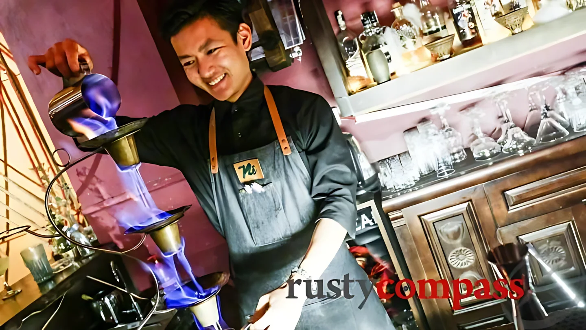
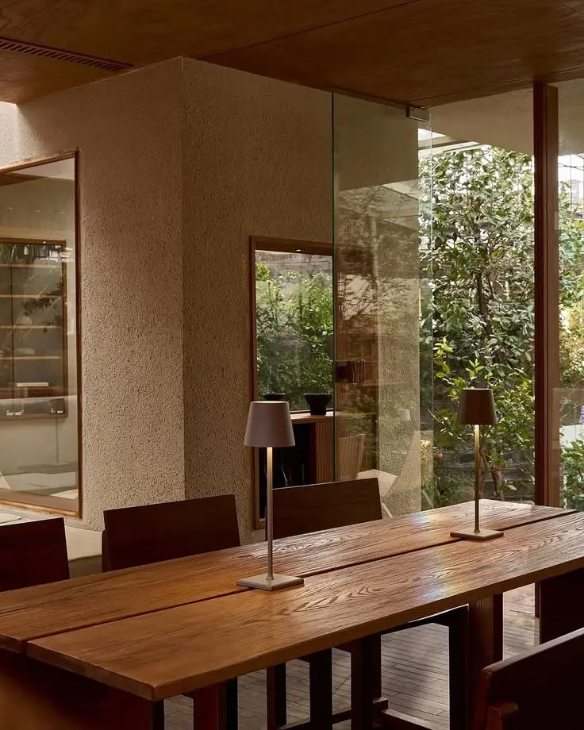
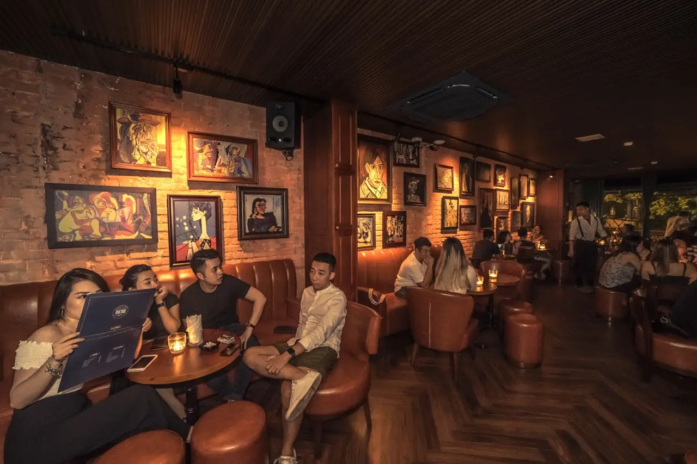

**Cocktail bar Hà Nội** tập trung trong phố cổ Hoàn Kiếm, nhất là hai con phố **Tống Duy Tân** và **Phùng Hưng**, cùng vài quán nhỏ yên tĩnh ở **Tây Hồ**. Có quán đưa hương vị Việt vào ly như cocktail Phở, có quán lọt danh sách mở rộng Asia's 50 Best Bars, có quán pha riêng theo khẩu vị từng khách. Bài này gom 9 quán kèm địa chỉ, điểm nổi bật và mức chi tham khảo.

## Cocktail bar Hà Nội tập trung ở đâu?

- **Tống Duy Tân, Hàng Bông:** Nê Cocktail Bar, The Black Sheep.
- **Phùng Hưng:** Gallery Bespoke, Bee'Znees.
- **Quanh hồ Hoàn Kiếm, Hàng Mã:** Polite & Co, The Haflington, Angelina (Metropole).
- **Tây Hồ:** Workshop14 trong ngõ Từ Hoa, gần Hồ Tây.

Xem toàn bộ danh sách tại trang [cocktail bar Hà Nội](/cocktail-bar-ha-noi/) và [bar Hoàn Kiếm](/bar-hoan-kiem/).

## Cocktail mang hương vị Việt

### Nê Cocktail Bar

[Nê Cocktail Bar](/bar/ne-cocktail-bar/) ở 3B Tống Duy Tân, Hàng Bông, mở từ năm 2017, gắn với bartender **Phạm Tiến Tiệp**. Quán theo đuổi cocktail thủ công dùng nguyên liệu Việt, tiêu biểu là món **cocktail Phở**.

- Mức chi tham khảo: từ 300.000đ/người

### The Alchemist Cocktail Bar

[The Alchemist](/bar/the-alchemist-cocktail-bar/) trên tầng hai một tòa nhà cũ trong phố cổ, không biển hiệu, lối vào qua một quán cà phê. Cocktail dùng **thảo mộc và nguyên liệu Việt**.

- Mức chi tham khảo: từ 350.000đ/người

## Quán được giới chuyên môn ghi nhận

### Workshop14 (Tây Hồ)

[Workshop14](/bar/workshop14/) chỉ khoảng 14 chỗ, ẩn sau cánh cổng gỗ trong ngõ 5 Từ Hoa, Quảng An, gần chùa Kim Liên. Quán do bartender Rich McDonough sáng lập, **xếp hạng 83 trong danh sách mở rộng Asia's 50 Best Bars 2025** và nhận giải Campari One To Watch.

- Giờ mở cửa: 16:00 – 00:30
- Mức chi tham khảo: từ 350.000đ/người

### Polite & Co

[Polite & Co](/bar/polite-va-co/) ở 5B Bảo Khánh, vài bước từ hồ Hoàn Kiếm, hoạt động từ năm 1995. Khoảng 25 loại cocktail thay đổi theo thời gian, chú trọng **công thức kinh điển**. Nên đặt trước nếu muốn ngồi quầy.

- Mức chi tham khảo: từ 400.000đ/người

## Cocktail pha riêng và không gian độc đáo

### Gallery Bespoke Cocktail Bar

[Gallery Bespoke](/bar/gallery-bespoke-cocktail-bar/) ở 95 Phùng Hưng, phía sau một phòng trưng bày nghệ thuật nhỏ, quán anh em với Jigger. Điểm đặc biệt là **cocktail pha theo yêu cầu** và Bespoke Bottles, ngoài cocktail signature, cổ điển, vang và bia thủ công.

- Mức chi tham khảo: từ 300.000đ/người

### The Black Sheep

[The Black Sheep](/bar/the-black-sheep/) ở 28 Tống Duy Tân, concept **nhà hát cocktail thu nhỏ**, tông đen và rèm đỏ. Có DJ sau 22 giờ, mở muộn vào cuối tuần.

- Mức chi tham khảo: từ 350.000đ/người

### The Haflington

[The Haflington](/bar/the-haflington/) ở 94 Hàng Mã, không gian như bảo tàng châu Âu với **bộ xương khủng long** treo trên quầy bar.

- Giờ mở cửa: 15:00 – 01:00
- Mức chi tham khảo: từ 300.000đ/người

### Bee'Znees

[Bee'Znees](/bar/bee-znees/) ở 163 Phùng Hưng, lối vào ngụy trang như kệ sách, nhạc jazz chủ đạo, nhạc sống tối thứ Tư. Cocktail xoay quanh gin, whisky, vodka, rum và tequila.

- Giờ mở cửa: 19:00 – 00:00
- Mức chi tham khảo: từ 300.000đ/người

### Angelina – Sofitel Legend Metropole

[Angelina](/bar/angelina-sofitel-legend-metropole/) ở tầng trệt khách sạn Metropole, 15 Ngô Quyền. Ngoài cocktail còn có **hơn 200 loại whisky**, nhiều chai hiếm, và là Habanos Lounge cho người mê xì gà.

- Mức chi tham khảo: từ 400.000đ/người

## So sánh nhanh cocktail bar Hà Nội

| Quán | Điểm nổi bật | Địa chỉ | Mức chi tham khảo |
|---|---|---|---|
| Nê Cocktail Bar | Cocktail vị Việt, cocktail Phở | 3B Tống Duy Tân | Từ 300k/người |
| Workshop14 | Asia's 50 Best mở rộng #83 (2025) | Ngõ 5 Từ Hoa, Tây Hồ | Từ 350k/người |
| Polite & Co | Cocktail kinh điển, từ 1995 | 5B Bảo Khánh | Từ 400k/người |
| Gallery Bespoke | Pha theo yêu cầu | 95 Phùng Hưng | Từ 300k/người |
| The Black Sheep | Nhà hát cocktail, DJ sau 22h | 28 Tống Duy Tân | Từ 350k/người |
| The Haflington | Bộ xương khủng long | 94 Hàng Mã | Từ 300k/người |
| Bee'Znees | Speakeasy, jazz | 163 Phùng Hưng | Từ 300k/người |
| Angelina | Whisky, xì gà | 15 Ngô Quyền | Từ 400k/người |

Mức chi là giá tham khảo, thay đổi theo đồ uống bạn chọn. Giờ mở cửa có thể thay đổi, gọi tổng đài để xác nhận trước khi đi.

:::cta
Giữ chỗ cocktail bar tối nay
Nhiều quán cocktail ở Hà Nội ít chỗ. Gọi 0838 000 222 hoặc để lại số, tổng đài TopChill giữ chỗ và báo ưu đãi giúp bạn, không cần cọc.
:::

## Kinh nghiệm đi cocktail bar ở Hà Nội

1. **Đặt chỗ trước,** nhất là Workshop14 và các quán dưới 20 chỗ.
2. **Đi một tối nhiều quán:** Tống Duy Tân và Phùng Hưng có nhiều quán cách nhau vài phút đi bộ.
3. **Nói khẩu vị với bartender** (chua, ngọt, đắng, mạnh, nhẹ) để được pha ly hợp ý.
4. **Thử món vị Việt** như cocktail Phở ở Nê, hoặc cocktail thảo mộc ở The Alchemist.
5. **Uống có trách nhiệm,** không lái xe sau khi uống rượu bia.

Chưa quen gọi cocktail? Đọc [các loại cocktail phổ biến](/blog/cac-loai-cocktail-pho-bien/). Thích quán ẩn mình, xem [speakeasy Việt Nam](/blog/speakeasy-viet-nam/); muốn nghe nhạc sống, xem [jazz bar](/blog/jazz-bar/).

## Câu hỏi thường gặp

### Cocktail bar Hà Nội tập trung ở đâu?

Chủ yếu ở phố cổ Hoàn Kiếm, nhất là Tống Duy Tân và Phùng Hưng. Tây Hồ có Workshop14 trong ngõ Từ Hoa.

### Quán cocktail nào ở Hà Nội có món vị Việt?

Nê Cocktail Bar (3B Tống Duy Tân) nổi tiếng với cocktail Phở và các ly dùng nguyên liệu Việt. The Alchemist dùng thảo mộc và nguyên liệu địa phương.

### Cocktail bar nào ở Hà Nội được xếp hạng quốc tế?

Workshop14 ở Tây Hồ xếp hạng 83 trong danh sách mở rộng Asia's 50 Best Bars 2025 và nhận giải Campari One To Watch.

### Một ly cocktail ở Hà Nội giá bao nhiêu?

Mức chi tham khảo khoảng 300.000đ–400.000đ mỗi người trở lên cho 2 ly, tuỳ quán. Bar khách sạn thường cao hơn quán độc lập.

### Đặt chỗ cocktail bar qua TopChill có cần cọc không?

Không. Bạn gọi 0838 000 222, nhắn Zalo hoặc để lại số trên web, tổng đài sẽ gọi lại xác nhận chỗ.
