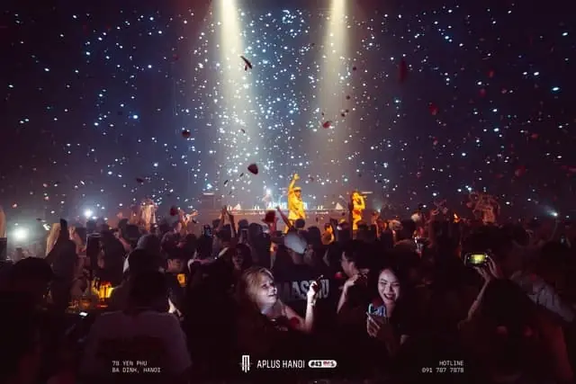

**Đặt bàn bar không cọc** qua TopChill giúp bạn gửi yêu cầu giữ chỗ mà không phải chuyển khoản cọc trước buổi đi. Khi đặt bàn qua TopChill, bạn không cần đặt cọc tại toàn bộ quán trên nền tảng. Bạn chọn quán, cung cấp thông tin buổi đi và nhận xác nhận bàn trước khi đến.

**[Chọn bar Hà Nội](https://topchill.vn/bar-ha-noi/) · [Chọn bar Sài Gòn](https://topchill.vn/bar-sai-gon/) · [Chọn bar Đà Nẵng](https://topchill.vn/bar-da-nang/)**

Đã chọn được quán? Mở trang quán và bấm **Đặt Bàn Ngay** để vào app, hoặc **[gọi 0838 000 222 để đặt bàn](tel:0838000222)**. Chuẩn bị tên quán, ngày, giờ đến và số khách để TopChill kiểm tra tình trạng bàn.

## Không cọc áp dụng như thế nào?

Chính sách không cọc áp dụng cho toàn bộ quán trên nền tảng khi bạn đặt qua TopChill. Bạn không phải chuyển khoản cọc giữ bàn trước khi đến.

Khi lên kế hoạch, hãy hỏi riêng các khoản chi cho buổi đi:

- **Đồ uống và đồ ăn:** món bạn chọn và giá trên thực đơn áp dụng tại thời điểm đến.
- **Mức chi tối thiểu, nếu có:** mức chi được yêu cầu cho loại bàn hoặc nhóm khách bạn chọn.
- **Phí và phụ phí, nếu có:** hỏi rõ phí đặt bàn, phí phục vụ, thuế, vé sự kiện hoặc những khoản khác trước khi xác nhận.

Không cọc không đồng nghĩa toàn bộ dịch vụ đều miễn phí. TopChill sẽ cần xác nhận tình trạng bàn và các điều kiện cho lựa chọn của bạn; một yêu cầu vừa gửi chưa phải là bàn đã được xác nhận.

## Cách đặt bàn qua TopChill

1. **Chọn quán.** Xem danh sách ở thành phố bạn muốn đến, mở trang chi tiết để đọc địa chỉ, loại hình và thông tin tham khảo.
2. **Chuẩn bị thông tin.** Ghi tên quán, ngày đi, giờ đến, số khách và loại bàn mong muốn. Nêu thêm nếu bạn đi sinh nhật, cần ngồi cùng nhóm hoặc có yêu cầu vị trí.
3. **Mở bảng đặt bàn trong app.** Bấm **Đặt Bàn Ngay** trên trang quán, chọn ngày, số khách, giờ đến và loại bàn. Bạn có thể gọi, nhắn Zalo, Telegram hoặc nhập số điện thoại rồi bấm **Gửi yêu cầu** để được liên hệ lại. Hỏi luôn mức chi, các khoản phí và cách đổi/hủy.
4. **Nhận xác nhận cụ thể.** Kiểm tra lại tên quán, địa chỉ, ngày giờ, số khách, loại bàn và thời gian giữ chỗ. Chỉ coi bàn đã được xác nhận khi bạn nhận được thông tin xác nhận từ bên tiếp nhận.

Bạn có thể chuẩn bị sẵn nội dung sau trước khi liên hệ:

> Mình muốn đặt bàn không cọc qua TopChill tại [tên quán], ngày [ngày], khoảng [giờ], cho [số người]. Nhờ kiểm tra còn bàn và báo giúp mức chi tối thiểu, phí/phụ phí nếu có, thời gian giữ chỗ và điều kiện đổi/hủy.

## Mở đúng quán trong app để gửi yêu cầu

Hai ví dụ dưới đây giúp bạn nhận diện đường đi từ trang quán tới bảng đặt bàn. Đây là hướng dẫn thao tác, không phải bảng xếp hạng hoặc lời bảo đảm quán luôn còn chỗ.

### Ví dụ với APLUS HANOI

[APLUS HANOI](/bar/aplus-hanoi/) là club tại 78 Yên Phụ, khu vực Ba Đình, Hà Nội. Dữ liệu quán trên TopChill ghi nhận dòng nhạc EDM, trance và techno. Nếu đây là trải nghiệm nhóm đang tìm, bạn có thể [mở bảng đặt bàn APLUS HANOI](/?dat=19) rồi chọn thông tin buổi đi.

### Ví dụ với Hero Club

[Hero Club](/bar/hero-club/) nằm tại 42M Yên Phụ, Trúc Bạch, Ba Đình, Hà Nội. Loại hình trong dữ liệu là club, với deep house, hip-hop và R&B. Bạn có thể [mở bảng đặt bàn Hero Club](/?dat=93), kiểm tra lại tên quán rồi chọn ngày, giờ và số khách của nhóm.

Trong bảng đặt bàn, hãy đọc lựa chọn của đúng quán thay vì áp dụng mức chi hoặc loại bàn của quán khác. Nếu chưa rõ một mục, dùng nút gọi để hỏi trước khi gửi yêu cầu. Việc mở bảng hoặc bấm gửi chỉ bắt đầu quá trình liên hệ; bạn vẫn cần nhận xác nhận bàn cụ thể.

## Trước khi đến, cần kiểm tra những gì?

**Địa điểm và thời gian:** đúng chi nhánh, đúng ngày, đúng giờ bạn dự định đến. Nếu quán nằm trong khách sạn hoặc tòa nhà, hỏi lối vào và tầng cần đến.

**Loại bàn:** bàn thường, bàn đứng, sofa hay VIP; nhóm có ngồi cùng nhau được không? Với rooftop, hỏi vị trí ngoài trời hay trong nhà và phương án khi thời tiết thay đổi.

**Chi phí:** mức chi được tính cho mỗi người hay cả bàn; giá đã gồm thuế và phí phục vụ chưa; đêm bạn đến có vé sự kiện hay phụ phí không?

**Thay đổi kế hoạch:** nếu đến trễ, đổi số khách hoặc hủy, bạn cần báo qua kênh nào và trước thời điểm nào? Hãy hỏi khi xác nhận bàn, rồi lưu lại nội dung trao đổi để tiện đối chiếu.

Nếu nhận được yêu cầu chuyển tiền cọc khi đặt qua TopChill, hãy liên hệ lại đúng số công khai trên website để làm rõ: chính sách không cọc áp dụng cho toàn bộ quán trên nền tảng.

## Chọn quán theo thành phố

- **[Bar Hà Nội](https://topchill.vn/bar-ha-noi/):** xem danh sách, địa chỉ và loại hình để chọn điểm hẹn cho nhóm.
- **[Bar Sài Gòn](https://topchill.vn/bar-sai-gon/):** chọn quán phù hợp với khu vực và trải nghiệm bạn muốn.
- **[Bar Đà Nẵng](https://topchill.vn/bar-da-nang/):** xem các lựa chọn tại thành phố rồi hỏi tình trạng bàn vào ngày bạn đến.

Nếu cần chuẩn bị thêm về cách chọn không gian và trao đổi chi phí, xem [kinh nghiệm đi bar lần đầu](/blog/kinh-nghiem-di-bar-lan-dau/). Bài hướng dẫn đó dành cho việc chuẩn bị buổi đi; chính sách không cọc được giải thích tại trang bạn đang đọc.

Thông tin quán và mức giá tham khảo có thể thay đổi. Hãy xác nhận lại cho đúng ngày, giờ và loại bàn của bạn.

:::cta
Chọn quán và gửi yêu cầu đặt bàn
Mở [app khám phá bar](/kham-pha/), chọn quán rồi bấm Đặt Bàn Ngay; hoặc [gọi 0838 000 222](tel:0838000222). Không cần cọc, vẫn cần nhận xác nhận bàn trước khi đến.
:::

Uống có trách nhiệm, không lái xe sau khi uống và sắp xếp phương tiện về phù hợp.

## Câu hỏi thường gặp

### Không cọc áp dụng cho tất cả quán hay chỉ quán đối tác?

Áp dụng cho toàn bộ quán trên nền tảng khi bạn đặt qua TopChill. Bạn vẫn cần nhận xác nhận còn bàn và hỏi rõ chi phí cho lựa chọn của mình.

### Không cọc có nghĩa là miễn phí đặt bàn không?

Không cọc là không cần trả trước khoản cọc giữ chỗ. Hãy hỏi riêng phí đặt bàn và các khoản khác, nếu có, khi liên hệ; không nên suy ra rằng mọi chi phí đều được miễn.

### Gửi yêu cầu rồi có chắc chắn có bàn chưa?

Bạn cần nhận xác nhận từ bên tiếp nhận. Hãy kiểm tra lại ngày giờ, số khách, loại bàn và thời gian giữ chỗ trước khi đến.

### Tôi muốn đổi giờ hoặc hủy thì làm sao?

Liên hệ lại kênh đã tiếp nhận yêu cầu, thông báo thay đổi và hỏi điều kiện áp dụng. Nên hỏi trước quy định đổi/hủy ngay lúc xác nhận bàn.
