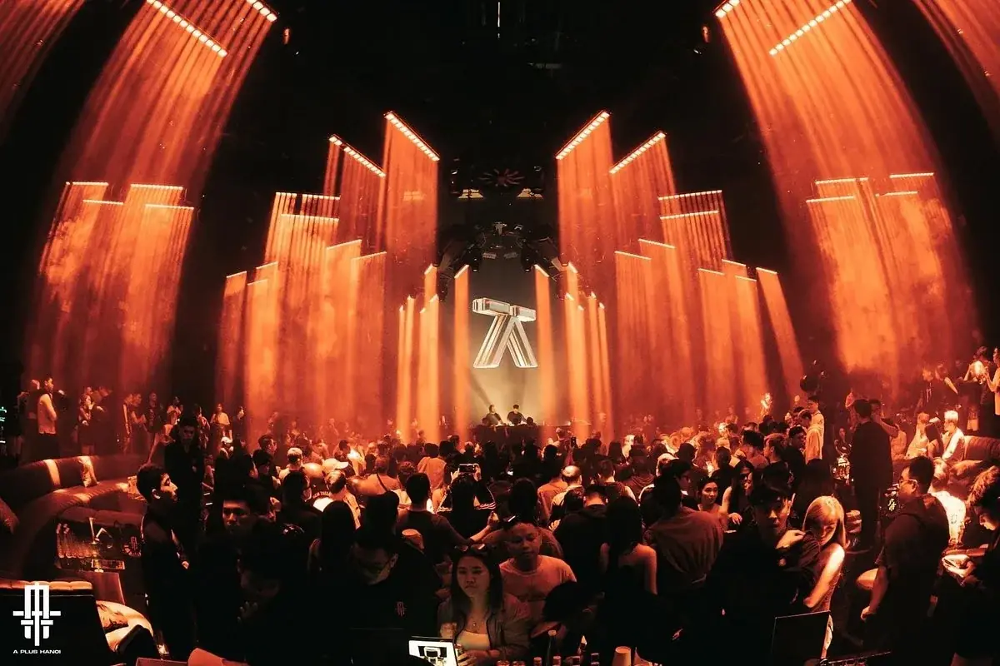
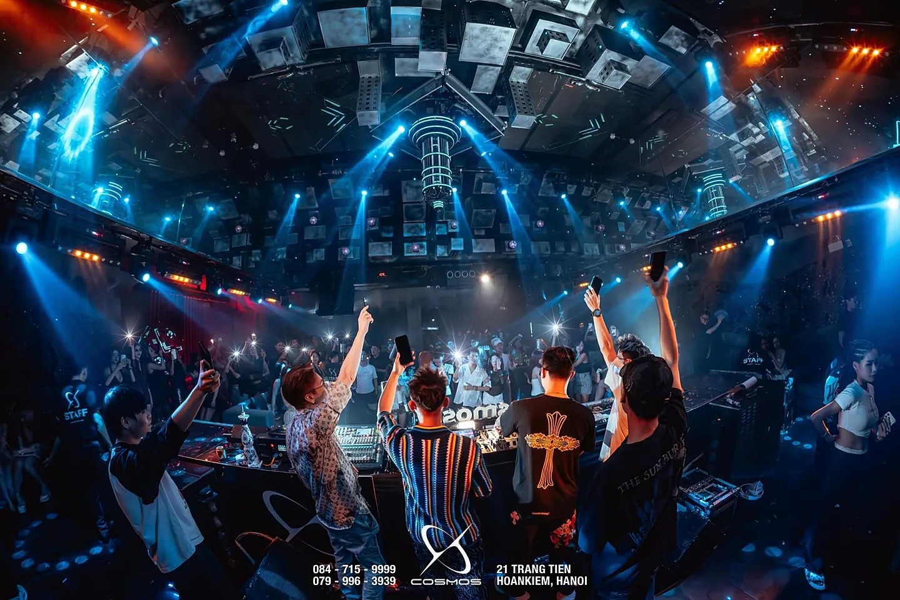
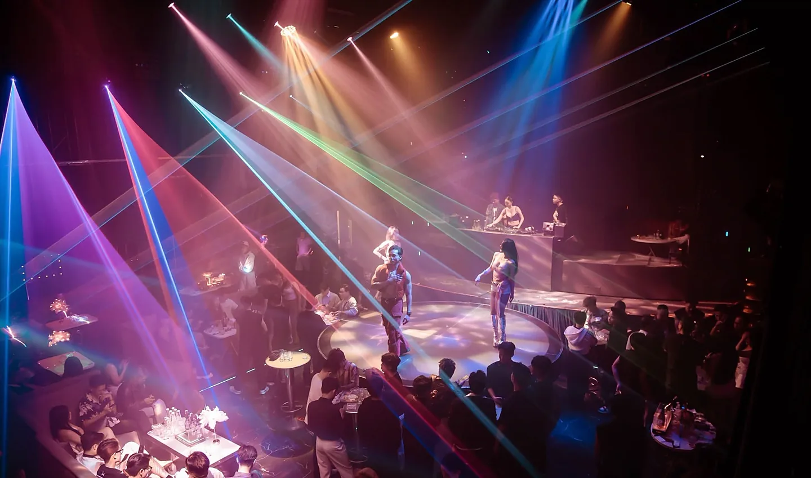

**Ghép bàn** là khi hai nhóm đi bar ít người ngồi chung một bàn: bàn 3 nam tìm thêm 2 nữ, bàn 2 nữ tìm thêm 2 nam, hoặc nhóm nhỏ nhập vào bàn lớn để chia bill và vui hơn. Ở club, bàn đứng hay bàn VIP thường có mức chi tối thiểu, nên ghép bàn còn giúp mỗi người chi ít hơn. Bài này hướng dẫn ghép bàn trên TopChill: đăng bàn, xin vào bàn, duyệt và hẹn gặp, cùng các quy tắc an toàn.

## Vì sao nên ghép bàn khi đi bar?

- **Chia bill bàn VIP:** club thường có mức chi tối thiểu cho bàn, đông người thì mỗi người chi ít hơn.
- **Không khí vui hơn:** club đông vui nhất khi bàn đủ người cùng nhảy, cùng nâng ly.
- **Làm quen bạn mới** cùng gu nhạc, cùng độ tuổi, trong một nơi công cộng có bảo vệ và nhân viên.
- **Đi một mình hoặc đi 2 người** vẫn có bàn đẹp, không phải đứng quầy.

## Cách ghép bàn trên TopChill

Vào [trang Ghép bàn](/ghep-ban/), hoặc bấm nút **"Ghép bàn ngay"** trên trang chủ.

### 1. Đăng bàn của bạn

Chọn thành phố, quán, giờ đến. Điền bàn bạn đang có mấy nam, mấy nữ và cần ghép thêm ai, ví dụ "Bàn 3 nam cần 2 nữ". Bàn hiện ngay trên bảng với **mã ghép bàn**, kèm dòng "đang thiếu bao nhiêu người". Số điện thoại của bạn **luôn ẩn**.

### 2. Người khác xin vào bàn

Nhóm khác thấy bàn hợp gu thì bấm **"Xin vào bàn"**, chọn nhóm mình mấy nam mấy nữ và để lại số. Chỉ chủ bàn và tổng đài thấy số này.

### 3. Chủ bàn tự duyệt

Chủ bàn thấy yêu cầu kèm số điện thoại của nhóm xin vào, bấm **Duyệt** hoặc **Từ chối**. Bàn đủ người sẽ chuyển sang mục "Bàn đã ghép thành công".

### 4. Hẹn gặp và giữ bàn

Sau khi được duyệt, hai bên mới thấy số của nhau và có **khung chat riêng trong thẻ bàn** để hẹn giờ, chỗ gặp. Tổng đài TopChill giữ bàn tại quán, không cần cọc.

:::cta
Ghép bàn tối nay
Đăng bàn miễn phí tại topchill.vn/ghep-ban, hoặc gọi 0838 000 222 để tổng đài ghép và giữ bàn giúp bạn, không cần cọc.
:::

## Club hợp ghép bàn đi nhóm đông

Ghép bàn hợp nhất ở club có sàn nhảy rộng, bàn VIP và DJ, nơi nhóm đông vui hơn nhóm nhỏ.

### Hà Nội

- [APLUS HANOI](/bar/aplus-hanoi/), 78 Yên Phụ: super club EDM, trance, techno, mở 19:00 – 04:00.
- [Hero Club](/bar/hero-club/), 42M Yên Phụ: deep house, hip-hop, R&B, không khí gần gũi.
- [Cosmos Club](/bar/cosmos-club/), 21 Tràng Tiền: house, tech house, mái vòm LED, mở 21:00 – 04:00.

### Sài Gòn

- [Canalis Club](/bar/canalis-club/), 264 Nam Kỳ Khởi Nghĩa, Quận 3: Vinahouse, màn LED lớn, mở 20:30 – 03:30.
- [Khu 13 Sài Gòn](/bar/khu-13-sai-gon/), 175/22 Phạm Ngũ Lão: techno, house, underground.
- [District K](/bar/district-k/), 30 Thủ Khoa Huân: beer club sức chứa khoảng 400 khách, có beer pong, bi-a, hợp nhóm đông.

Xem thêm [club Hà Nội](/blog/club-ha-noi/) và [club Sài Gòn](/blog/club-sai-gon/).

## Quy tắc ghép bàn an toàn

1. **Chỉ dành cho người từ 18 tuổi.** Mang CCCD, club có thể kiểm tra ở cửa.
2. **Gặp ở nơi công cộng:** hẹn ngay tại quán hoặc cửa quán, không hẹn chỗ riêng.
3. **Tự giữ đồ uống của mình,** không nhận ly đã mở từ người lạ.
4. **Nói rõ cách chia bill trước,** ví dụ chia đều hay mỗi nhóm trả phần mình gọi.
5. **Không môi giới, không gạ gẫm, không quấy rối.** TopChill ẩn tin và chặn người vi phạm.
6. **Về bằng taxi hoặc xe công nghệ,** không lái xe sau khi uống rượu bia.
7. Gặp sự cố, gọi ngay tổng đài 0838 000 222.

## Mẹo ghép bàn nhanh thành công

- **Đăng sớm,** tốt nhất từ chiều cho buổi tối, để nhiều người kịp thấy.
- **Chọn quán cụ thể và giờ rõ ràng,** người xin vào dễ quyết hơn.
- **Ghi chú ngắn về gu:** "thích EDM, chia bill đều" giúp ghép đúng người.
- **Duyệt nhanh:** để trang mở, yêu cầu mới tự hiện, bấm Duyệt ngay khi thấy hợp.

## Câu hỏi thường gặp

### Ghép bàn đi bar là gì?

Là khi hai nhóm đi bar ít người ngồi chung một bàn, ví dụ bàn nam tìm thêm nữ hoặc bàn nữ tìm thêm nam, để vui hơn và chia bill bàn.

### Ghép bàn trên TopChill có mất phí không?

Không. Đăng bàn, xin vào bàn và giữ bàn qua tổng đài TopChill đều miễn phí, không cần cọc. Bạn chỉ trả tiền đồ uống tại quán.

### Số điện thoại của tôi có bị lộ không?

Không. Số chủ bàn luôn ẩn và chỉ hiện cho người được duyệt. Số người xin vào chỉ chủ bàn và tổng đài thấy. Tin nhắn trong bàn chỉ người trong bàn đọc được.

### Nếu không ai xin vào bàn thì sao?

Gọi 0838 000 222, tổng đài sẽ tìm nhóm phù hợp hoặc gợi ý quán đông khách để bạn vẫn có bàn đẹp tối đó.
