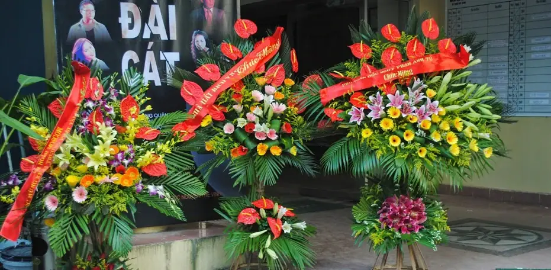
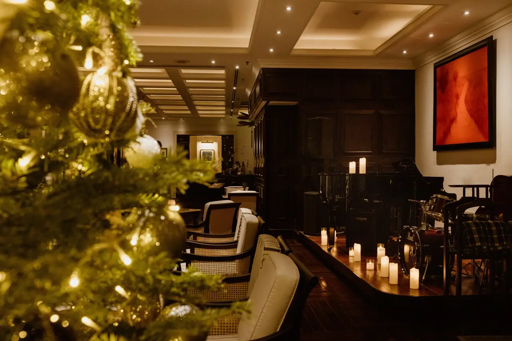
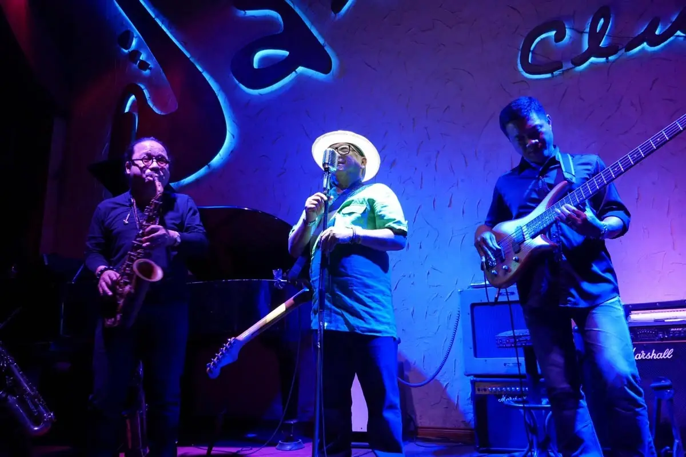
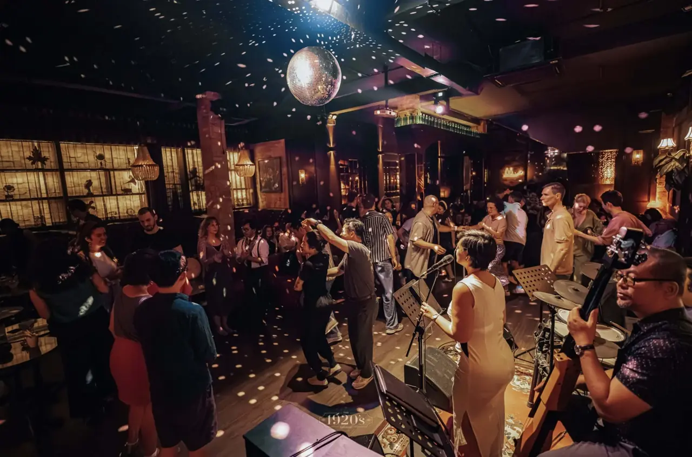

**Jazz bar** là chỗ cho buổi tối chậm rãi: một ly cocktail, ban nhạc chơi saxophone, piano, contrabass ngay trước mặt. Hà Nội và Sài Gòn đều có câu lạc bộ jazz lâu năm do chính nghệ sĩ saxophone nổi tiếng mở, cùng các quầy bar khách sạn cổ có jazz và swing mỗi tối. Bài này gom 10 quán có nhạc jazz, kèm lịch nhạc đã được công bố, địa chỉ và mức chi tham khảo.

## Jazz bar Hà Nội

Phần lớn nằm quanh Nhà hát Lớn và phố cổ Hoàn Kiếm. Xem thêm [jazz bar Hà Nội](/jazz-bar-ha-noi/).

### Binh Minh Jazz Club

[Binh Minh Jazz Club](/bar/binh-minh-jazz-club/) là câu lạc bộ jazz lâu năm của Hà Nội do nghệ sĩ saxophone **Quyền Văn Minh** sáng lập, ở số 1 Tràng Tiền, phía sau Nhà hát Lớn. Có jazz sống mỗi tối từ khoảng 21:00 với nhạc công trong nước và quốc tế.

- Nhạc: jazz sống mỗi tối
- Mức chi tham khảo: từ 300.000đ/người

### Le Club Bar – Sofitel Legend Metropole

[Le Club Bar](/bar/le-club-bar-sofitel-legend-metropole/) là quầy bar cổ điển trong khách sạn Sofitel Legend Metropole Hanoi, 15 Ngô Quyền, nhìn ra khu vườn khách sạn. Có **jazz và swing sống từ 20:00, thứ Ba đến Chủ nhật**.

- Mức chi tham khảo: từ 350.000đ/người

### Bee'Znees

[Bee'Znees](/bar/bee-znees/) là speakeasy ở 163 Phùng Hưng, lối vào ngụy trang như một kệ sách. Jazz là nhạc chủ đạo, có **nhạc sống tối thứ Tư**.

- Giờ mở cửa: 19:00 – 00:00
- Mức chi tham khảo: từ 300.000đ/người

### Tadioto

[Tadioto](/bar/tadioto/) là bar-cafe bohemian ở 24B Tông Đản, gần Nhà hát Lớn, do nhà văn Nguyễn Quý Đức điều hành, tường treo tranh đương đại Việt Nam. Vài tối mỗi tuần có **buổi nghe đĩa than jazz**, đọc sách hay triển lãm.

- Mức chi tham khảo: từ 450.000đ/người

## Jazz bar Sài Gòn

Tập trung ở Quận 1. Xem thêm [jazz bar Sài Gòn](/jazz-bar-sai-gon/).

### Sax n' Art Jazz Club

[Sax n' Art Jazz Club](/bar/sax-n-art-jazz-club/) ở 28 Lê Lợi, Quận 1, do nghệ sĩ saxophone **Trần Mạnh Tuấn** làm chủ. Nhạc sống mỗi tối, các set thường bắt đầu khoảng 20–21 giờ và kéo dài qua nửa đêm.

- Mức chi tham khảo: từ 300.000đ/người

### The Rabbit Hole

[The Rabbit Hole](/bar/the-rabbit-hole/) ở tầng hầm 138 Nam Kỳ Khởi Nghĩa, lối vào qua một bốt điện thoại. **Jazz sống tối thứ Hai, thứ Tư và Chủ nhật, 20:00–23:00.**

- Giờ mở cửa: 18:00 – 02:00
- Mức chi tham khảo: từ 400.000đ/người

### Snuffbox Speakeasy

[Snuffbox Speakeasy](/bar/snuffbox-speakeasy/) ở 14 Tôn Thất Đạm, phong cách thập niên 1920, một số tối có **jazz, swing** hoặc DJ khách mời.

- Mức chi tham khảo: từ 300.000đ/người

### Rooftop Garden Bar – Rex Hotel

[Rooftop Garden Bar](/bar/rooftop-garden-bar-rex-hotel/) là khu vườn trên tầng 5 khách sạn Rex, đầu phố đi bộ Nguyễn Huệ. Nhạc sống hằng đêm, thường là nhạc xưa, đôi khi có jazz hoặc acoustic.

- Mức chi tham khảo: từ 350.000đ/người

## Jazz ở Đà Nẵng và Đà Lạt

### The 1920's Lounge (Đà Nẵng)

[The 1920's Lounge](/bar/the-1920-s-lounge/) ở 53 Trần Quốc Toản, Hải Châu, phong cách thập niên 1920, gắn với **đêm nhạc jazz biểu diễn trực tiếp mỗi tối**, xen acoustic và ballad.

- Giờ mở cửa: 18:30 – 01:30
- Mức chi tham khảo: từ 300.000đ/người

### Woody Classic Bar (Đà Lạt)

[Woody Classic Bar](/bar/woody-classic-bar/) ở 6 Nguyễn Chí Thanh, gần hồ Xuân Hương, phong cách cổ điển, nhạc jazz hoặc acoustic, hợp buổi tối se lạnh.

- Mức chi tham khảo: từ 300.000đ/người

## Lịch nhạc jazz nhanh

| Quán | Thành phố | Lịch nhạc đã công bố | Mức chi tham khảo |
|---|---|---|---|
| Binh Minh Jazz Club | Hà Nội | Mỗi tối từ ~21:00 | Từ 300k/người |
| Le Club Bar (Metropole) | Hà Nội | Thứ Ba – CN, từ 20:00 | Từ 350k/người |
| Bee'Znees | Hà Nội | Nhạc sống tối thứ Tư | Từ 300k/người |
| Sax n' Art | Sài Gòn | Mỗi tối, từ ~20–21h | Từ 300k/người |
| The Rabbit Hole | Sài Gòn | Thứ Hai, Tư, CN 20:00–23:00 | Từ 400k/người |
| The 1920's Lounge | Đà Nẵng | Mỗi tối | Từ 300k/người |

Lịch nhạc lấy theo thông tin quán đã công bố và có thể thay đổi. Gọi tổng đài để xác nhận tối nay có ban nhạc trước khi đi.

:::cta
Giữ bàn nghe jazz tối nay
Gọi 0838 000 222, tổng đài TopChill hỏi lịch ban nhạc và giữ bàn gần sân khấu giúp bạn, không cần cọc.
:::

## Kinh nghiệm đi jazz bar

1. **Đến trước giờ nhạc 20–30 phút** để có bàn gần sân khấu.
2. **Giữ yên lặng khi ban nhạc chơi,** vỗ tay sau mỗi đoạn solo là phép lịch sự quen thuộc.
3. **Hỏi về phụ thu nhạc sống,** một số quán tính thêm vào bill.
4. **Gọi đồ uống hợp không khí:** whisky, Old Fashioned, Negroni hay Manhattan. Xem [whisky cho người mới](/blog/whisky-cho-nguoi-moi/) và [các loại cocktail phổ biến](/blog/cac-loai-cocktail-pho-bien/).
5. **Uống có trách nhiệm,** không lái xe sau khi uống rượu bia.

Thích quán ẩn mình? Đọc thêm [speakeasy Việt Nam](/blog/speakeasy-viet-nam/).

## Câu hỏi thường gặp

### Jazz bar nào ở Hà Nội có nhạc sống mỗi tối?

Binh Minh Jazz Club (1 Tràng Tiền) có jazz sống mỗi tối từ khoảng 21:00. Le Club Bar trong Sofitel Legend Metropole có jazz và swing từ 20:00, thứ Ba đến Chủ nhật.

### Jazz bar nào ở Sài Gòn nổi tiếng?

Sax n' Art Jazz Club (28 Lê Lợi) của nghệ sĩ Trần Mạnh Tuấn có nhạc sống mỗi tối. The Rabbit Hole (138 Nam Kỳ Khởi Nghĩa) có jazz sống tối thứ Hai, thứ Tư và Chủ nhật.

### Đi jazz bar hết bao nhiêu tiền?

Mức chi tham khảo khoảng 300.000đ–450.000đ mỗi người trở lên cho 2 đồ uống. Quầy bar khách sạn thường cao hơn câu lạc bộ jazz độc lập.

### Có cần đặt bàn trước khi đi jazz bar không?

Nên đặt, nhất là cuối tuần và khi muốn ngồi gần sân khấu. Gọi 0838 000 222, tổng đài TopChill giữ bàn không cần cọc.
