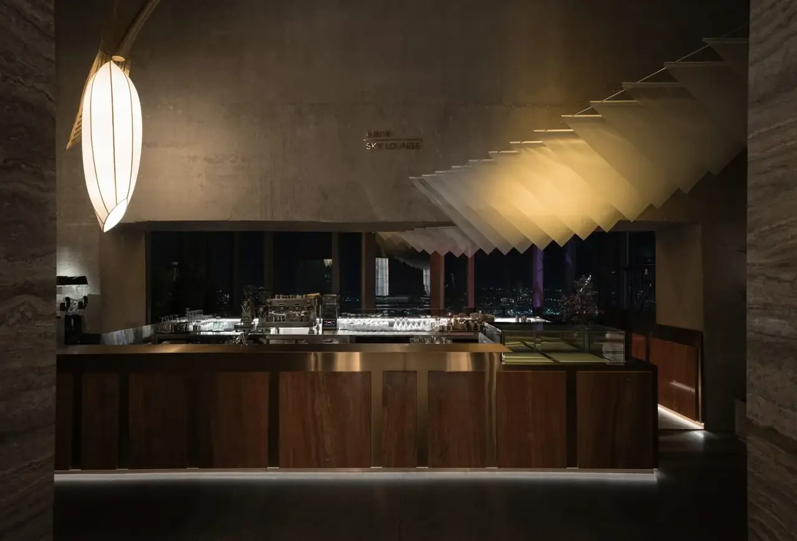
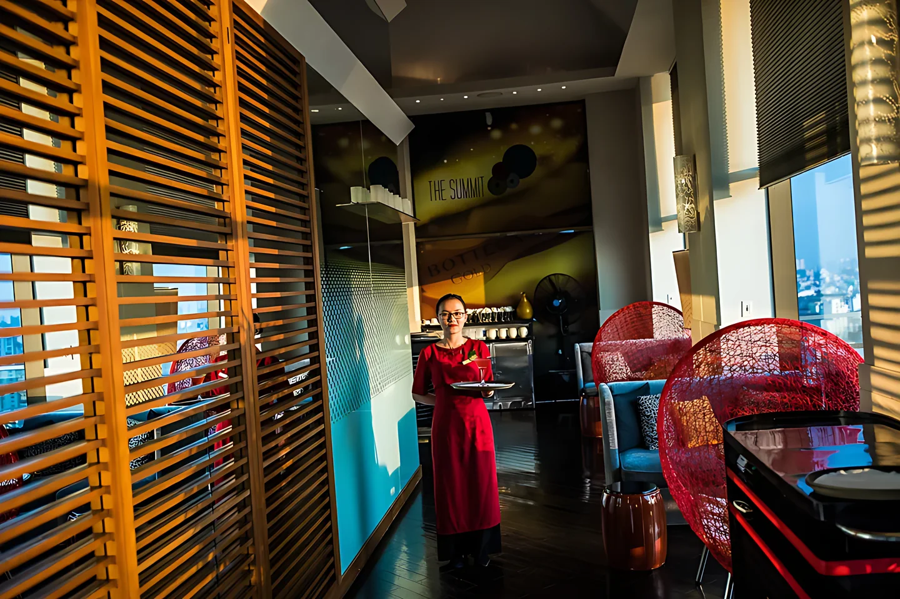
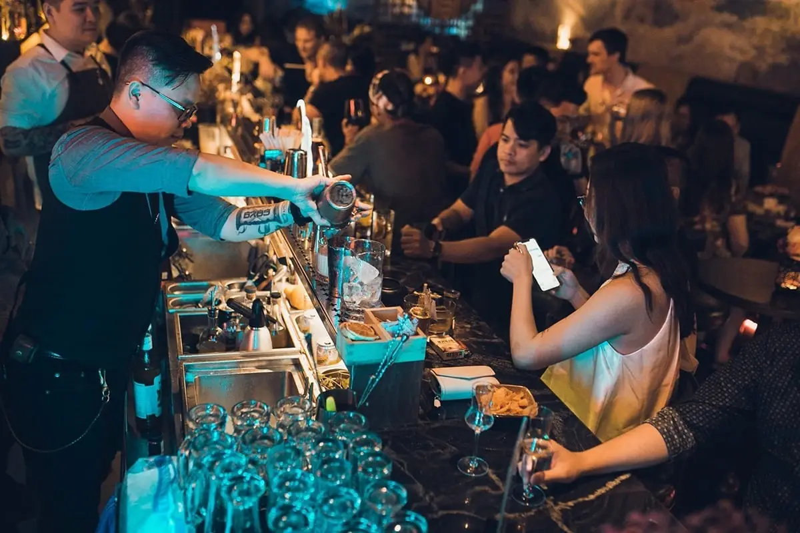

**Lounge bar** là kiểu quán ở giữa bar và club: ghế sofa êm, bàn thấp, ánh sáng ấm, nhạc vừa đủ để vẫn trò chuyện được, có quán thêm DJ hoặc ca sĩ về khuya. Lounge hợp hẹn hò, tiếp khách, sinh nhật nhóm nhỏ hay đơn giản là ngồi lâu với bạn bè. Bài này giải thích lounge khác bar, club thế nào và gợi ý 12 lounge có thật từ Hà Nội, Sài Gòn đến Đà Nẵng, Cần Thơ, Bình Dương, Vũng Tàu, Đà Lạt.

## Lounge khác bar và club thế nào?

| Kiểu quán | Chỗ ngồi | Âm nhạc | Hợp với |
|---|---|---|---|
| **Lounge** | Sofa, bàn thấp, ngồi lâu | Nhạc nhẹ, DJ hoặc ca sĩ về khuya | Hẹn hò, tiếp khách, nhóm nhỏ |
| **Cocktail bar** | Ghế quầy, bàn nhỏ | Nhạc nền | Thưởng thức cocktail |
| **Club** | Bàn đứng, bàn VIP | DJ, nhạc mạnh, sàn nhảy | Quẩy khuya, nhóm đông |
| **Pub** | Bàn gỗ, ghế đẩu | Nhạc nền, thể thao | Uống bia, trò chuyện |

## Lounge Sài Gòn

### Blank Lounge (Landmark 81)

[Blank Lounge](/bar/blank-lounge/) trên tầng 75–76 Landmark 81, 720A Điện Biên Phủ, Bình Thạnh. Khu ngoài trời tầng 75 có **vách kính nhô ra khỏi tòa nhà**, nhìn gần như toàn cảnh thành phố, là góc ngắm hoàng hôn và chụp ảnh nổi tiếng.

- Mức chi tham khảo: từ 350.000đ/người

### 2 Lam Son (Park Hyatt Saigon)

[2 Lam Son](/bar/2-lam-son/) là quầy bar sảnh khách sạn Park Hyatt, 2 Công trường Lam Sơn, đối diện Nhà hát Thành phố, quen thuộc dưới tên Martini Bar. Nội thất gỗ tối, ánh sáng ấm, có tầng lửng riêng tư hơn, hợp tiếp khách.

- Mức chi tham khảo: từ 400.000đ/người

### Fetti Social Club

[Fetti Social Club](/bar/fetti-social-club/) ở 20 Nguyễn Công Trứ, Quận 1, kết hợp social club, lounge và club, đèn đỏ với những quả cầu disco xếp chồng, nhạc EDM, hip-hop, house. Hợp khi muốn lounge sôi động hơn.

- Giờ mở cửa: 20:00 – 02:00
- Mức chi tham khảo: từ 400.000đ/người

## Lounge Hà Nội

### The Summit (Pan Pacific Hanoi)

[The Summit](/bar/the-summit-pan-pacific-hanoi/) trên tầng 20 khách sạn Pan Pacific, 1 Thanh Niên, Ba Đình, **nhìn 360 độ** ra Hồ Tây, hồ Trúc Bạch và sông Hồng. Có cocktail signature và đồ ăn nhẹ kiểu châu Á, hợp ngắm hoàng hôn hoặc tiếp đối tác.

- Mức chi tham khảo: từ 450.000đ/người

### Tadioto

[Tadioto](/bar/tadioto/) ở 24B Tông Đản, Hoàn Kiếm, gần Nhà hát Lớn, phong cách bohemian do nhà văn Nguyễn Quý Đức điều hành. Tường treo tranh đương đại, vài tối mỗi tuần có buổi nghe đĩa than jazz.

- Mức chi tham khảo: từ 450.000đ/người

### Maxx Bar & Lounge

[Maxx Bar & Lounge](/bar/maxx-bar-va-lounge/) ở 25 Ngô Văn Sở, Hoàn Kiếm, bar lounge có DJ, đặt bàn theo nhóm, hợp tụ tập bạn bè hay sinh nhật.

- Mức chi tham khảo: từ 400.000đ/người

## Lounge ở các thành phố khác

### Pavo Cuisine & Mixology (Đà Nẵng)

[Pavo](/bar/pavo-cuisine-va-mixology/) ở 11B Trần Phú, Hải Châu, lounge kết hợp ẩm thực và mixology, cảm hứng Địa Trung Hải, **quầy bar 360 độ**, có nhạc sống và show diễn.

- Giờ mở cửa: 17:00 – 03:00
- Mức chi tham khảo: từ 350.000đ/người

### Mode DJ Lounge (Cần Thơ)

[Mode DJ Lounge](/bar/mode-dj-lounge/) ở 354 đường 30 Tháng 4, Ninh Kiều, âm thanh ánh sáng tốt, nhạc DJ mạnh, có shisha, đôi khi có ca sĩ từ Sài Gòn về biểu diễn.

- Mức chi tham khảo: từ 350.000đ/người

### Vita Club và Imperial Dragon Lounge (Bình Dương)

[Vita Club](/bar/vita-club/) trên tầng 4 Becamex Tower, 230 Đại lộ Bình Dương, sang trọng, có ca sĩ khách mời và DJ về khuya. [Imperial Dragon Lounge](/bar/imperial-dragon-lounge/) ở 25 Nguyễn Đình Chiểu, có ca sĩ và DJ cuối tuần, hay được chọn tổ chức sinh nhật.

- Mức chi tham khảo: từ 350.000–400.000đ/người

### U.S Bar – The Art Of Mixology (Vũng Tàu)

[U.S Bar](/bar/u-s-bar-the-art-of-mixology/) ở 120 Ba Cu, phong cách lounge phương Tây tông đen đỏ, cocktail và mocktail nhiều màu sắc, cuối tuần có acoustic hoặc DJ.

- Mức chi tham khảo: từ 350.000đ/người

### Envy Lounge Bar (Đà Lạt)

[Envy Lounge Bar](/bar/envy-lounge-bar/) ở 1 Lê Đại Hành, trung tâm Đà Lạt, lounge nhỏ ấm cúng, nhạc nhẹ, hợp cặp đôi muốn tránh không khí ồn ào.

- Mức chi tham khảo: từ 350.000đ/người

## So sánh nhanh

| Lounge | Thành phố | Điểm nổi bật | Mức chi tham khảo |
|---|---|---|---|
| Blank Lounge | Sài Gòn | Tầng 75–76 Landmark 81 | Từ 350k/người |
| 2 Lam Son | Sài Gòn | Sảnh Park Hyatt | Từ 400k/người |
| Fetti Social Club | Sài Gòn | Lounge kiêm club | Từ 400k/người |
| The Summit | Hà Nội | Tầng 20, nhìn Hồ Tây | Từ 450k/người |
| Tadioto | Hà Nội | Bohemian, đĩa than jazz | Từ 450k/người |
| Pavo | Đà Nẵng | Quầy bar 360 độ | Từ 350k/người |
| Mode DJ Lounge | Cần Thơ | DJ, shisha | Từ 350k/người |
| Vita Club | Bình Dương | Ca sĩ, DJ | Từ 400k/người |

Mức chi là giá tham khảo, thay đổi theo đồ uống bạn chọn. Giờ mở cửa có thể thay đổi, gọi tổng đài để xác nhận trước khi đi.

:::cta
Đặt bàn lounge tối nay
Gọi 0838 000 222 hoặc để lại số điện thoại, tổng đài TopChill giữ bàn sofa đẹp và báo ưu đãi giúp bạn, không cần cọc.
:::

## Kinh nghiệm đi lounge

1. **Đặt trước bàn sofa** nếu đi nhóm hoặc tổ chức sinh nhật.
2. **Lounge khách sạn thường có dress code lịch sự:** áo có cổ, giày kín.
3. **Lounge có DJ đông dần từ 22h,** muốn ngồi yên tĩnh thì đến sớm.
4. **Hỏi trước mức chi tối thiểu** cho bàn VIP hoặc khu riêng.
5. **Uống có trách nhiệm,** không lái xe sau khi uống rượu bia.

Xem thêm [bar Sài Gòn](/blog/bar-sai-gon/), [rooftop bar Hà Nội](/blog/rooftop-bar-ha-noi/) và [cocktail bar Hà Nội](/blog/cocktail-bar-ha-noi/).

## Câu hỏi thường gặp

### Lounge bar là gì?

Lounge bar là quán có sofa, bàn thấp, ánh sáng ấm và nhạc vừa phải để trò chuyện, nằm giữa bar và club. Nhiều lounge có DJ hoặc ca sĩ về khuya.

### Lounge khác club thế nào?

Lounge thiên về ngồi lâu, trò chuyện, nhạc nhẹ hơn. Club có sàn nhảy, DJ nhạc mạnh, bàn đứng hoặc bàn VIP và đông nhất về khuya.

### Lounge nào ở Sài Gòn có view đẹp?

Blank Lounge trên tầng 75–76 Landmark 81 nhìn gần như toàn cảnh thành phố. 2 Lam Son trong Park Hyatt hợp tiếp khách sang trọng.

### Đặt bàn lounge qua TopChill có cần cọc không?

Không. Gọi 0838 000 222, nhắn Zalo hoặc để lại số trên web, tổng đài sẽ gọi lại xác nhận bàn.
