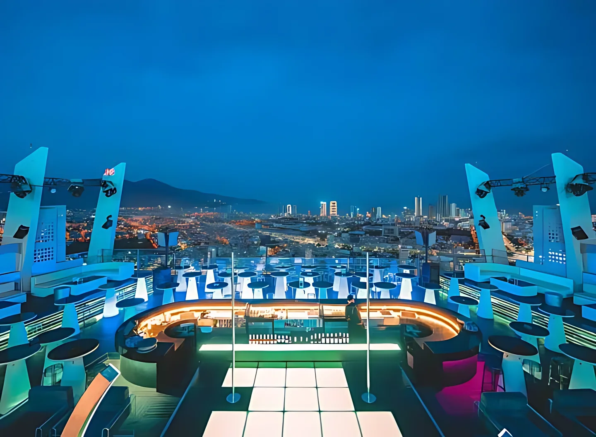
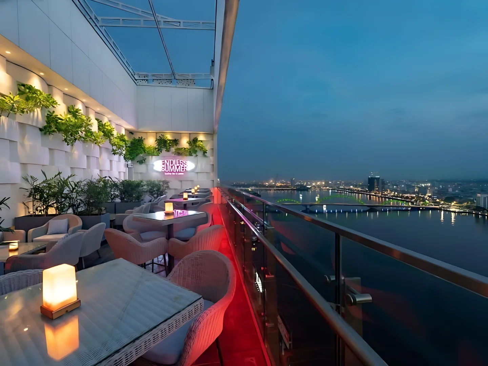
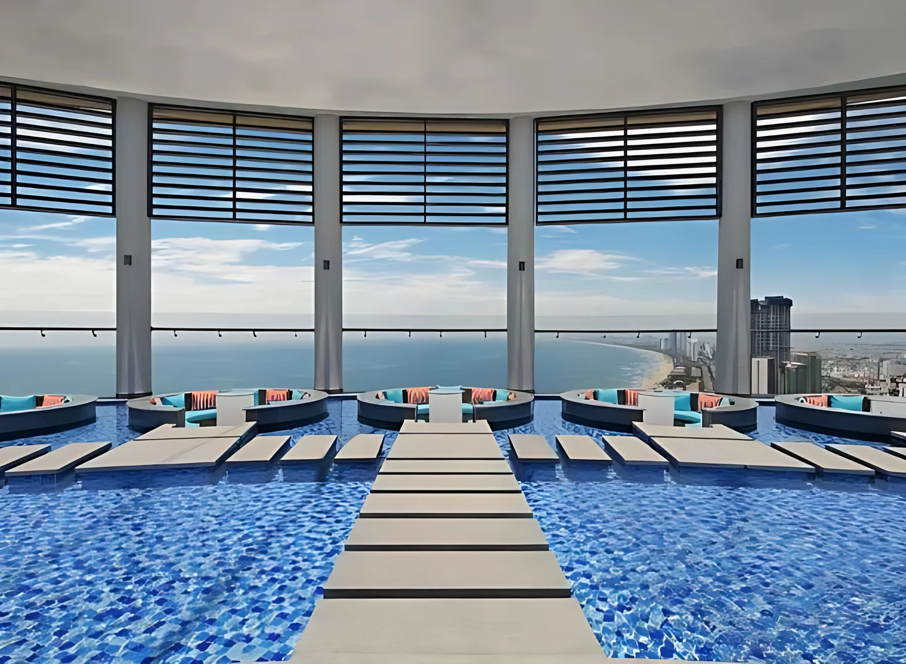

**Rooftop bar Đà Nẵng** chia thành hai nhóm rõ ràng: bên **sông Hàn** (Bạch Đằng, Trần Hưng Đạo) nhìn cầu Rồng, cầu Sông Hàn lên đèn, và bên **biển Mỹ Khê** (Võ Nguyên Giáp) ngắm biển và hồ bơi vô cực trên mái. Bài này gom 6 rooftop có thật, kèm tầng cao, giờ mở cửa và mức chi tham khảo để bạn chọn đúng view.

## Chọn view sông hay view biển?

- **View sông Hàn:** đẹp nhất buổi tối khi cầu Rồng, cầu Sông Hàn lên đèn. Sky36, Brilliant Top Bar, Endless Summer.
- **View biển Mỹ Khê:** đẹp lúc hoàng hôn và chiều mát, nhiều quán có hồ bơi vô cực. Horizon Bar, Sky 21, The Top Bar.

Xem thêm [rooftop bar Đà Nẵng](/rooftop-bar-da-nang/) và bài [bar Đà Nẵng](/blog/bar-da-nang/).

## Rooftop view sông Hàn

### Sky36

[Sky36](/bar/sky36/) trên tầng 35–37 khách sạn Novotel Danang Premier Han River, 36 Bạch Đằng, nhìn xuống sông Hàn và trung tâm Hải Châu. Vừa là **rooftop vừa là nightclub**, có khu ngoài trời, sofa lounge, khu VIP, thường có đêm DJ EDM, hip-hop, R&B.

- Giờ mở cửa: 18:00 – 02:00
- Mức chi tham khảo: từ 300.000đ/người

### Brilliant Top Bar

[Brilliant Top Bar](/bar/brilliant-top-bar/) trên tầng 17 khách sạn Brilliant, 162 Bạch Đằng, nhìn ra **sông Hàn, cầu Rồng** và thành phố. Thực đơn có cocktail, mocktail, mojito nhiều vị, bia tươi, vang và món ăn.

- Giờ mở cửa: 16:00 – 23:00
- Mức chi tham khảo: từ 400.000đ/người

### Endless Summer Rooftop Bar & Lounge

[Endless Summer](/bar/endless-summer-rooftop-bar-va-lounge-da-nang/) trên tầng 25 Wink Hotel Danang Riverside, 351 Trần Hưng Đạo, **view 360 độ** ra sông Hàn và trung tâm. Mở lại từ 1/3/2025 sau cải tạo, có hồ bơi trên mái, cocktail nhiệt đới và pool party.

- Giờ mở cửa: 16:30 – 00:00
- Mức chi tham khảo: từ 350.000đ/người

## Rooftop view biển Mỹ Khê

### Horizon Bar

[Horizon Bar](/bar/horizon-bar/) trên tầng 36 khách sạn Four Points by Sheraton, 118–120 Võ Nguyên Giáp. Có khu trong nhà cửa kính toàn cảnh và sân hiên ngoài trời, **ghế dạng pod bên hồ bơi vô cực** nhìn biển, ban nhạc sống một số ngày trong tuần.

- Mức chi tham khảo: từ 500.000đ/người

### Sky 21 Bar & Bistro

[Sky 21 Bar & Bistro](/bar/sky-21-bar-va-bistro/) trên tầng 21 khách sạn Belle Maison Parosand, 216 Võ Nguyên Giáp, hướng ra biển Mỹ Khê, phần trong nhà kết hợp sân hiên mở.

- Giờ mở cửa: 17:00 – 00:00
- Mức chi tham khảo: từ 450.000đ/người

### The Top Bar – A La Carte Da Nang Beach

[The Top Bar](/bar/the-top-bar-a-la-carte-da-nang-beach/) trên tầng 23 khách sạn A La Carte, 200 Võ Nguyên Giáp, cạnh **hồ bơi vô cực bao quanh tầng thượng**, nhìn biển Mỹ Khê và thành phố, có món nhẹ Việt và quốc tế.

- Mức chi tham khảo: từ 350.000đ/người

## So sánh nhanh rooftop Đà Nẵng

| Rooftop | View | Tầng | Mức chi tham khảo |
|---|---|---|---|
| Sky36 | Sông Hàn | 35–37 | Từ 300k/người |
| Brilliant Top Bar | Sông Hàn, cầu Rồng | 17 | Từ 400k/người |
| Endless Summer | Sông Hàn 360 độ | 25 | Từ 350k/người |
| Horizon Bar | Biển Mỹ Khê | 36 | Từ 500k/người |
| Sky 21 | Biển Mỹ Khê | 21 | Từ 450k/người |
| The Top Bar | Biển, hồ bơi vô cực | 23 | Từ 350k/người |

Mức chi là giá tham khảo, thay đổi theo đồ uống bạn chọn. Giờ mở cửa có thể thay đổi, gọi tổng đài để xác nhận trước khi đi.

:::cta
Đặt bàn rooftop Đà Nẵng tối nay
Gọi 0838 000 222 hoặc để lại số điện thoại, tổng đài TopChill giữ bàn sát lan can view đẹp giúp bạn, không cần cọc.
:::

## Kinh nghiệm đi rooftop Đà Nẵng

1. **View biển:** đến khoảng 16h30–17h30 để ngắm hoàng hôn và trời chuyển màu.
2. **View sông Hàn:** đẹp nhất sau 19h khi cầu lên đèn. Tối thứ 7, Chủ nhật cầu Rồng thường có màn phun lửa, phun nước khoảng 21h, nên hỏi lại lịch trước khi đi.
3. **Mùa mưa Đà Nẵng** (khoảng tháng 9 đến tháng 12) hay mưa chiều, hỏi quán có khu trong nhà không.
4. **Rooftop khách sạn thường có dress code lịch sự,** muốn xuống hồ bơi thì hỏi trước.
5. **Uống có trách nhiệm,** không lái xe sau khi uống rượu bia.

Muốn ra bãi biển? Xem [beach club Việt Nam](/blog/beach-club-viet-nam/).

## Câu hỏi thường gặp

### Rooftop bar nào ở Đà Nẵng nhìn cầu Rồng đẹp?

Brilliant Top Bar (tầng 17, 162 Bạch Đằng) nhìn ra sông Hàn và cầu Rồng. Sky36 và Endless Summer cũng nhìn bao quát sông Hàn từ trên cao.

### Rooftop Đà Nẵng nào có hồ bơi vô cực?

Horizon Bar (tầng 36 Four Points), The Top Bar (tầng 23 A La Carte) và Endless Summer (tầng 25 Wink Hotel) đều có hồ bơi trên mái.

### Đi rooftop bar Đà Nẵng hết bao nhiêu tiền?

Mức chi tham khảo khoảng 300.000đ–500.000đ mỗi người cho 2 đồ uống, tuỳ quán.

### Đặt bàn rooftop Đà Nẵng qua TopChill có cần cọc không?

Không. Gọi 0838 000 222, nhắn Zalo hoặc để lại số trên web, tổng đài sẽ gọi lại xác nhận bàn.
