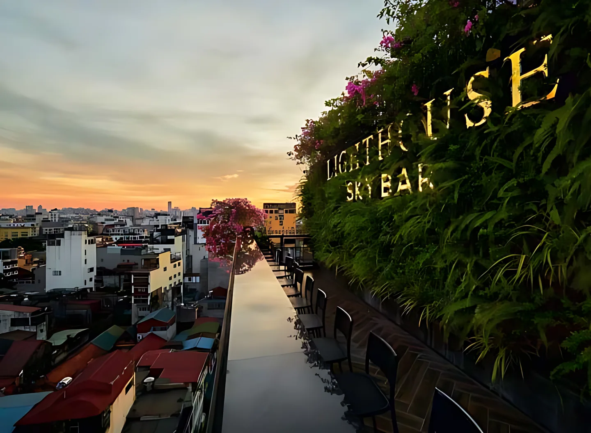
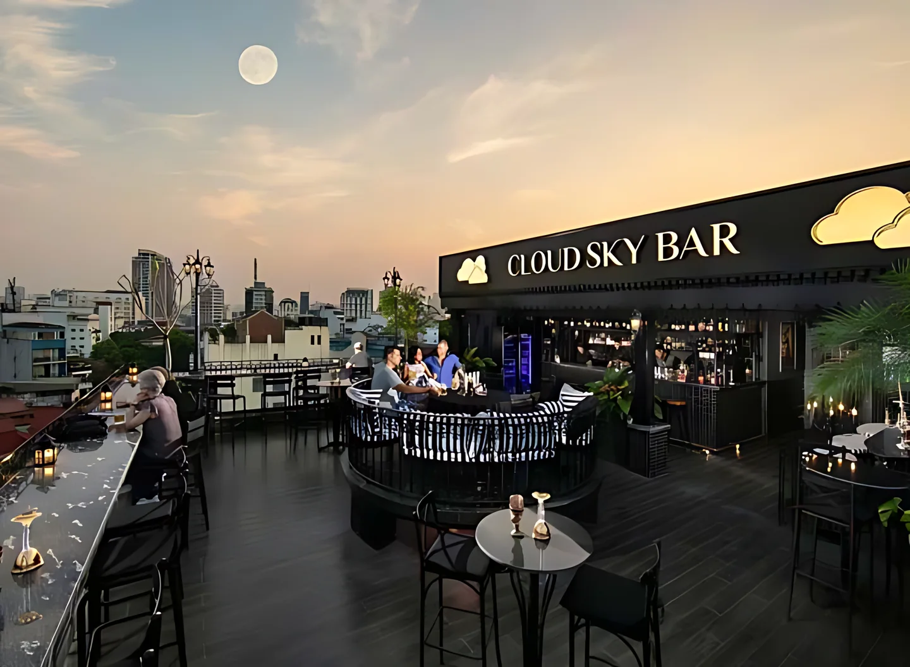
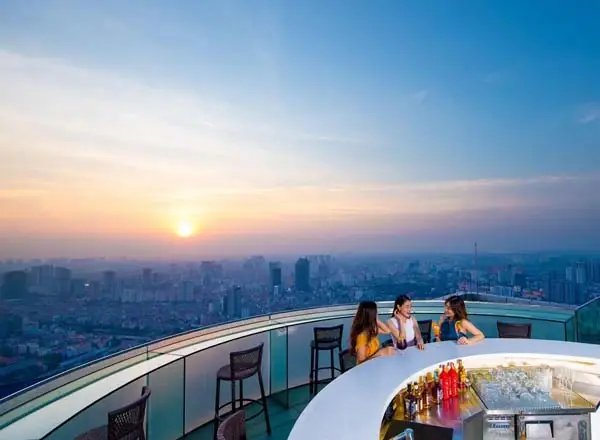

**Rooftop bar Hà Nội** là lựa chọn quen thuộc khi bạn muốn vừa nhâm nhi một ly cocktail vừa ngắm thành phố lên đèn. Bài này tổng hợp 5 sky bar ở phố cổ, Ba Đình và ven Hồ Tây, kèm địa chỉ, không gian và mức chi tham khảo để bạn chọn nhanh trước khi đặt bàn.

## Rooftop bar Hà Nội tập trung ở đâu?

Phần lớn rooftop ở Hà Nội nằm trên tầng cao của khách sạn. Có hai cụm chính:

- **Phố cổ, Hoàn Kiếm:** các sky bar tầng 9–11 nhìn xuống mái ngói phố cổ, hồ Hoàn Kiếm và sông Hồng. Không gian nhỏ, ấm cúng, hợp hẹn hò.
- **Ba Đình, Tây Hồ:** quầy bar trên tòa nhà cao tầng, view rộng ra Hồ Tây, hồ Trúc Bạch và đường chân trời thành phố.

Xem toàn bộ danh sách tại trang [bar Hà Nội](/bar-ha-noi/).

## Sky bar view phố cổ

### Lighthouse Sky Bar

[Lighthouse Sky Bar](/bar/lighthouse-sky-bar/) nằm trên tầng 10 và 11 khách sạn La Siesta Premium, số 27 Hàng Bè. Quán được thiết kế như một con thuyền neo trên mái, với ngọn hải đăng đỏ trắng nhấp nháy về đêm. Từ sân thượng bạn nhìn ra hồ Hoàn Kiếm, mái nhà phố cổ và sông Hồng.

- Khu vực: Hoàn Kiếm, giữa phố cổ
- Phù hợp: hẹn hò, nhóm nhỏ, khách du lịch
- Mức chi tham khảo: từ 500.000đ/người

### Moonlight Sky Bar

[Moonlight Sky Bar](/bar/moonlight-sky-bar/) ở tầng cao khách sạn La Siesta Classic, số 94 Mã Mây. Điểm nhận diện của quán là mô hình cầu Long Biên thu nhỏ bắc ngang phía trên quầy bar. Thực đơn có cocktail cổ điển lẫn signature, rượu vang và món ăn nhẹ.

- Khu vực: Hoàn Kiếm, phố Mã Mây
- Phù hợp: khách thích không gian lãng mạn, trang nhã
- Mức chi tham khảo: từ 400.000đ/người

### Cloud Sky Bar

[Cloud Sky Bar](/bar/cloud-sky-bar/) nằm trên tầng 9 khách sạn JM Marvel, số 16 Hàng Da. Từ sân thượng bạn nhìn thẳng xuống phố Hàng Da và đường chân trời phố cổ, đẹp nhất lúc hoàng hôn. Không khí thoải mái, hợp ngồi lâu trò chuyện.

- Khu vực: Hoàn Kiếm, gần chợ Hàng Da
- Phù hợp: nhóm bạn, du khách ở quanh phố cổ
- Mức chi tham khảo: từ 400.000đ/người

## Rooftop view toàn cảnh thành phố

### Top of Hanoi

[Top of Hanoi](/bar/top-of-hanoi/) là quầy bar ngoài trời trên tầng thượng khách sạn Lotte Hotel Hanoi, tòa Lotte Center, 54 Liễu Giai. Đây là một trong những điểm ngắm Hà Nội 360 độ trên cao, đặc biệt đẹp khi trời tối. Thực đơn gồm cocktail, rượu vang, bia và đồ ăn nhẹ.

- Khu vực: Ba Đình
- Phù hợp: hẹn hò, tiếp khách, dịp đặc biệt
- Mức chi tham khảo: từ 450.000đ/người

### The Summit (Pan Pacific Hanoi)

[The Summit](/bar/the-summit-pan-pacific-hanoi/) là lounge trên tầng 20 khách sạn Pan Pacific Hanoi, số 1 Thanh Niên. Không gian rộng, nhìn ra Hồ Tây, hồ Trúc Bạch và sông Hồng. Quán phục vụ cocktail signature và đồ ăn nhẹ kiểu châu Á, hợp ngắm hoàng hôn trên Hồ Tây.

- Khu vực: Ba Đình, đường Thanh Niên
- Phù hợp: ngắm hoàng hôn, gặp đối tác
- Mức chi tham khảo: từ 450.000đ/người

## So sánh nhanh 5 rooftop bar Hà Nội

| Bar | Khu vực | View nổi bật | Mức chi tham khảo |
|---|---|---|---|
| Lighthouse Sky Bar | Hàng Bè | Hồ Hoàn Kiếm, sông Hồng | Từ 500k/người |
| Moonlight Sky Bar | Mã Mây | Phố cổ về đêm | Từ 400k/người |
| Cloud Sky Bar | Hàng Da | Mái phố cổ, hoàng hôn | Từ 400k/người |
| Top of Hanoi | Liễu Giai | Toàn cảnh 360 độ | Từ 450k/người |
| The Summit | Thanh Niên | Hồ Tây, hồ Trúc Bạch | Từ 450k/người |

Mức chi là giá tham khảo, có thể thay đổi theo thực đơn và thời điểm. Giờ mở cửa của từng quán có thể đổi theo mùa, gọi tổng đài để xác nhận trước khi đi.

:::cta
Đặt bàn rooftop Hà Nội tối nay
Gọi 0838 000 222 hoặc để lại số điện thoại, tổng đài TopChill giữ bàn giúp bạn, không cần cọc.
:::

## Mẹo đi rooftop bar ở Hà Nội

1. **Đến trước hoàng hôn khoảng 30 phút** để có chỗ ngồi sát lan can và chụp ảnh đẹp.
2. **Mang áo khoác mỏng từ tháng 11 đến tháng 3**, trên cao gió lạnh hơn dưới phố.
3. **Ăn mặc lịch sự:** các sky bar trong khách sạn thường không nhận khách mặc đồ quá tuỳ tiện.
4. **Đặt bàn trước tối thứ 6, thứ 7** vì chỗ view đẹp hết nhanh.
5. **Uống có trách nhiệm**, không lái xe sau khi uống rượu bia. Gọi taxi hoặc xe công nghệ để về.

Nếu muốn không khí sôi động hơn, xem thêm các club và bar có nhạc sống trên trang [bar Hà Nội](/bar-ha-noi/).

## Câu hỏi thường gặp

### Rooftop bar Hà Nội nào gần hồ Hoàn Kiếm?

Lighthouse Sky Bar (27 Hàng Bè), Moonlight Sky Bar (94 Mã Mây) và Cloud Sky Bar (16 Hàng Da) đều nằm trong phố cổ, đi bộ ra hồ Hoàn Kiếm chỉ vài phút.

### Đi rooftop bar Hà Nội hết bao nhiêu tiền?

Mức chi tham khảo khoảng 400.000đ–500.000đ mỗi người trở lên cho 2–3 ly, tuỳ quán và đồ uống bạn chọn.

### Rooftop nào ngắm Hồ Tây đẹp?

The Summit trên tầng 20 khách sạn Pan Pacific Hanoi nhìn thẳng ra Hồ Tây và hồ Trúc Bạch, hợp ngắm hoàng hôn.

### Đặt bàn rooftop qua TopChill có cần cọc không?

Không. Bạn gọi 0838 000 222, nhắn Zalo hoặc để lại số trên web, tổng đài sẽ gọi lại xác nhận bàn.
