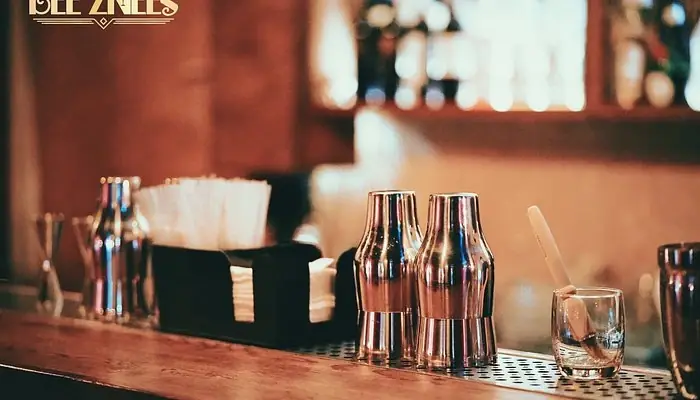
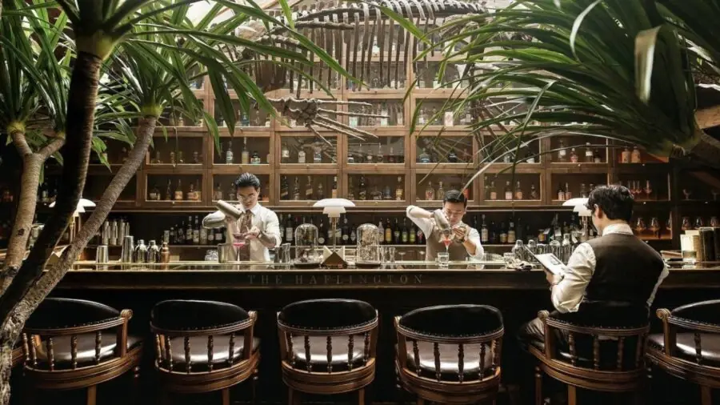
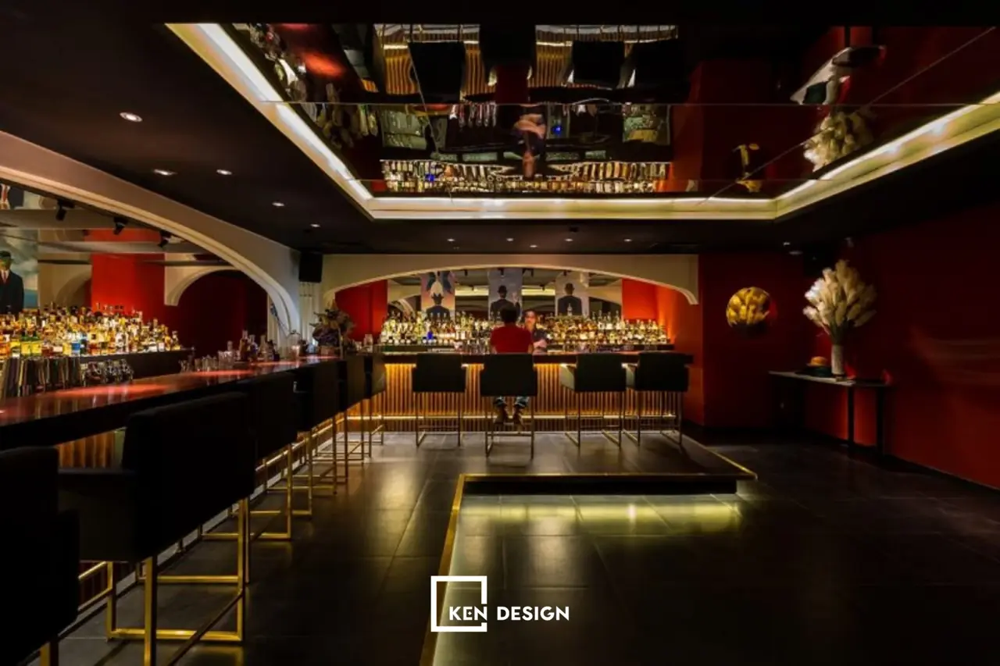
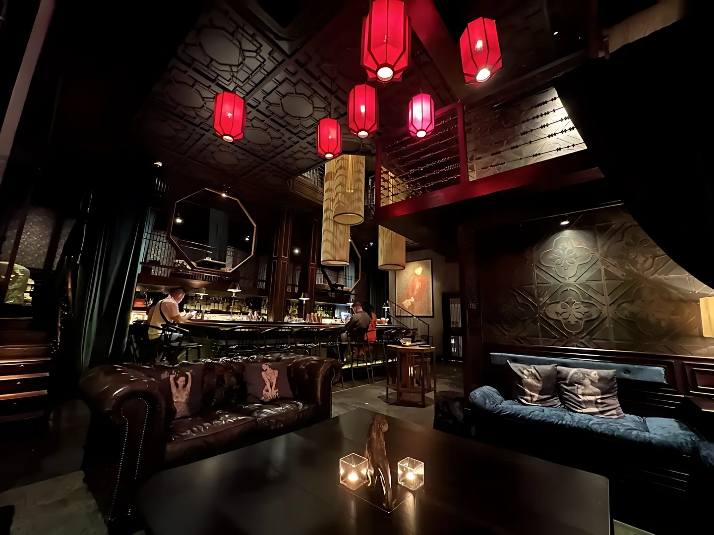
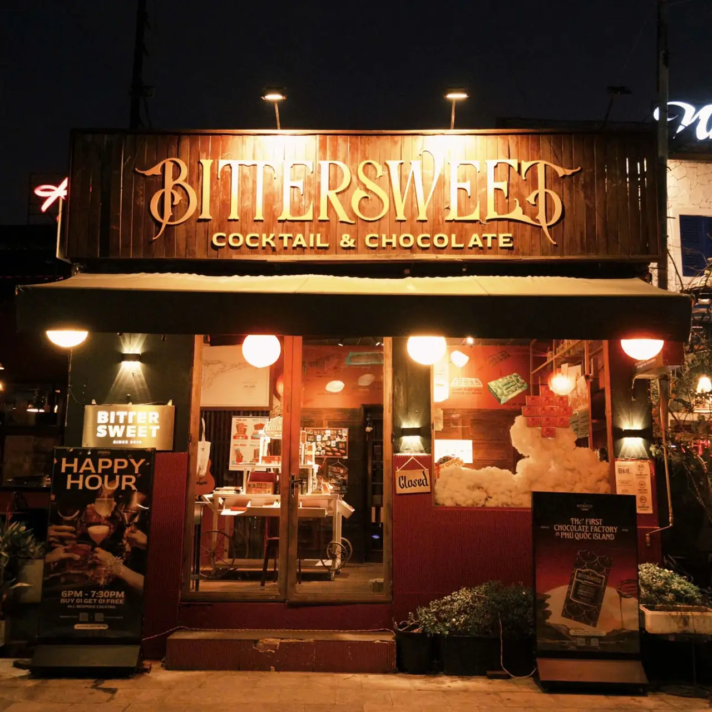

**Speakeasy** là kiểu quán bar ẩn mình, lối vào giấu sau một kệ sách, một bốt điện thoại hay một cửa hàng nhỏ, bên trong ánh đèn mờ và cocktail pha chế kỹ. Tên gọi bắt nguồn từ các quán rượu lén lút ở Mỹ thời cấm rượu thập niên 1920. Ở Việt Nam, speakeasy nhiều nhất ở phố cổ Hà Nội và Quận 1 Sài Gòn, rải rác ở Đà Nẵng, Nha Trang, Phú Quốc, Đà Lạt. Bài này gom 14 quán kèm địa chỉ và mức chi tham khảo.

## Speakeasy khác cocktail bar thường thế nào?

- **Lối vào bí mật hoặc không biển hiệu:** cầu thang hẹp, cửa ẩn, đi xuyên qua một quán khác.
- **Không gian nhỏ, ánh sáng mờ,** thường dưới 50 chỗ, hợp nhóm 2–4 người.
- **Cocktail là trọng tâm,** nhiều quán pha theo khẩu vị riêng của từng khách.
- **Nhạc nhẹ,** thường là jazz, swing, không mở nhạc sàn ồn ào.

## Speakeasy Hà Nội

Phần lớn nằm trong phố cổ Hoàn Kiếm. Xem thêm [cocktail bar Hà Nội](/cocktail-bar-ha-noi/).

### Bee'Znees

[Bee'Znees](/bar/bee-znees/) ở 163 Phùng Hưng, Hoàn Kiếm, lối vào ngụy trang như một **kệ sách**. Bên trong mang hơi hướng thập niên 1920 với quả cầu disco, rèm đỏ và bản đồ thế giới vẽ trên trần. Nhạc jazz là chủ đạo, có nhạc sống tối thứ Tư.

- Giờ mở cửa: 19:00 – 00:00
- Mức chi tham khảo: từ 300.000đ/người

### The Haflington

[The Haflington](/bar/the-haflington/) trên tầng trên một ngôi nhà cũ ở 94 Hàng Mã, giữa phố cổ. Không gian lấy cảm hứng từ bảo tàng châu Âu, nổi bật với **bộ xương khủng long** treo phía trên quầy bar.

- Giờ mở cửa: 15:00 – 01:00
- Mức chi tham khảo: từ 300.000đ/người

### The Alchemist Cocktail Bar

[The Alchemist](/bar/the-alchemist-cocktail-bar/) trên tầng hai một tòa nhà cũ trong phố cổ, **không biển hiệu**, lối vào đi qua một quán cà phê. Cocktail dùng thảo mộc và nguyên liệu Việt.

- Mức chi tham khảo: từ 350.000đ/người

### Polite & Co

[Polite & Co](/bar/polite-va-co/) ở 5B Bảo Khánh, Hàng Trống, vài bước từ hồ Hoàn Kiếm, hoạt động từ năm 1995. Không gian hoài cổ kiểu speakeasy, thực đơn khoảng 25 loại cocktail chú trọng công thức kinh điển. Nên đặt trước nếu muốn ngồi quầy.

- Mức chi tham khảo: từ 400.000đ/người

## Speakeasy Sài Gòn

Tập trung ở Quận 1 và Thảo Điền. Xem thêm [cocktail bar Sài Gòn](/cocktail-bar-sai-gon/) và bài [bar Sài Gòn](/blog/bar-sai-gon/).

### The Rabbit Hole

[The Rabbit Hole](/bar/the-rabbit-hole/) ở tầng hầm 138 Nam Kỳ Khởi Nghĩa, lối vào đi qua một **bốt điện thoại**. Ánh sáng mờ, ghế nệm êm, có jazz sống tối thứ Hai, thứ Tư và Chủ nhật từ 20:00 đến 23:00.

- Giờ mở cửa: 18:00 – 02:00
- Mức chi tham khảo: từ 400.000đ/người

### Snuffbox Speakeasy

[Snuffbox Speakeasy](/bar/snuffbox-speakeasy/) ở 14 Tôn Thất Đạm, Quận 1, phong cách thập niên 1920, hoạt động từ năm 2015, tập trung cocktail thủ công. Một số tối có jazz, swing hoặc DJ khách mời.

- Mức chi tham khảo: từ 300.000đ/người

### Madam Kew

[Madam Kew](/bar/madam-kew/) ở 37bis Ký Con, Quận 1, phía trên nhà hàng Quince Saigon. Không gian lấy cảm hứng từ một tiệm hút thuốc phiện xưa và câu chuyện về nhân vật Madam Kew người Thượng Hải. Quán có tên trong Tatler Best 20 Bars Việt Nam 2025.

- Mức chi tham khảo: từ 300.000đ/người

### Drinking & Healing

[Drinking & Healing](/bar/drinking-va-healing/) trên tầng 2 một tòa nhà Pháp cổ ở 25 Hồ Tùng Mậu, lối lên là cầu thang hẹp **không biển hiệu**. Thực đơn nổi bật với nhiều biến tấu gin tonic.

- Giờ mở cửa: 18:00 – 01:00
- Mức chi tham khảo: từ 300.000đ/người

### Dram Bar (Thảo Điền)

[Dram Bar](/bar/dram-bar/) ở 2 Đặng Hữu Phổ, Thảo Điền, phía trên nhà hàng Stoker, vào qua một **cánh cửa ẩn**. Whisky là trọng tâm, cocktail cổ điển được làm mới, có mocktail. Xem thêm [whisky cho người mới](/blog/whisky-cho-nguoi-moi/).

- Mức chi tham khảo: từ 300.000đ/người

## Speakeasy ở các thành phố khác

### United Bar Danang (Đà Nẵng)

[United Bar](/bar/united-bar-danang/) ở 02 Nguyễn Chí Thanh, Hải Châu, ẩn sau mặt tiền nhỏ như **một xe bánh mì**. Tường gạch, gác gỗ, tông tối gợi nhớ speakeasy Mỹ thập niên 1920.

- Giờ mở cửa: 18:00 – 01:00
- Mức chi tham khảo: từ 300.000đ/người

### The Craftsman Cocktail Bar (Đà Nẵng)

[The Craftsman](/bar/the-craftsman-cocktail-bar/) là bar nhỏ gói gọn trong một gian phòng ở rìa khu phố Tây An Thượng, gần biển Mỹ Khê, được nhắc tới với Singapore Sling, Whiskey Sour, Hemingway Daiquiri. Quán nghỉ thứ Ba.

- Giờ mở cửa: 19:30 – 01:30
- Mức chi tham khảo: từ 400.000đ/người

### Hybrid Nha Trang

[Hybrid Nha Trang](/bar/hybrid-nha-trang/) khuất trong một con hẻm khu Lộc Thọ, sức chứa khoảng 40 khách, từng có tên trong danh sách 51–100 Asia's 50 Best Bars năm 2021.

- Mức chi tham khảo: từ 300.000đ/người

### Bittersweet & Co. (Phú Quốc)

[Bittersweet & Co.](/bar/bittersweet-va-co/) ở 185 Trần Hưng Đạo, mở từ năm 2016, được xem là speakeasy đầu tiên trên đảo. Lối vào là **cánh cửa bí mật trong một cửa hàng sô-cô-la**, không có thực đơn cố định, mỗi ly pha riêng theo sở thích.

- Giờ mở cửa: 18:00 – 01:00
- Mức chi tham khảo: từ 300.000đ/người

### The Balcony Speakeasy Bar (Đà Lạt)

[The Balcony](/bar/the-balcony-speakeasy-bar/) ở 6 Quang Trung, bên ngoài như một quán cà phê bình thường, bên trong tối và tông gỗ trầm, tầng trên có chỗ ngồi ngoài trời nhìn ra thành phố.

- Mức chi tham khảo: từ 400.000đ/người

## So sánh nhanh speakeasy Việt Nam

| Speakeasy | Thành phố | Lối vào | Mức chi tham khảo |
|---|---|---|---|
| Bee'Znees | Hà Nội | Kệ sách | Từ 300k/người |
| The Haflington | Hà Nội | Tầng trên nhà cũ, Hàng Mã | Từ 300k/người |
| The Alchemist | Hà Nội | Qua quán cà phê | Từ 350k/người |
| The Rabbit Hole | Sài Gòn | Bốt điện thoại | Từ 400k/người |
| Madam Kew | Sài Gòn | Phía trên Quince | Từ 300k/người |
| Drinking & Healing | Sài Gòn | Cầu thang không biển hiệu | Từ 300k/người |
| Dram Bar | Sài Gòn | Cửa ẩn, Thảo Điền | Từ 300k/người |
| United Bar | Đà Nẵng | Mặt tiền xe bánh mì | Từ 300k/người |
| Bittersweet & Co. | Phú Quốc | Cửa hàng sô-cô-la | Từ 300k/người |

Mức chi là giá tham khảo, thay đổi theo đồ uống bạn chọn. Giờ mở cửa và lịch nhạc có thể thay đổi, gọi tổng đài để xác nhận trước khi đi.

:::cta
Giữ chỗ speakeasy tối nay
Speakeasy thường ít chỗ. Gọi 0838 000 222 hoặc để lại số điện thoại, tổng đài TopChill giữ chỗ và chỉ lối vào giúp bạn, không cần cọc.
:::

## Kinh nghiệm đi speakeasy

1. **Đặt chỗ trước,** nhất là cuối tuần, vì quán thường dưới 50 chỗ.
2. **Hỏi trước lối vào:** nhiều quán không biển hiệu, gọi tổng đài để được chỉ đường.
3. **Đi nhóm nhỏ 2–4 người** để dễ có chỗ và trò chuyện.
4. **Nói khẩu vị với bartender** (chua, ngọt, đắng, mạnh hay nhẹ) để được pha ly hợp ý.
5. **Uống có trách nhiệm,** không lái xe sau khi uống rượu bia.

Chưa quen gọi cocktail? Đọc [các loại cocktail phổ biến](/blog/cac-loai-cocktail-pho-bien/) và [mocktail không cồn](/blog/mocktail-do-uong-khong-con-o-bar/).

## Câu hỏi thường gặp

### Speakeasy là gì?

Speakeasy là quán bar ẩn mình, lối vào giấu kín hoặc không biển hiệu, không gian nhỏ, ánh sáng mờ, tập trung vào cocktail. Tên gọi xuất phát từ các quán rượu lén lút ở Mỹ thời cấm rượu thập niên 1920.

### Speakeasy ở Hà Nội ở đâu?

Phần lớn trong phố cổ Hoàn Kiếm: Bee'Znees (163 Phùng Hưng), The Haflington (94 Hàng Mã), The Alchemist, Polite & Co (5B Bảo Khánh).

### Speakeasy ở Sài Gòn ở đâu?

Chủ yếu ở Quận 1: The Rabbit Hole (138 Nam Kỳ Khởi Nghĩa), Snuffbox (14 Tôn Thất Đạm), Madam Kew (37bis Ký Con), Drinking & Healing (25 Hồ Tùng Mậu). Ở Thảo Điền có Dram Bar.

### Đi speakeasy hết bao nhiêu tiền?

Mức chi tham khảo khoảng 300.000đ–400.000đ mỗi người trở lên cho 2 ly cocktail, tuỳ quán.

### Đặt chỗ speakeasy qua TopChill có cần cọc không?

Không. Bạn gọi 0838 000 222, nhắn Zalo hoặc để lại số trên web, tổng đài sẽ gọi lại xác nhận chỗ.
