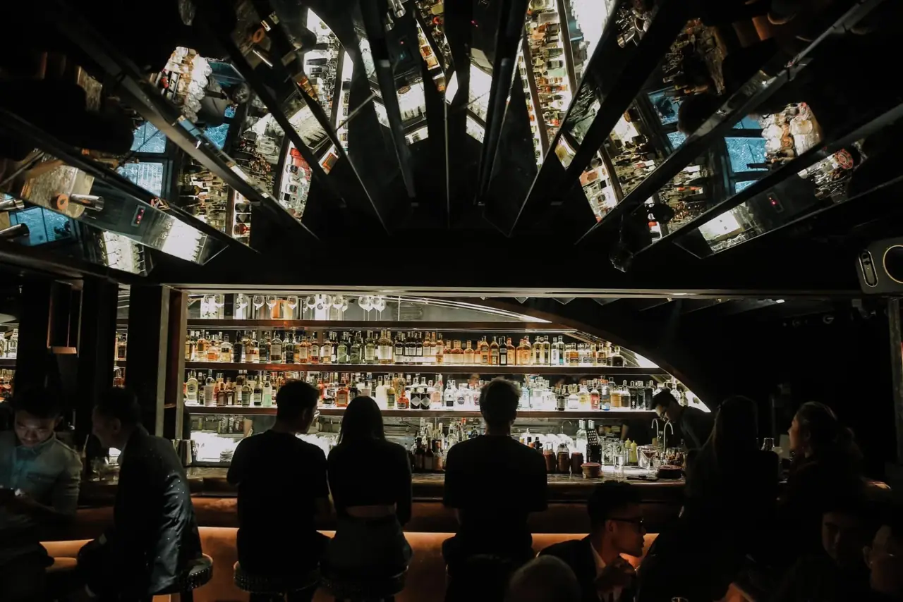
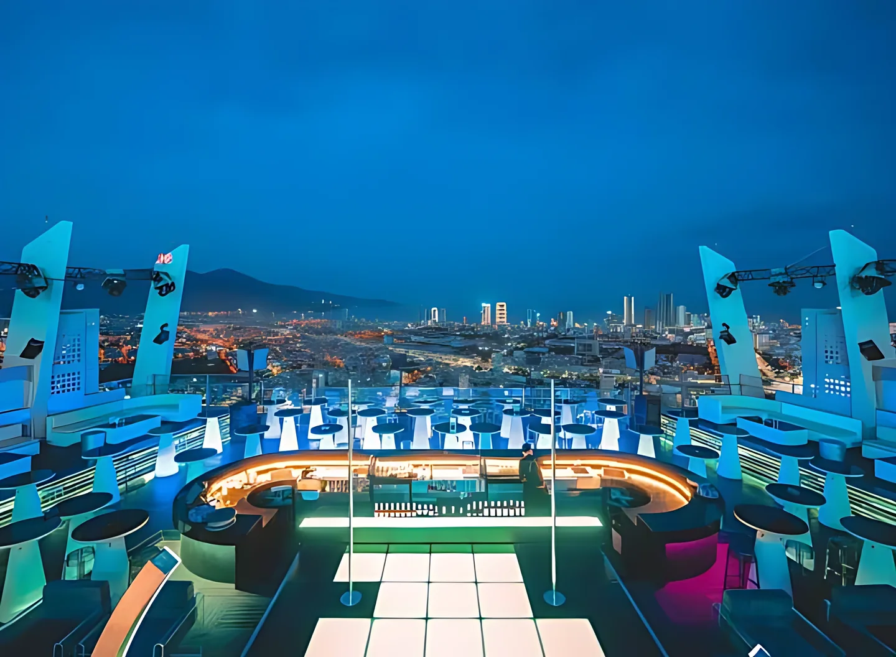
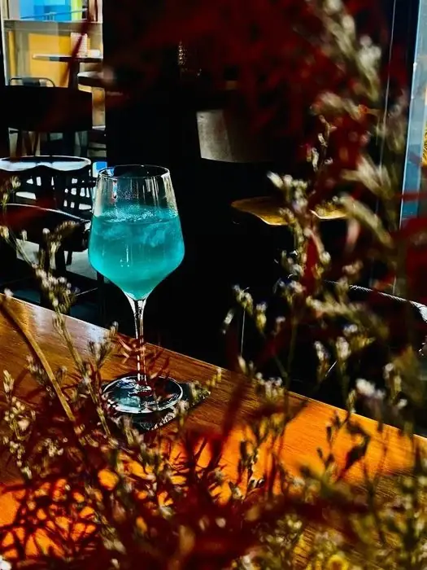

**Tổ chức sinh nhật ở bar** ngày càng phổ biến: không phải dọn dẹp, có sẵn nhạc, đồ uống, không gian đẹp để chụp ảnh, và nhiều quán hỗ trợ mang bánh, trang trí bàn. Bài này hướng dẫn chọn quán, đặt bàn, ước tính chi phí và gợi ý 10 bar, lounge, club có thật thường được chọn để tổ chức sinh nhật.

## Chọn kiểu quán theo nhóm của bạn

| Kiểu quán | Hợp với | Không khí |
|---|---|---|
| **Club, beer club** | Nhóm 8–20 người muốn quẩy | DJ, nhạc mạnh, sân khấu, đông khuya |
| **Lounge** | Nhóm 4–12 người, vừa trò chuyện vừa nghe nhạc | Sofa, DJ hoặc ca sĩ về khuya |
| **Rooftop** | Cặp đôi, nhóm nhỏ, chụp ảnh đẹp | View thành phố, hoàng hôn |
| **Pub, beer garden** | Nhóm đông, ngân sách vừa phải | Ăn uống, nhạc sống, thoải mái |

## Đặt bàn sinh nhật ở bar thế nào?

1. **Đặt trước ít nhất 1–2 ngày,** cuối tuần nên đặt sớm hơn.
2. **Báo rõ số người, giờ đến và "tổ chức sinh nhật"** để quán chuẩn bị bàn hợp, có quán hỗ trợ bảng tên, nến, nhạc chúc mừng.
3. **Hỏi chính sách mang bánh:** quán có cho mang bánh ngoài không, có phụ thu không, có tủ lạnh giữ bánh không.
4. **Hỏi mức chi tối thiểu** cho bàn VIP, sofa hoặc khu riêng.
5. **Thống nhất cách chia bill** trong nhóm trước khi đi.

Gọi tổng đài TopChill **0838 000 222**: tổng đài hỏi giúp chính sách bánh, trang trí và giữ bàn, không cần cọc.

## 10 quán hợp tổ chức sinh nhật

### Maxx Bar & Lounge (Hà Nội)

[Maxx Bar & Lounge](/bar/maxx-bar-va-lounge/) ở 25 Ngô Văn Sở, Hoàn Kiếm, bar lounge có DJ, **đặt bàn theo nhóm**, hợp tụ tập bạn bè hay sinh nhật buổi tối.

- Mức chi tham khảo: từ 400.000đ/người

### The Black Sheep (Hà Nội)

[The Black Sheep](/bar/the-black-sheep/) ở 28 Tống Duy Tân, concept nhà hát cocktail tông đen rèm đỏ, thường có tiệc và sự kiện âm nhạc, DJ sau 22 giờ. Hợp nhóm nhỏ thích cocktail.

- Mức chi tham khảo: từ 350.000đ/người

### Sky36 (Đà Nẵng)

[Sky36](/bar/sky36/) trên tầng 35–37 khách sạn Novotel Danang Premier Han River, thường có đêm DJ EDM, hip-hop, R&B và **tiệc theo chủ đề** trên cao.

- Mức chi tham khảo: từ 300.000đ/người

### INU Beer Club & Lounge (Cần Thơ)

[INU Beer Club & Lounge](/bar/inu-beer-club-va-lounge/) ở 81A Trần Phú, Ninh Kiều, không gian rộng có tầng lửng, sự kiện hằng tuần với DJ và nghệ sĩ khách mời, thu hút **các nhóm tổ chức sinh nhật**.

- Giờ mở cửa: 16:00 – 01:00
- Mức chi tham khảo: từ 600.000đ/người

### Imperial Dragon Lounge và Chích Pub (Bình Dương)

[Imperial Dragon Lounge](/bar/imperial-dragon-lounge/) ở 25 Nguyễn Đình Chiểu, Thủ Dầu Một, có ca sĩ và DJ cuối tuần, **thường được chọn tổ chức sinh nhật**, mức chi khá dễ chịu. [Chích Pub](/bar/chich-pub-food-va-beer/) ở 35 Bạch Đằng, ven sông, có DJ buổi tối, hợp nhóm vừa ăn uống vừa mừng sinh nhật.

- Mức chi tham khảo: từ 300.000–350.000đ/người

### New Square Bar (Hạ Long)

[New Square Bar](/bar/new-square-bar/) ở Cái Dăm, Bãi Cháy, không gian không quá lớn, hợp gặp gỡ đối tác, **tổ chức sinh nhật** hoặc đi nhóm bạn.

- Mức chi tham khảo: từ 550.000đ/người

### Endless Summer Rooftop (Hải Phòng)

[Endless Summer Rooftop Bar & Lounge](/bar/endless-summer-rooftop-bar-va-lounge-hai-phong/) trên tầng 22 Wink Hotel, có hồ bơi vô cực và **tiệc hồ bơi cuối tuần**, hợp sinh nhật nhóm nhỏ muốn ảnh đẹp trên cao.

- Mức chi tham khảo: từ 450.000đ/người

### Fang Pub và La Sirena (Vũng Tàu)

[Fang Pub](/bar/fang-pub/) ở 3 Lý Tự Trọng có ban nhạc sống, **thường được chọn tổ chức tiệc sinh nhật**. [La Sirena Bar & Grill](/bar/la-sirena-bar-va-grill/) ở 159 Thùy Vân gần biển, hợp nhóm bạn hoặc gia đình, kể cả sinh nhật nhỏ.

- Mức chi tham khảo: từ 300.000đ/người

## Chi phí tổ chức sinh nhật ở bar

| Hạng mục | Mức tham khảo |
|---|---|
| Đồ uống mỗi người (2–3 ly) | 300.000đ–600.000đ |
| Bàn VIP, sofa ở club, lounge | Thường có mức chi tối thiểu, gọi để được báo |
| Phụ thu mang bánh ngoài | Tuỳ quán, có nơi miễn phí |

Mức chi là giá tham khảo, thay đổi theo quán, ngày trong tuần và đồ uống bạn chọn.

:::cta
Đặt bàn sinh nhật ở bar
Gọi 0838 000 222 hoặc để lại số, tổng đài TopChill giữ bàn đẹp, hỏi giúp chính sách mang bánh, trang trí và báo ưu đãi, không cần cọc.
:::

## Mẹo cho buổi sinh nhật trọn vẹn

1. **Đến trước giờ khách mời 20–30 phút** để nhận bàn và sắp xếp bánh.
2. **Báo quán giờ cắt bánh** để DJ hoặc ban nhạc phát nhạc chúc mừng.
3. **Nhóm đông mà ít người quen?** Thử [ghép bàn](/ghep-ban/) để bàn vui hơn.
4. **Nhân vật chính và bạn bè mang CCCD,** club có thể kiểm tra tuổi.
5. **Cử người không uống lo đường về,** hoặc gọi taxi, xe công nghệ. Không lái xe sau khi uống rượu bia.

Xem thêm [đặt bàn bar không cần cọc](/blog/dat-ban-bar-khong-coc/) và [kinh nghiệm đi bar lần đầu](/blog/kinh-nghiem-di-bar-lan-dau/).

## Câu hỏi thường gặp

### Tổ chức sinh nhật ở bar có được mang bánh không?

Phần lớn quán cho mang bánh ngoài, một số có phụ thu hoặc giới hạn giờ cắt bánh. Gọi tổng đài để được hỏi trước chính sách của từng quán.

### Tổ chức sinh nhật ở bar hết bao nhiêu tiền?

Mức tham khảo khoảng 300.000đ–600.000đ mỗi người cho đồ uống. Bàn VIP hoặc sofa ở club, lounge thường có mức chi tối thiểu cao hơn.

### Nên chọn club hay lounge để tổ chức sinh nhật?

Nhóm đông muốn quẩy thì chọn club hoặc beer club. Nhóm nhỏ muốn vừa trò chuyện vừa nghe nhạc thì chọn lounge hoặc rooftop.

### Đặt bàn sinh nhật qua TopChill có cần cọc không?

Không. Gọi 0838 000 222, nhắn Zalo hoặc để lại số trên web, tổng đài sẽ gọi lại xác nhận bàn.
