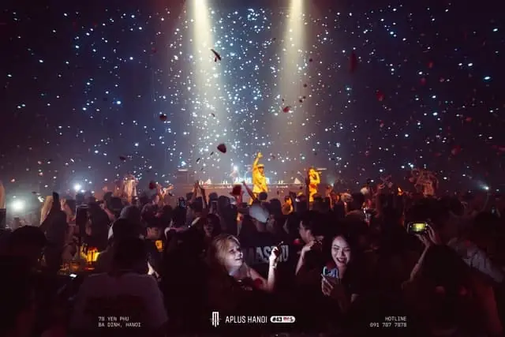
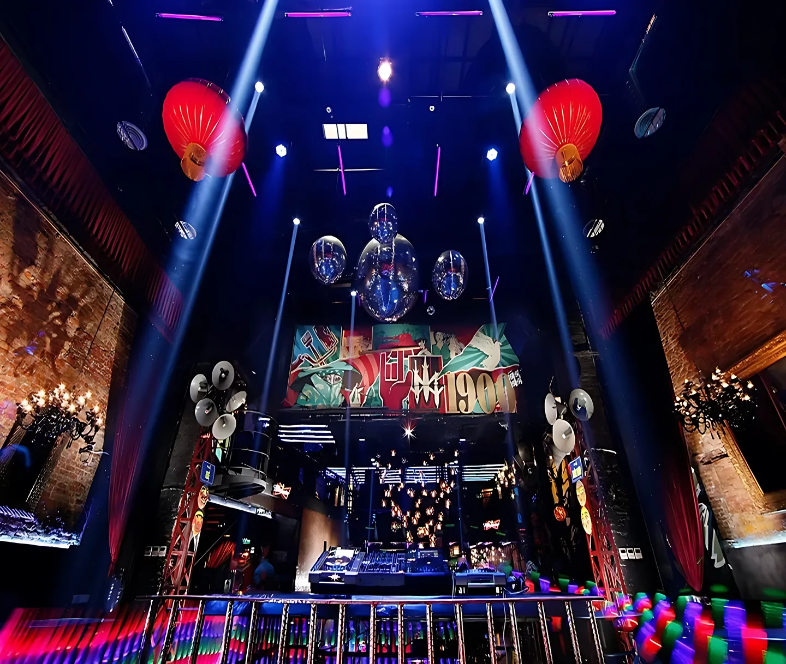
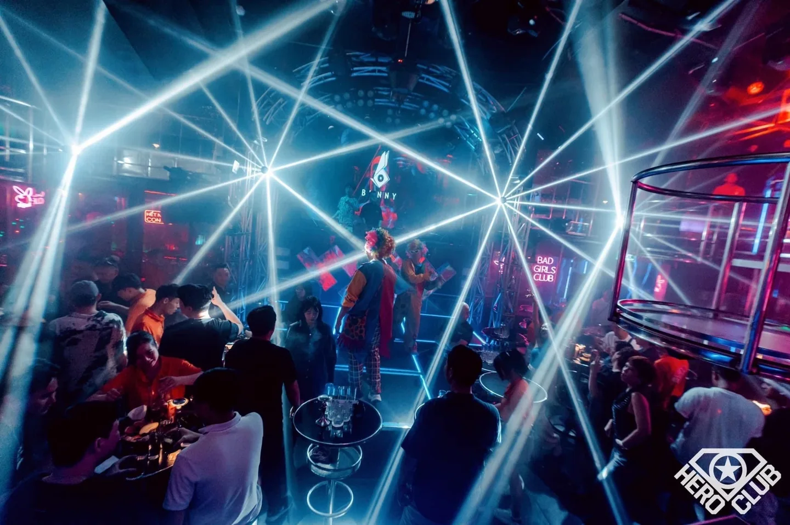

Nếu bạn đang tìm **top bar Hà Nội** để quẩy tối nay, đây là 6 địa điểm TopChill đang đặt lên đầu danh sách: **APLUS HANOI, 1900 Le Théâtre, Hero Club, Track 42, Maxx Bar & Lounge và Cosmos Club**. Quán nào cũng có địa chỉ rõ ràng, nằm ở Yên Phụ hoặc khu phố cổ Hoàn Kiếm, nên bạn dễ đến và dễ ghé nhiều nơi trong một tối. Bài này nói rõ từng quán có gì, hợp ai, mức chi tham khảo và cách đặt bàn.

Thứ tự trong bài do ban biên tập TopChill chọn, ưu tiên quán có địa chỉ rõ ràng, không khí quẩy đêm và dễ đặt bàn. Đây không phải bảng xếp hạng theo số liệu bình chọn.

## Bảng tóm tắt top 6 bar Hà Nội

| # | Bar | Khu vực | Địa chỉ | Âm nhạc | Mức chi tham khảo |
|---|---|---|---|---|---|
| 1 | APLUS HANOI | Ba Đình | 78 Yên Phụ | EDM, Trance, Techno | Từ 300k/người |
| 2 | 1900 Le Théâtre | Hoàn Kiếm | 8B Tạ Hiện | DJ quốc tế, live band | Từ 600k/người |
| 3 | Hero Club | Ba Đình | 42M Yên Phụ | Deep house, hip-hop, R&B | Từ 400k/người |
| 4 | Track 42 | Ba Đình | 42 Yên Phụ | Mainstream, EDM | Từ 500k/người |
| 5 | Maxx Bar & Lounge | Hoàn Kiếm | 25 Ngô Văn Sở | DJ, nhạc sàn | Từ 400k/người |
| 6 | Cosmos Club | Hoàn Kiếm | 21 Tràng Tiền | House, tech house, EDM | Từ 500k/người |

Mức chi là giá tham khảo cho 2–3 đồ uống, giá thực tế tuỳ đồ uống và bàn bạn chọn. Giờ mở cửa và lịch DJ có thể thay đổi, hãy gọi tổng đài để xác nhận trước khi đi.

## 1. APLUS HANOI

[APLUS HANOI](/bar/aplus-hanoi/) (APLUS CLUB) là super club tại **78 Yên Phụ, Ba Đình**, chuyên nhạc điện tử với không gian quy mô lớn. Âm nhạc xoay quanh big-room EDM với những đoạn cao trào bùng nổ, trance dồn dập và techno nặng bass, thường đi kèm các đêm diễn của DJ.

- Giờ mở cửa: 19:00 – 04:00
- Nhạc: EDM, Trance, Techno
- Phù hợp: nhóm bạn muốn quẩy hết mình trên sàn nhảy
- Mức chi tham khảo: từ 300.000đ/người
- **Ưu đãi qua TopChill:** giảm 5% bill, đến trong khung 19:00–21:00 giảm thêm 5%

APLUS là đối tác của TopChill, nên bạn đặt bàn qua web hoặc tổng đài sẽ nhận ưu đãi trên. Đây cũng là lý do APLUS đứng đầu danh sách.

## 2. 1900 Le Théâtre

[1900 Le Théâtre](/bar/1900-le-theatre/) là club lớn tại **8B Tạ Hiện, Hoàn Kiếm**, nằm trong tòa nhà của nhà hát Quảng Lạc cũ với sức chứa khoảng 1.500 khách. Club có sàn nhảy rộng, khu VIP và hệ thống âm thanh ánh sáng hiện đại, thường xuyên có DJ quốc tế, live band và tiệc chủ đề. Theo thông tin tổng hợp từ nguồn công khai, club nằm trong top 100 club của DJ Mag 2024.

- Nhạc: DJ quốc tế, live band, tiệc chủ đề
- Phù hợp: nhóm đông, tiệc sinh nhật, người thích club lớn giữa phố cổ
- Mức chi tham khảo: từ 600.000đ/người
- Lưu ý: khách cần đủ 18 tuổi và mang theo giấy tờ tùy thân

## 3. Hero Club

[Hero Club](/bar/hero-club/) ở **42M Yên Phụ, Trúc Bạch, Ba Đình**, nội thất phong cách công nghiệp với tranh tường siêu anh hùng và quầy DJ đặt trong một chiếc xe tải cũ. Âm nhạc chủ yếu là deep house, hip-hop và R&B, thường có DJ khách mời và sự kiện vào cuối tuần. Quán thu hút cả khách địa phương lẫn người nước ngoài.

- Nhạc: Deep house, hip-hop, R&B
- Phù hợp: ai thích không khí club gần gũi, cá tính
- Mức chi tham khảo: từ 400.000đ/người

## 4. Track 42

[Track 42](/bar/track-42/) là club phong cách "mainstream luxury" tại **42 Yên Phụ, Ba Đình**, cùng tuyến phố với APLUS và Hero Club. Club có bàn SVIP, bàn đứng và bàn quầy kèm dịch vụ chai, hợp nhóm bạn muốn quẩy theo nhạc mainstream và EDM.

- Nhạc: Mainstream, EDM
- Phù hợp: nhóm bạn, tiệc nhỏ có bàn chai
- Mức chi tham khảo: từ 500.000đ/người
- Lưu ý: gọi tổng đài để xác nhận lịch DJ và giờ mở cửa

## 5. Maxx Bar & Lounge

[Maxx Bar & Lounge](/bar/maxx-bar-va-lounge/) (còn gọi New Fame Bar) ở **25 Ngô Văn Sở, Hoàn Kiếm**, gần khu trung tâm và hồ Hoàn Kiếm. Quán theo phong cách bar lounge có DJ, đặt bàn theo nhóm, hợp các buổi tụ tập bạn bè hay sinh nhật buổi tối.

- Nhạc: DJ, nhạc sàn
- Phù hợp: nhóm bạn, sinh nhật, ai muốn bar lounge ngay trung tâm
- Mức chi tham khảo: từ 400.000đ/người
- Lưu ý: các nguồn công khai ghi số điện thoại khác nhau, hãy đặt bàn qua tổng đài TopChill để được xác nhận

## 6. Cosmos Club

[Cosmos Club](/bar/cosmos-club/) nằm ở **21 Tràng Tiền, Hoàn Kiếm**, cách hồ Hoàn Kiếm vài phút đi bộ. Club tập trung vào house, tech house và EDM, nổi bật với mái vòm LED và màn hình LED cong 360 độ bao quanh sân khấu.

- Giờ mở cửa: 21:00 – 04:00
- Nhạc: House, tech house, EDM
- Phù hợp: nhóm bạn muốn quẩy khuya ngay trung tâm phố cổ
- Mức chi tham khảo: từ 500.000đ/người

## Chọn bar Hà Nội theo nhu cầu

- **Quẩy EDM, techno hết mình:** APLUS HANOI, Track 42.
- **Club lớn, nhiều DJ quốc tế:** 1900 Le Théâtre.
- **Không khí cá tính, deep house, hip-hop:** Hero Club.
- **Ở trung tâm, đi bộ từ hồ Hoàn Kiếm:** Cosmos Club (Tràng Tiền), Maxx Bar & Lounge (Ngô Văn Sở), 1900 Le Théâtre (Tạ Hiện).
- **Muốn ghé nhiều quán trong một tối:** phố Yên Phụ có APLUS, Track 42 và Hero Club cùng một tuyến, đi bộ được giữa các quán.

Nếu bạn thích không gian yên tĩnh hơn, xem thêm [rooftop bar Hà Nội](/blog/rooftop-bar-ha-noi/), [lounge Hà Nội](/lounge-ha-noi/) hoặc [pub Hà Nội](/pub-ha-noi/). Danh sách đầy đủ ở trang [bar Hà Nội](/bar-ha-noi/) và [club Hà Nội](/club-ha-noi/).

:::cta
Đặt bàn top bar Hà Nội tối nay
Gọi 0838 000 222 hoặc để lại số điện thoại, tổng đài TopChill giữ bàn giúp bạn, không cần cọc.
:::

## Kinh nghiệm đi bar Hà Nội

1. **Đặt bàn trước tối thứ 6, thứ 7 và dịp lễ.** Club lớn đông nhanh, bàn đẹp hết sớm.
2. **Đến sau 22h** nếu bạn thích không khí sôi động nhất, đến sớm hơn nếu muốn dễ nói chuyện.
3. **Mang CCCD.** Nhiều club kiểm tra giấy tờ ở cửa và chỉ nhận khách từ 18 tuổi.
4. **Hỏi mức chi tối thiểu** khi đặt bàn VIP hoặc sofa, và hỏi trước về phí phục vụ, VAT.
5. **Mùa đông Hà Nội lạnh,** nên mang áo khoác khi xếp hàng ngoài cửa.
6. **Uống có trách nhiệm,** không lái xe sau khi uống rượu bia. Gọi taxi hoặc xe công nghệ về nhà.

## Câu hỏi thường gặp

### Top bar Hà Nội hiện nay gồm những quán nào?

TopChill đang đặt lên đầu danh sách: APLUS HANOI, 1900 Le Théâtre, Hero Club, Track 42, Maxx Bar & Lounge và Cosmos Club. Thứ tự do ban biên tập chọn, ưu tiên quán có địa chỉ rõ ràng và không khí quẩy đêm.

### Bar nào ở Hà Nội quẩy EDM tốt?

APLUS HANOI (78 Yên Phụ) chuyên big-room EDM, trance, techno. Track 42 và Cosmos Club cũng chơi EDM, Cosmos thiên về house và tech house.

### Đi bar ở Hà Nội hết bao nhiêu tiền?

Mức chi tham khảo khoảng 300.000đ–600.000đ mỗi người trở lên cho 2–3 đồ uống, tuỳ quán. APLUS từ 300k, Hero Club từ 400k, 1900 Le Théâtre từ 600k.

### Bar nào gần hồ Hoàn Kiếm?

Cosmos Club (21 Tràng Tiền), Maxx Bar & Lounge (25 Ngô Văn Sở) và 1900 Le Théâtre (8B Tạ Hiện) đều nằm trong khu trung tâm, đi bộ từ hồ Hoàn Kiếm vài phút.

### Đặt bàn qua TopChill có cần cọc không?

Không. Bạn gọi 0838 000 222, nhắn Zalo hoặc để lại số trên web, tổng đài sẽ gọi lại xác nhận bàn. Đặt APLUS HANOI qua TopChill còn được giảm 5% bill.
